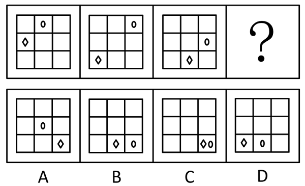

# 图形推理-位置规律（外圈循环平移）

考点：[[20-考点/判断推理/图形推理/图形推理-位置规律（外圈循环平移）|图形推理 / 图形推理-位置规律（外圈循环平移）]]

**问法模型**：‘填入问号处使之呈现一定的规律性’且元素组成相同 → 优先考虑位置规律，分别描点跟踪各小元素的移动方向与步数

## 推理链
1. 第1步：四幅图均为3×3九宫格，元素组成相同，只有椭圆（0）和菱形（◇）位置改变，锁定位置规律
2. 第2步：对外圈8格按顺时针编号（左上→上中→右上→右中→右下→下中→左下→左中），椭圆依次在上中、右上、右中，每次顺时针移动1格
3. 第3步：菱形依次在左中、左下、下中，每次沿外圈逆时针移动1格
4. 第4步：递推至第4幅图：椭圆顺时针再走1格到右下角，菱形逆时针再走1格（下中→右下）也到右下角，两者重合于右下角
5. 第5步：逐项对照：A项椭圆移入中心格（违背外圈移动规律）、B项两者位于下中/右中位置、C项椭圆与菱形同在右下角、D项两者在左下/下中位置
6. 第6步：只有C项两者都位于右下角，与递推结果一致，故选C

**最快解法**：⚡ 描点跟踪法+排除法：分别盯住椭圆和菱形两个元素，数出椭圆顺时针每次1格、菱形逆时针每次1格，推出第4幅图两者必重合于右下角，直接锁定C

## 易错点
- ⚠ 只跟踪一个元素就作答，忽略另一元素的相反方向（如只看菱形会误选B/D）
- ⚠ 顺时针与逆时针方向数反，导致菱形位置推错
- ⚠ 误选A项：A中椭圆跑到中心格，违背‘沿外圈移动’的题干规律

## 母题抽象
> 🧩 当题干图形元素组成相同、仅小元素位置变化时，用位置规律中的描点跟踪法，分别数出各元素的移动方向和步数，沿外圈循环递推至问号处验证选项

**同类特征**：元素组成相同、九宫格外圈小元素、双元素双轨迹、移动方向相反（一顺一逆）、每次移动1格、问号处递推

## 相关题
- [[10-真题/判断推理/图形推理/2172768 位置规律（旋转-翻转）|2172768]]（海南 2021，相关度1）
- [[10-真题/判断推理/图形推理/10204458 位置规律-平移（特征交点沿内圈循环平移）|10204458]]（甘肃 2024，相关度1）
- [[10-真题/判断推理/图形推理/10204614 图形推理-位置规律（旋转+翻转交替循环）|10204614]]（黑龙江 2024，相关度1）
- [[10-真题/判断推理/图形推理/10297399 位置规律—平移（多黑块分组循环平移）|10297399]]（四川 2025，相关度1）
- [[10-真题/判断推理/图形推理/11226892 位置规律-九宫格小元素沿固定循环链移动|11226892]]（上海 2025，相关度1）

---

### 题干

从所给的四个选项中，选择最合适的一个填入问号处，使之呈现一定的规律性：

### 选项
- A. A
- B. B
- C. C　✅
- D. D

### 官方解析
元素组成相同，优先考虑位置规律。观察发现，椭圆形沿外圈每次顺时针移动1格，菱形沿外圈每次逆时针移动1格，故？处图形中椭圆形和菱形都应移动到右下角，只有C项符合。
故正确答案为C。

### 给定材料
（无）
