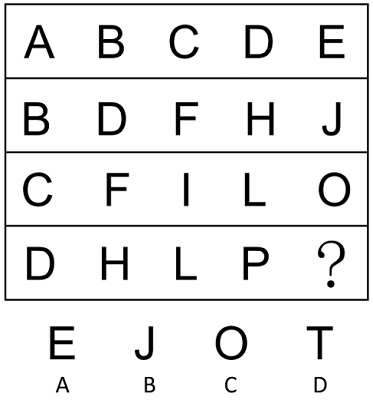

# 字母类图形-字母表顺序等差规律（行内间隔数逐行递增）

考点：[[20-考点/判断推理/图形推理/字母类图形-字母表顺序等差规律（行内间隔数逐行递增）|图形推理 / 字母类图形-字母表顺序等差规律（行内间隔数逐行递增）]]

**问法模型**：问号处填入最合适图形使之呈现规律性 → 将字母还原为字母表序号，按行观察相邻元素间隔数，找'间隔数逐行递增'的规律推问号处

## 推理链
1. 第1步：题干为4行字母矩阵，第一行为A、B、C、D、E，相邻字母紧邻，中间间隔0个字母
2. 第2步：第二行B、D、F、H、J，相邻字母间隔1个字母（B→D隔C）；第三行C、F、I、L、O间隔2个字母（C→F隔D、E）；发现行内间隔数按行递增1
3. 第3步：依此规律，第四行D、H、L、P相邻应间隔3个字母：D→H隔E、F、G，H→L隔I、J、K，L→P隔M、N、O，与题干吻合；则P之后跳过Q、R、S，问号处应为T
4. 第4步：对照选项，A项E、B项J、C项O、D项T，仅D项T符合；另行首字母A、B、C、D依次后移一位，可作行规律的佐证

**最快解法**：⚡ 按行数间隔法：逐行查相邻字母间跳过的字母个数，得0、1、2、3的递增规律；末行P之后隔Q、R、S，直接锁定T选D

## 易错点
- ⚠ 把'间隔3个字母'误解为字母序号加3（P加3应为S），正确理解是跳过3个字母后到达第4个字母（P→T）
- ⚠ 只注意行首字母A、B、C、D递增的次级规律，忽略行内间隔这一核心规律，无从锁定答案
- ⚠ 只按列或整体扫描找不到规律就放弃，未尝试'按行提取字母表序号'的字母题常用转化

## 母题抽象
> 🧩 当图形是字母（或数字、天干等有序符号）排成的行列阵列时，将符号换算为所在序列的序号，按行（或列）检验相邻元素间隔数，若发现间隔数逐行（列）递增的规律，即用末项外推问号处

**同类特征**：字母排成的多行矩阵、问号位于末行末位、每行字母呈等距跳字母、行间间隔数递增0→1→2→3、行首字母A、B、C、D依次后移、选项为单个字母

## 相关题
（暂无）

---

### 题干

从所给的四个选项中，选择最合适的一个填入问号处，使之呈现一定的规律性：

### 选项
- A. A
- B. B
- C. C
- D. D　✅

### 官方解析
观察发现，题干图形均为字母，且在字母表中的顺序存在规律。第一行中相邻字母在字母表中间隔0个字母，第二行中相邻字母在字母表中间隔1个字母，第三行中相邻字母在字母表中间隔2个字母，按此规律，第四行中相邻字母在字母表中应间隔3个字母，故？处应为T，只有D项符合。
故正确答案为D。

### 给定材料
（无）
