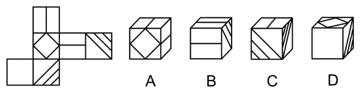
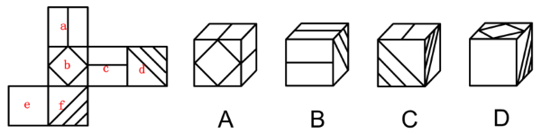

# 空间重构-六面体折纸盒（选非题）：相对面排除+公共点顺时针画边法

考点：[[20-考点/判断推理/图形推理/空间重构-六面体折纸盒（选非题）：相对面排除+公共点顺时针画边法|图形推理 / 空间重构-六面体折纸盒（选非题）：相对面排除+公共点顺时针画边法]]

**问法模型**：问'展开图折不成哪个立体图形'→选非题，先用相对面排除锁定各选项面组合，再对存疑选项用公共点画边法核对相邻面图案方向

## 推理链
1. 第1步：给展开图标号a~f，先定相对面：面a与面f相对、面b与面d相对（相隔一个面的面和'Z'字形两端为相对面）
2. 第2步：解题规则：相对面在立体图形中不能同时出现，据此先确定每个选项必然包含和必然不包含的面
3. 第3步：A项由面a、b、c组成，三者两两相邻，与展开图一致，排除；B项必含面a和面c，面a与面f相对，故右侧面为面d，由a、c、d组成，一致，排除；D项必含面b和面e，面b与面d相对，故右侧面为面f，由b、e、f组成，一致，排除
4. 第4步：C项必含面d和面f，面a与面f相对，故顶面为面c，即由面c、d、f组成
5. 第5步：对C项用公共点顺时针画边法验证：以三个面的公共点为起点，沿面c顺时针画边，展开图中边1与面c内的线段平行，而选项中边1与面c内的线段垂直
6. 第6步：C项相邻面图案方向与展开图不符，折不成，本题为选非题，当选C

**最快解法**：⚡ 排除法+公共点画边法：先由'面a对f、面b对d'快速定各选项三个面的组合排除A、B、D，再对C以三面公共点为起点沿面c顺时针画边，比较边1与面c内线段是平行还是垂直即可锁定答案

## 易错点
- ⚠ 忽略这是选非题，把三个'折得成'的正确项当成答案选走
- ⚠ 相对面误判（把相邻面当成相对面），导致面组合判断错误、排除方向搞反
- ⚠ 画边法方向搞反（逆时针画边）或起点选错公共点，导致平行/垂直关系误判

## 母题抽象
> 🧩 当题干为六面体展开图且问'折不成哪个'时，先找相对面用'相对面不能同时出现'确定每个选项的面组合并排除，剩余存疑项用'公共点顺时针画边法'比对相邻面图案的平行/垂直等方向关系即可得答案

**同类特征**：折不成/不能由展开图折叠而成、选非题、六面体展开图标号、相对面不能同时出现、公共点顺时针画边、面内线段平行/垂直

## 相关题
- [[10-真题/资料分析/综合/250219 综合分析选非题（图表数据可推断性判断）|250219]]（深圳市考 2008，相关度1）
- [[10-真题/资料分析/综合/10297333 综合分析选非题（同比增速逐年比较+年均增长量+比重百分点还原）|10297333]]（浙江 2025，相关度1）
- [[10-真题/资料分析/综合/14355349 综合分析-选非题（增长率计算比较+人均值计算）|14355349]]（浙江 2024，相关度1）
- [[10-真题/资料分析/综合/17097816 综合判断·选非题（增长率与增长量偷换）|17097816]]（山西 2024，相关度1）
- [[10-真题/资料分析/综合/2052088 综合分析-选非题（趋势判断+增速排序+增长量比较+增长率计算逐项核对）|2052088]]（吉林 2017，相关度1）

---

### 题干

左边展开平面图折不成右边的哪个立体图形？

### 选项
- A. A
- B. B
- C. C　✅
- D. D

### 官方解析

将题干展开图标上序号，如下图所示，逐一进行分析。

A项：选项由面a、面b和面c组成，选项与题干展开图一致，排除；

B项：选项必然包含面a和面c，展开图中面a和面f为相对面，相对面不能同时出现，故选项的右侧面应为面d，即选项由面a、面c和面d组成，选项与题干展开图一致，排除；

C项：选项必然包含面d和面f，展开图中面a和面f为相对面，相对面不能同时出现，故选项的顶面应为面c，即选项由面c、面d和面f组成。在选项和展开图中，以三个面的公共点为起点沿面c顺时针画边，展开图中边1与面c上线段平行，而选项中边1与面c上线段垂直，选项与题干展开图不一致，当选；

D项：选项必然包含面b和面e，展开图中面b和面d为相对面，相对面不能同时出现，故选项的右侧面应为面f，即选项由面b、面e和面f组成，选项与题干展开图一致，排除。

本题为选非题，故正确答案为C。

### 给定材料
（无）
