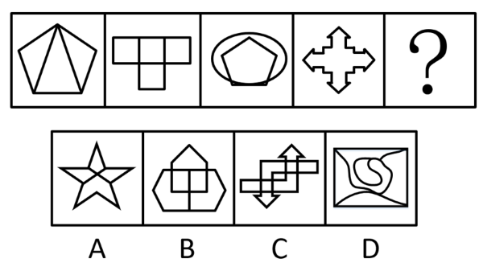

# 属性规律（轴对称）+ 数量规律（一笔画-笔画数）复合考查

考点：[[20-考点/判断推理/图形推理/属性规律（轴对称）+ 数量规律（一笔画-笔画数）复合考查|图形推理 / 属性规律（轴对称）+ 数量规律（一笔画/笔画数）复合考查]]

**问法模型**：'选择最合适的一个填入问号处，使之呈现一定的规律性'且元素组成不同 → 按'先属性后数量'顺序找复合规律：先用对称性初筛，再用笔画数终选。

## 推理链
1. 第1步：题干四图元素组成不同（五边形内三角、方块T形组合、圆内接五边形、十字箭头），但图形规整且含明显等腰/对称元素，优先考虑属性规律中的对称性。
2. 第2步：观察发现图1正五边形、图2方块组合、图3圆与五边形、图4十字箭头均为轴对称图形，规律为'全轴对称'。
3. 第3步：逐项对照——C项上下双箭头错位、仅有中心对称而非轴对称，D项方框内曲线不对称，依轴对称规律排除C、D。
4. 第4步：A、B仍需第二规律区分；题干中图3出现圆与五边形'相切'、图4为典型封闭十字箭头轮廓，提示考查笔画数。
5. 第5步：数奇点验证——题干四图奇点数均为0或2，全部可一笔画（如图1内部两条线仅使底边两端点为奇点，共2个奇点）。
6. 第6步：A项五角星内部交叉线使奇点数多于2个，为多笔画图形，排除；B项'房形'外框加内部线条为轴对称且奇点数为2（一笔画），当选。

**最快解法**：⚡ 两步排除法：第一步用'轴对称'排除C、D；第二步用'一笔画数奇点'排除A（五角星内交叉线奇点>2，多笔画），直接锁定B。口诀：元素不同先属性（对称），属性分不出再数量（笔画）。

## 易错点
- ⚠ 只验证到轴对称就仓促选A——五角星是最典型的对称图形，必须继续找第二规律。
- ⚠ 凭直觉认为五角星'能一笔画'而不实际数奇点：A内部交叉线条使奇点数超过2个，实为多笔画。
- ⚠ 解题顺序错乱：元素组成不同时应'先属性（对称）后数量（笔画）'，若先数面/线易陷入无规律。

## 母题抽象
> 🧩 当题干图形规整且出现明显等腰/对称元素（正多边形、方块组合、圆内接图形、十字箭头）时，先验证轴对称排除非对称项；若剩余选项仍难区分，转而数奇点验证一笔画，'相切轮廓、封闭箭头'等特征常是笔画数的提示信号。

**同类特征**：元素组成不同、图形规整含等腰元素、题干全为轴对称图形、图3圆与五边形相切、图4封闭十字箭头轮廓、对称+一笔画复合规律

## 相关题
- [[10-真题/判断推理/图形推理/14403696 图形推理-对称性（轴对称与中心对称的组合判断）|14403696]]（山东 2025，相关度2）
- [[10-真题/判断推理/图形推理/10204454 数量规律-部分数（黑白球连通区域数做和）|10204454]]（甘肃 2024，相关度1）
- [[10-真题/判断推理/图形推理/10204604 数量规律-线数量（汉字横线数）|10204604]]（辽宁 2024，相关度1）
- [[10-真题/判断推理/图形推理/10297050 数量规律-特殊计数（线条穿过小白球的数量）|10297050]]（天津 2025，相关度1）
- [[10-真题/判断推理/图形推理/10297127 图形间关系-相交图形中不相交边数量（黑白图形相交）|10297127]]（天津 2025，相关度1）

---

### 题干

从所给的四个选项中，选择最合适的一个填入问号处，使之呈现一定的规律性：

### 选项
- A. A
- B. B　✅
- C. C
- D. D

### 官方解析
元素组成不同，优先考虑属性规律。题干图形较规整，且出现明显的等腰元素，优先考虑对称性。题干图形均为轴对称图形，排除C、D两项。继续观察发现，图3出现相切，图4为明显的一笔画图形，考虑笔画数，题干图形均为一笔画图形，可排除A项，只有B项符合。
故正确答案为B。

### 给定材料
（无）
