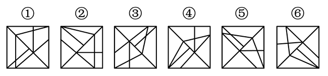

# 数量规律-面数量（框内交点数、笔画数均可替代，属多规律收敛题）

考点：[[20-考点/判断推理/图形推理/数量规律-面数量（框内交点数、笔画数均可替代，属多规律收敛题）|图形推理 / 数量规律-面数量（框内交点数、笔画数均可替代，属多规律收敛题）]]

**问法模型**：『把六个图形分为两类，使每一类都有各自共同特征』→ 分组分类模型：先查属性（对称/曲直/开闭）无果即转数量规律，按『面数量→框内交点数→笔画数』顺序逐一尝试，找到能把六图均分为3+3的规律即可锁定答案

## 推理链
1. 第1步：六个图形均为『正方形外框+内部交叉线条』结构，元素组成不同，对称、曲直、封闭等属性无明显3/3分组特征，转向数量规律
2. 第2步：图形被内部线条明显分割成多个封闭区域，优先考虑面数量，逐图清点外框内的封闭区域个数
3. 第3步：数得图①③⑤均有10个面，图②④⑥均有9个面，面数量10与9形成3/3两组
4. 第4步：交叉验证——数外框以内交点数：图①③⑤均有5个框内交点，图②④⑥均有4个框内交点，分组与面数量完全一致
5. 第5步：再验证笔画数——图①③⑤均为4笔画图形，图②④⑥均为3笔画图形，分组再次一致，三条数量规律收敛于同一分类
6. 第6步：对照选项，B项为『①③⑤，②④⑥』，与所有规律结论吻合，故选B

**最快解法**：⚡ 数面法：先快速扫一遍属性（对称/曲直）排除属性规律，然后逐图数封闭区域——①③⑤都是10个面、②④⑥都是9个面，按面数分成两组直接选B；若某个图面数数不清或数不齐，立即切换为『数框内交点』（①③⑤=5个，②④⑥=4个）或『数笔画』（①③⑤=4笔，②④⑥=3笔），任一规律数齐3图即可分组

## 易错点
- ⚠ 面数数漏：内部交叉线将外框分割出大量小三角形区域，数面时易漏掉被多条线切割出的细小封闭区域，导致①③⑤面数误判为9
- ⚠ 规律切换不及时：只盯着面数量死磕，面数数乱后未及时换用框内交点数或笔画数这两个等价规律
- ⚠ 误入属性规律歧途：见线条杂乱先找对称或曲直属性，浪费时间；本题属性无3/3分组特征，应快速转数量
- ⚠ 笔画数误判：数笔画时忘记先找奇点数，直接按『线条条数』计，易把一笔能画完的线段拆开多算

## 母题抽象
> 🧩 当六个图形呈现『外框+内部交叉线条』、元素组成不同且属性规律（对称/曲直/开闭）无法3/3分组时，依次按面数量→框内交点数→笔画数清点，只要某一数量指标能把图形均分为两组（如10/9、5/4、4/3），即可直接锁定分组答案

**同类特征**：分组分类题、正方形外框+内部交叉线、图形被明显分割、元素组成不同、属性规律缺失、多数量规律收敛于同一分组

## 相关题
- [[10-真题/判断推理/图形推理/2133620 图形推理-数量规律（一笔画-奇点数）|2133620]]（国考 2018，相关度2）
- [[10-真题/判断推理/图形推理/2376943 图形推理-位置关系（两图相切的切点数量）|2376943]]（选调 2019，相关度2）
- [[10-真题/判断推理/图形推理/2633371 数量规律-数角（交点处分角计数）|2633371]]（选调 2016，相关度2）
- [[10-真题/判断推理/图形推理/2725321 数量规律-角的计数（直角个数）|2725321]]（四川 2020，相关度2）
- [[10-真题/判断推理/图形推理/2725328 数量规律-部分数（相同图形的连通性）|2725328]]（四川 2020，相关度2）

---

### 题干

把下面的六个图形分为两类，使每一类图形都有各自的共同特征或规律，分类正确的一项是：

### 选项
- A. ①②③，④⑤⑥
- B. ①③⑤，②④⑥　✅
- C. ①④⑤，②③⑥
- D. ①④⑥，②③⑤

### 官方解析
解法一：本题为分组分类题目。元素组成不同，且无明显属性规律，考虑数量规律。观察发现，图形明显被分割，考虑面数量。图①③⑤均有10个面，图②④⑥均有9个面，即图①③⑤为一组，图②④⑥为一组。
故正确答案为B。
解法二：本题为分组分类题目。元素组成不同，且无明显属性规律，考虑数量规律。观察发现，题干图形中线条相交明显，考虑数点，整体数点无规律，而题干图形中出现明显外框，考虑数框内交点数。图①③⑤均有5个框内交点，图②④⑥均有4个框内交点，即图①③⑤为一组，图②④⑥为一组。
故正确答案为B。
解法三：本题为分组分类题目。元素组成不同，且无明显属性规律，考虑数量规律。观察发现，题干均为“框+线条”图形，可以考虑笔画数，图①③⑤为4笔画图形，图②④⑥为3笔画图形，即图①③⑤为一组，图②④⑥为一组。
故正确答案为B。
注：本题不严谨，多种考点均能对应B项，考生应重点掌握做题思路，考场上想到哪个规律就用哪个规律。

### 给定材料
（无）

> [!warning] 疑点（官方解析可能有误，待人工复核）
> 官方解析自注『本题不严谨』：面数量（10/9）、框内交点数（5/4）、笔画数（4/3）三种不同考点均指向B项，属多规律收敛型题目；答案本身无矛盾，但备考时应以做题思路（属性无果→逐试数量规律）为核心，而非死记某一单一考点
