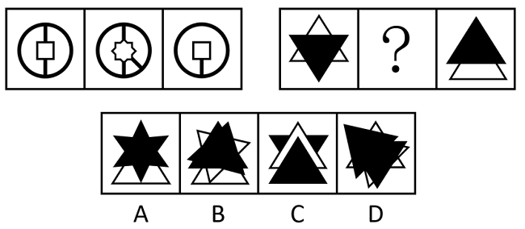

# 样式规律-图形复合运算（旋转+相加）

考点：[[20-考点/判断推理/图形推理/样式规律-图形复合运算（旋转+相加）|图形推理 / 样式规律-图形复合运算（旋转+相加）]]

**问法模型**：两组三图且问号位于图2 → 优先逆向观察'图1与图3如何运算得到图2'（本题：图3逆时针旋转45°后与图1叠加），再将该复合操作原样套用到第二组

## 推理链
1. 第1步：两组图形元素组成相似（圆/方形线框、三角形黑白面），优先考虑样式规律，且问号在图2，故先研究第一组中图1与图3到图2的关系
2. 第2步：观察第一组图1为'圆+竖直直径线+中心正方形'，图3为'圆+偏下方正方形+由正方形延伸到圆底的竖线'，而图2中央呈八角星状、且多出一条指向右下的斜线，提示需对图3做旋转后再叠加
3. 第3步：将图3逆时针旋转45°：原偏下方正方形转到中心且呈斜45°菱形，与图1的中心正方形叠加拼合成图2中央的八角星；原竖线同步转为指向右下45°的线段，与图2的右下斜线对应
4. 第4步：确认规律为'图2＝图3逆时针旋转45°后与图1相加'
5. 第5步：第二组套用：图1为'上方白三角框+黑色实心倒三角'，图3为'黑色实心正三角+下方白三角框'，将图3逆时针旋转45°后与图1叠加
6. 第6步：图1的黑色倒三角与旋转后的黑色实心三角错位叠加，形成倾斜不规则黑色多边形，白色三角框轮廓相应错位；A为规则八角星、C为规整上下叠放，均无45°错位特征，只有D呈现三角形旋转错位叠加后的不规则黑色形状，故选D

**最快解法**：⚡ 口诀法：'问号在图2，先看1和3怎么变2'——第一组发现'图3逆时针转45°再与图1相加'，第二组直接套用，重点盯黑色实心三角形：图1黑倒三角＋图3黑三角旋转45°后必呈不规则倾斜形状，排除规整对称的A、C，锁定D

## 易错点
- ⚠ 思维定式：习惯按'图1+图2=图3'正向找规律，本题问号在图2需逆向观察，方向搞反则找不到规律
- ⚠ 只考虑黑白/线条简单相加，漏掉'旋转45°'这一复合操作，导致对照选项时无从下手
- ⚠ 旋转方向和角度判断错误（应为逆时针45°），会误选B等倾斜角度不符的选项

## 母题抽象
> 🧩 当两组三图且问号位于图2时，优先验证'图1与图3经旋转/翻转等位置操作后再叠加得到图2'的复合运算规律，并将同一操作原样迁移到另一组，逐项比对叠加后的形状（尤其黑块错位轮廓）定答案

**同类特征**：两组三图式、问号在图2、元素组成相似、线条/黑块叠加、复合操作（旋转+相加）

## 相关题
- [[10-真题/判断推理/图形推理/10204610 样式规律-加减同异（去同存异），九宫格列规律|10204610]]（辽宁 2024，相关度1）
- [[10-真题/判断推理/图形推理/10297349 样式规律-黑白运算|10297349]]（浙江 2025，相关度1）
- [[10-真题/判断推理/图形推理/10297407 样式规律-黑白运算（定义叠加）|10297407]]（四川 2025，相关度1）
- [[10-真题/判断推理/图形推理/11226895 图形推理-样式规律（叠加求同-保留相同部分）|11226895]]（上海 2025，相关度1）
- [[10-真题/判断推理/图形推理/11226896 样式规律-加减同异（分区域：上圆内部求异+下椭圆内部求同）|11226896]]（上海 2025，相关度1）

---

### 题干

从所给的四个选项中，选择最合适的一个填入问号处，使之呈现一定的规律性：

### 选项
- A. A
- B. B
- C. C
- D. D　✅

### 官方解析

元素组成相似，优先考虑样式规律。第二组图形中问号在图2，故优先观察第一组图形中图1和图3是如何得到图2的。第一组图形中，图3先逆时针旋转45°后，再与图1相加得到图2。第二组图形运用此规律，图3先逆时针旋转45°后，再与图1相加得到图2，只有D项符合。

故正确答案为D。

注：本题考虑相加的特征明显，但出题不够严谨，第一组图形图2缺少部分线条，如下图红线所示，且本题再无其他规律。同学们需重点掌握这类问号在图2的加减同异题目的解题方法，优先观察图1与图3是如何得到图2的。

### 给定材料
（无）

> [!note] 复核版本状态
> 原题不可计分（underdetermined；来源记录的答案键/竞争项：D）；仅当前明确标注的编辑版按答案D计分。
> 详细原题疑点、修订题面、解析和证据见下方独立复核记录。

<!-- CODEX-ANSWER-REVIEW:BEGIN -->
### 本次独立复核

**复核结论：** `resolved`（答案与解析已核定）

**原题计分状态：** 不计分（`underdetermined`：原题证据不足以唯一判定）。来源中记录的答案键/竞争项：D；这些记录不代表原题已核准答案。

**原题疑点与处理：**

四川 2017 〔20-考点/判断推理/图形推理/样式规律-图形复合运算（旋转+相加）〕 — 官方解析已自注'出题不够严谨'：按'图1＋逆时针旋转45°后的图3'严格叠加，所得线条（如正方形与旋转菱形叠加的完整轮廓）多于第一组图2的实际线条，即图2缺少部…

**当前计分版本：** 明确标注的编辑版；未列出的题干、材料或选项沿用固定题源。答案不回填为原题答案。

**计分答案：** D（可计分）

**复核解析：**

本版把变换规则直接写入题干，因此第一组示例的漏线不再影响判断。第二组图3旋转45°后，其竖直/水平边变成斜边；与图1叠加后，黑色图形成为错位的复合轮廓，白色三角轮廓也出现斜置边。D是唯一同时显示这些旋转与叠加特征的选项；A、C仍为直立或轴对齐轮廓，B的偏移方向或角度不符。特别是C的黑色三角仍尖向正上、底边水平，不可能是旋转45°后的图3。

**修订题干：**

【编者修订版，非原题复原】原题第一组图2漏画部分叠加线，本版不以该图推断规则。只看第二组：保持图1不变，将图3整体绕中心逆时针旋转45°，再与图1叠加；所有轮廓线均保留，完全重合的线只画一次。问号处应选哪项？

**相关信息：**

图形推理—旋转与图形叠加。编辑版直接给定第二组操作，避开源题第一组图2漏线；答案只对应编辑版。

**核对依据与来源边界：**

- 固定题源：[原题文件](https://github.com/Mentat-Uran/kaogongzhentizhengliu/blob/84ab93d4b64b61d897bece8a1c0a5bab06b4feb2/10-%E7%9C%9F%E9%A2%98/%E5%88%A4%E6%96%AD%E6%8E%A8%E7%90%86/%E5%9B%BE%E5%BD%A2%E6%8E%A8%E7%90%86/4768005%20%E6%A0%B7%E5%BC%8F%E8%A7%84%E5%BE%8B-%E5%9B%BE%E5%BD%A2%E5%A4%8D%E5%90%88%E8%BF%90%E7%AE%97%EF%BC%88%E6%97%8B%E8%BD%AC%2B%E7%9B%B8%E5%8A%A0%EF%BC%89.md)；内容版本 `84ab93d4b64b61d897bece8a1c0a5bab06b4feb2`，源 Markdown blob `6087851ef15bdd95557f308d670972a3cc2c6683`.
- **核心依据：** 独立几何复核确认第二组图3逆时针旋转45°后，只有D呈现斜置轮廓与错位复合黑块；源题解析附红线图也确认第一组图2缺线，故编辑版明确不以其为规则证据。
- 固定题图/公式图：`90-图片/题目图/17f67a9d61ec4c2.png`, `90-图片/题目图/17f67ae2c4cac4f.png`.

<!-- CODEX-ANSWER-REVIEW:END -->
