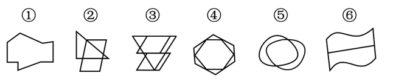

# 属性规律-对称性（中心对称的判定）

考点：[[20-考点/判断推理/图形推理/属性规律-对称性（中心对称的判定）|图形推理 / 属性规律-对称性（中心对称的判定）]]

**问法模型**：'把六个图形分为两类，使每一类都有各自的共同特征' → 分组分类模型：先找两组各自的规律；找不出时按官方注释降级为'一组具有某属性、另一组不具有'（本题即中心对称的有无）

## 推理链
1. 第1步：六图元素组成不同（①箭头状多边形、②三角形叠平行四边形、③上下梯形组合、④带交叉线的六边形、⑤相交双椭圆、⑥含波浪线的四边形），无统一数量特征，优先考虑属性规律
2. 第2步：属性规律中先检验对称性，采用'绕中心旋转180°是否与原图重合'逐一判定中心对称
3. 第3步：图④（六边形加交叉线结构）、图⑤（两个相交的椭圆/圆）、图⑥（四边形与两条波浪线整体点对称）旋转180°后均与自身重合，为中心对称图形
4. 第4步：图①为不规则多边形、图②为直角三角形叠平行四边形、图③为上下错位的梯形组合，旋转180°后均无法与自身重合，均不是中心对称图形
5. 第5步：按'④⑤⑥中心对称、①②③非中心对称'分组，①②③一组、④⑤⑥一组，对照选项得A

**最快解法**：⚡ 旋转180°检验法（中心对称口诀'转半圈看重合'）：逐图想象绕中心旋转180°，④⑤⑥能重合归一组，①②③不能重合归另一组，直接锁定A

## 易错点
- ⚠ 惯性思维只想找'两组各自的规律'（如对称轴方向、面数），忽略官方注释认可的'一组具有规律、一组不具有'的合法分法
- ⚠ 图⑥含波浪曲线易被误判为不对称——中心对称只看旋转180°后是否与原图重合，是否含曲线、是否轴对称均不影响判定
- ⚠ 图②③为多元素组合图形，易先去数面/线/角的数量而绕开优先级更高的属性规律

## 母题抽象
> 🧩 当分组分类题'元素组成不同'且无明显数量规律时，优先检验属性中的对称性，尤其是逐图做'旋转180°是否与自身重合'的中心对称检验，常见答案形态为'三个中心对称、三个非中心对称'。

**同类特征**：元素组成不同、六图形状差异大、无统一数量特征、含曲线图形（相交双椭圆、波浪线四边形）、含多元素组合图形（三角形+平行四边形、上下梯形）、问法为'分为两类，使每一类都有各自共同特征'

## 相关题
- [[10-真题/判断推理/图形推理/10204454 数量规律-部分数（黑白球连通区域数做和）|10204454]]（甘肃 2024，相关度1）
- [[10-真题/判断推理/图形推理/10204604 数量规律-线数量（汉字横线数）|10204604]]（辽宁 2024，相关度1）
- [[10-真题/判断推理/图形推理/10297050 数量规律-特殊计数（线条穿过小白球的数量）|10297050]]（天津 2025，相关度1）
- [[10-真题/判断推理/图形推理/10297127 图形间关系-相交图形中不相交边数量（黑白图形相交）|10297127]]（天津 2025，相关度1）
- [[10-真题/判断推理/图形推理/10297148 数量规律-线的细化（端点连线穿过线条数；备选：平行线组数）|10297148]]（天津 2025，相关度1）

---

### 题干

把下面的六个图形分为两类，使每一类图形都有各自的共同特征或规律，分类正确的一项是：

### 选项
- A. ①②③，④⑤⑥　✅
- B. ①③⑤，②④⑥
- C. ①④⑤，②③⑥
- D. ①②⑥，③④⑤

### 官方解析
元素组成不同，优先考虑属性规律。观察发现，图④⑤⑥均为中心对称图形，图①②③均不是中心对称图形，即图①②③为一组，图④⑤⑥为一组。
故正确答案为A。
注：分组分类题目优先考虑两组图形分别具有各自的规律，无法分成具有各自规律的两组时，才考虑将图形分成一组具有该规律，一组不具有该规律。

### 给定材料
（无）
