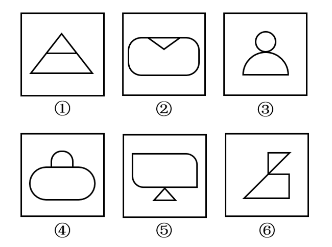

# 图形间关系-两图相交（相交于边 vs 相交于点）

考点：[[20-考点/判断推理/图形推理/图形间关系-两图相交（相交于边 vs 相交于点）|图形推理 / 图形间关系-两图相交（相交于边 vs 相交于点）]]

**问法模型**：6个图形分两类、每类有共同规律 → 优先观察'图形间关系'（相交/相切/相离），按交界形式分类

## 推理链
1. 第1步：题干每幅图均由两个封闭图形组合而成，如①中三角形与梯形、③中圆与半圆、④中半圆与圆角矩形、⑥中上下两个三角形，应优先考虑图形间关系
2. 第2步：观察两图形交界处的接触形式，规则为：公共部分是一整段线段→'相交于边'，公共部分仅一个接触点→'相交于点'
3. 第3步：逐图判定——①中小三角形与下方梯形共用一条横线段，②中V形三角形的两条斜边与圆角矩形重合，④中上方半圆的直边与圆角矩形顶边重合，均相交于边；③中圆与半圆仅切于一点，⑤中小三角形顶点与上方图形仅一点相触，⑥中上、下三角形仅一个顶点相接，均相交于点
4. 第4步：按'相交于边/相交于点'分组，①②④为一组、③⑤⑥为一组，对应选项B

**最快解法**：⚡ 图形间关系口诀'只看交界处'：公共部分为线段的归一组（①②④），公共部分为一个点的归另一组（③⑤⑥），直接锁定B

## 易错点
- ⚠ 只注意到'每幅图都有两个图形接触'，未进一步区分接触形式是边还是点
- ⚠ ②和⑤都带尖角易误判为同类：实为②中V形两边与圆角矩形重合属相交于边，⑤仅一个顶点接触属相交于点
- ⚠ 受直线/曲线构成或'像人形、像书包'的外观干扰，偏离图形间关系考点；或将①看作单图内部线条而非两个面相交

## 母题抽象
> 🧩 当题干每幅图都由两个图形相交（接触）而成时，按交界处是'公共边'还是'公共点'分成两类：共边一组、共点一组

**同类特征**：每幅图由两个图形组成、两图形存在接触/相交、分组分类题型、需比较交界处形式（边/点）、直曲图形混合出现

## 相关题
- [[10-真题/判断推理/图形推理/10297422 数量规律-部分数（连通区数量）及每部分所含元素个数|10297422]]（四川 2025，相关度1）
- [[10-真题/判断推理/图形推理/19283951 属性规律-对称性（黑球整体轴对称+对称轴经过黑球个数的二级辨析）|19283951]]（国考 2025，相关度1）
- [[10-真题/判断推理/图形推理/2133622 图形间关系（相交-相切交替规律）|2133622]]（国考 2018，相关度1）
- [[10-真题/判断推理/图形推理/2452823 图形间关系（两图相交+阴影与其中一图形状相同）|2452823]]（河南 2019，相关度1）
- [[10-真题/判断推理/图形推理/3523357 分组分类-元素位置关系（相同元素的对角相对-同行同列相邻）|3523357]]（青海 2021，相关度1）

---

### 题干

把下面的6个图形分为两类，使每一类图形都有各自的共同规律，分类正确的是：

### 选项
- A. ①②⑥，③④⑤
- B. ①②④，③⑤⑥　✅
- C. ①③④，②⑤⑥
- D. ①③⑤，②④⑥

### 官方解析
本题为分组分类题目。观察发现，题干每幅图形均由两个面相交而成，考虑图形间关系。图①②④中两个图形均相交于边，图③⑤⑥中两个图形均相交于点，即图①②④为一组，图③⑤⑥为一组。
故正确答案为B。

### 给定材料
（无）
