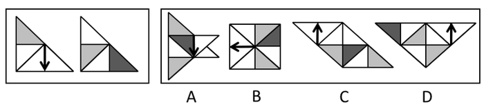

# 平面拼合（旋转+重叠覆盖）

考点：[[20-考点/判断推理/图形推理/平面拼合（旋转+重叠覆盖）|图形推理 / 平面拼合（旋转+重叠覆盖）]]

**问法模型**：'只有一个是两图经平移、旋转、重叠覆盖组合而成' → 特征元素旋转跟踪法：以箭头指向反推旋转方向与角度，再用深灰块落点和外轮廓验证排除

## 推理链
1. 第1步：提取特征元素——题干图1内含一个竖直向下的箭头和一个中灰色三角形，图2内含一个位于角部的深灰三角形及白色区域；组合规则允许平移、平面内旋转和重叠覆盖。
2. 第2步：确定排除指纹——整体旋转时箭头指向与色块方位同步变化，且两图拼合后外轮廓应为完整正方形（B即为正方形轮廓），故以'箭头方向＋深灰块位置＋外轮廓'逐项对照。
3. 第3步：按官方拼法，图1顺时针旋转90°，其向下箭头变为向左（下→左）；图2逆时针旋转90°，其右下角深灰三角转至右上角，两图重叠覆盖拼合。
4. 第4步：对照A项——箭头仍向下、深灰块居中且右侧多出箭状突出，外轮廓残缺，与拼合结果不符，排除。
5. 第5步：对照C、D项——外轮廓均残缺变形，且两图箭头都向上，与'图1顺时针旋转后箭头向左'直接矛盾，排除。
6. 第6步：对照B项——外轮廓为完整正方形，箭头向左，深灰三角恰位于右上角，与'图1顺时针＋图2逆时针'拼合结果完全一致，故选B。

**最快解法**：⚡ 箭头锁定法：图1箭头向下，顺时针转90°即指向左，四个选项中仅B的箭头向左，一步锁定B；再用图2深灰块逆时针转至右上角验证无误。

## 易错点
- ⚠ 只盯色块拼接形状、忽略箭头这一强方向特征，在C、D（箭头向上）之间纠结误选
- ⚠ 旋转方向搞反：向下箭头顺时针90°才指向左，误按逆时针旋转会得出'向右'而错排B
- ⚠ 忽略'重叠覆盖'规则，见图1的中灰三角在B中被覆盖'消失'，就误判B不符合

## 母题抽象
> 🧩 当平面拼合题的题干图出现箭头等方向性元素时，先用选项箭头指向反推所需旋转方向和角度，再用深色块落点与外轮廓验证，即可秒锁唯一答案。

**同类特征**：两图拼合：只许平移、平面旋转、重叠覆盖、图1含向下箭头、图2含角部深灰三角形、拼合后外轮廓为完整正方形、选项以箭头方向（下/左/上/上）相区分

## 相关题
（暂无）

---

### 题干

右边四个图形中，只有一个是由左边的两个图形组合（只能通过上、下、左、右平移、在平面上旋转、重叠覆盖）而成的，请把它找出来：

### 选项
- A. A
- B. B　✅
- C. C
- D. D

### 官方解析

本题考查平面拼合。将题干图1顺时针旋转后的图形与图2逆时针旋转后的图形进行拼合，即可得到B项。

故正确答案为B。

### 给定材料
（无）
