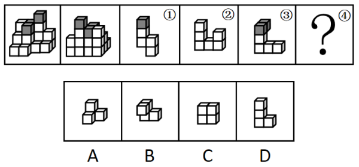
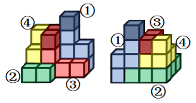

# 立体拼合（正方体堆叠多面体的拆分与重组）

考点：[[20-考点/判断推理/图形推理/立体拼合（正方体堆叠多面体的拆分与重组）|图形推理 / 立体拼合（正方体堆叠多面体的拆分与重组）]]

**问法模型**：整体多面体可拆分为①②③④四件、求问号处剩余件 → 立体拼合模型：块数守恒＋灰色块分配＋凹凸互补试拼排除

## 推理链
1. 第1步：由题干提取总量条件——整体由同样大小的18个白色正方体和3个灰色正方体堆叠而成，共21块；正视图与后视图共同锁定整体轮廓及灰色块的空间位置
2. 第2步：观察拆分件①、②、③，三者图形中各恰好含1个灰色正方体，由灰块总数3个可知第④件应全为白色正方体，且①+②+③+④的块数之和必须等于21（块数守恒）
3. 第3步：将①、②、③按其凹凸形状先行嵌入整体轮廓，正视图与后视图中被占据位置之外的剩余空腔形状即为目标④的形状（凹凸互补原则）
4. 第4步：剩余空腔呈底层方块错位、上层方块偏移的阶梯状，需与选项逐一对照：C项为2×2平板形、D项为竖直L形，均与空腔凹凸走向不符，排除
5. 第5步：A、B外形相近需精细辨析——将选项在空间中旋转后与空腔比对，A项各凸起与空腔凹陷一一咬合，B项凸出方位与之相反、无法嵌入
6. 第6步：块数、颜色（全白）、凹凸咬合三重验证均指向A，与官方答案一致

**最快解法**：⚡ 排除法＋凹凸互补试拼：先用'灰块分配'确定④全白、用块数守恒锁定④的块数，排除C（平板2×2）、D（竖直L形）等形状明显不合的选项，再将剩余空腔与A、B旋转比对，凹凸能咬合的A即为答案

## 易错点
- ⚠ 只数视图可见方块而漏数被遮挡的正方体，块数守恒算错
- ⚠ 忽略灰色正方体在①②③中已各占1个的分配关系，颜色判断失误
- ⚠ A与B外形相近，未在空间中旋转就凭平面轮廓草率判断，误选凸起方向相反的B

## 母题抽象
> 🧩 当题干出现'立方体堆叠整体＋拆分为编号部件＋求问号部件'特征时，用'块数守恒＋彩色块分配＋凹凸互补试拼'三步法，验证剩余空腔与哪个选项旋转后完全咬合

**同类特征**：18个白色+3个灰色正方体共21块、给出正视图和后视图、拆分为①②③④四个多面体、①②③中各含1个灰块、求问号处的剩余部件、选项为小正方体组合图形

## 相关题
- [[10-真题/判断推理/图形推理/10297423 图形推理-立体拼合（正方体堆叠的拆分与重组）|10297423]]（四川 2025，相关度1）
- [[10-真题/判断推理/图形推理/2264364 立体拼合-小立方体计数（视图分排计数+体积守恒）|2264364]]（国考 2019，相关度1）
- [[10-真题/判断推理/图形推理/5894887 立体拼合（多面体组合·凹凸互补）|5894887]]（国考 2024，相关度1）

---

### 题干

下图为同样大小的18个白色正方体和3个灰色正方体堆叠而成的多面体正视图和后视图。该多面体可拆分为①、②、③和④共4个多面体的组合，下列哪一项能填入问号处？

### 选项
- A. A　✅
- B. B
- C. C
- D. D

### 官方解析

本题考查立体拼合，如下图所示，立体图可以由①、②、③以及A项拼合而成。

故正确答案为A。

### 给定材料
（无）
