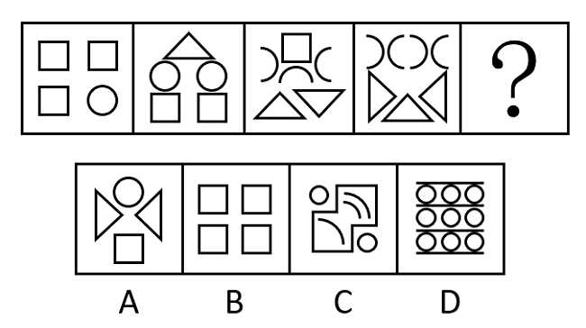

# 数量规律-线数量（曲线数与直线数分开数，构成双等差数列）

考点：[[20-考点/判断推理/图形推理/数量规律-线数量（曲线数与直线数分开数，构成双等差数列）|图形推理 / 数量规律-线数量（曲线数与直线数分开数，构成双等差数列）]]

**问法模型**：'选择最合适的一个填入问号处，使之呈现一定的规律性'→ 元素组成不同且无属性规律时，将每幅图的曲线数与直线数分开点数，验证是否各自形成等差数列后递推

## 推理链
1. 第1步：题干五幅图元素组成不同，对称、封闭等属性规律不明显，且每幅图都由'单一曲线图形（圆、弧）+多边形（正方形、三角形）'混合构成，考虑线的数量并把曲线、直线分开数
2. 第2步：先数曲线——图1的1个圆=1条曲线，图2的2个圆=2条，图3的2段半圆弧+1段弧=3条，图4的4段弧=4条，曲线数依次为1、2、3、4，故？处应为5条曲线
3. 第3步：再数直线——图1三个正方形3×4=12条，图2三角形3条+两个正方形8条=11条，图3正方形4条+两三角形3+3=10条，图4三个三角形3×3=9条，直线数依次为12、11、10、9，故？处应为8条直线
4. 第4步：曲线、直线两条数列均呈等差变化，问号处图形须同时满足'曲线5条、直线8条'
5. 第5步：逐项对照排除——A项两三角形+正方形共10条直线、圆1条曲线；B项四个正方形16条直线、0条曲线；D项9个圆+3条直线，曲线9直线3，均不符合
6. 第6步：C项曲线共5条（大圆、小圆、内部两段弧及圆角弧）、直线共8条，同时满足双数列要求，当选

**最快解法**：⚡ 分线计数法：先快速数曲线，1、2、3、4递增等差，锁定？处须5条曲线（排除B的0条、D的9条）；再用直线数12、11、10、9递减等差校验需8条（排除A的10条），仅C同时满足，选C

## 易错点
- ⚠ 把曲线与直线合并数总条数（本题总数恰好恒为13），误用'总数不变'规律，一旦选项设计为总数相符但曲线数不符就会出错
- ⚠ 弧线计数失误：把1段半圆弧误计为2条曲线（当成月牙形双弧）或漏数圆角处的弧，导致曲线数列错位
- ⚠ 只凭曲线数列选答案，忽略直线数列的校验作用，未做到'双数列同时满足'

## 母题抽象
> 🧩 当图形元素组成不同、无明显属性规律，且图中既有圆/弧等曲线元素又有三角形/正方形等多边形时，将曲线数与直线数分开点数，验证是否各自构成等差数列，由双数列共同锁定问号处答案

**同类特征**：元素组成不同、无明显属性规律、圆/弧等曲线元素与三角形/正方形并存、数量规律-线数量、曲线数1、2、3、4递增、直线数12、11、10、9递减

## 相关题
- [[10-真题/判断推理/图形推理/12536394 数量规律-线数量（内外图形直线数相等）|12536394]]（四川 2024，相关度3）
- [[10-真题/判断推理/图形推理/5518369 数量规律-数曲线（曲线条数递增）|5518369]]（湖北 2021，相关度3）
- [[10-真题/判断推理/图形推理/10204454 数量规律-部分数（黑白球连通区域数做和）|10204454]]（甘肃 2024，相关度2）
- [[10-真题/判断推理/图形推理/10297050 数量规律-特殊计数（线条穿过小白球的数量）|10297050]]（天津 2025，相关度2）
- [[10-真题/判断推理/图形推理/10297262 数量规律-面的形状种类（封闭面种类数分组）|10297262]]（浙江 2025，相关度2）

---

### 题干

从所给的四个选项中，选择最合适的一个填入问号处，使之呈现一定的规律性：

### 选项
- A. A
- B. B
- C. C　✅
- D. D

### 官方解析
本题元素组成不同，无明显属性规律，考虑数量规律。观察发现，题干图形中出现单一曲线、多边形，考虑线的数量。题干图形中既有曲线又有直线，考虑曲线和直线分开去数。题干图形中曲线数量依次为：1、2、3、4、？，所以？处图形的曲线数为5；直线数量依次为：12、11、10、9、？，所以？处图形的直线数为8。只有C项符合。
故正确答案为C。

### 给定材料
（无）
