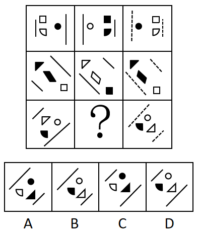

# 位置规律（翻转）＋样式规律（黑白互换、实线变虚线）的组合规律

考点：[[20-考点/判断推理/图形推理/位置规律（翻转）＋样式规律（黑白互换、实线变虚线）的组合规律|图形推理 / 位置规律（翻转）＋样式规律（黑白互换、实线变虚线）的组合规律]]

**问法模型**：九宫格'？'处填入图形 → 逐行横向找规律：先看位置变化（翻转），再看样式变化（黑白互换、实线变虚线），前两行验证一致后套用到第三行

## 推理链
1. 第1步：第一行图1→图2：图形左右翻转得到图2，线条不变，黑白颜色互换（如白方块变黑方块、黑圆变白圆）
2. 第2步：第一行图2→图3：位置不变，实线（竖线）变成虚线，黑白颜色再次互换
3. 第3步：第二行验证同一规律：图1沿斜线（直线）方向翻转得到图2，线条不变、黑白互换；图2→图3位置不变，实斜线变虚斜线、黑白互换，规律成立
4. 第4步：归纳通式：图1→图2＝沿直线翻转＋黑白互换（线仍为实线）；图2→图3＝位置不变＋实线变虚线＋黑白互换
5. 第5步：第三行应用：问号处为图2，可由已知的图3逆推——图3为虚线，把虚线还原为实线、黑白颜色互换一次、位置保持不变，即得问号处图形
6. 第6步：第三行图3中黑半圆、白圆、白三角与虚斜线，逆推后问号处应为白半圆（轮廓）、黑圆、黑三角与实斜线，且整体为图3沿斜线方向的对应翻转位
7. 第7步：逐项对照：A项实斜线＋黑圆＋白轮廓半圆＋黑三角完全符合，B、C、D在颜色或翻转方位上不符，故选A

**最快解法**：⚡ 规律逆推法：问号（图2）＝第三行图3'虚线还原为实线＋黑白互换一次＋位置不变'，直接比对四个选项中满足'实线＋与图3颜色相反'的唯一图形，秒选A

## 易错点
- ⚠ 忽略'实线变虚线'的线型规律，只盯位置和颜色导致比对不全
- ⚠ 第三行应'沿直线（斜线）方向翻转'，误用左右翻转会选错翻转方位
- ⚠ 两次黑白互换叠加会抵消（图3颜色与翻转后的图1相同），误以为图3与图2颜色相同而错选C或D

## 母题抽象
> 🧩 当九宫格每行元素形状相同而方位、颜色、线型存在差异时，用'逐行两段式规律（图1→图2翻转＋黑白互换；图2→图3实线变虚线＋黑白互换）'验证前两行，再从第三行已知图逆推问号处

**同类特征**：九宫格问号处、每行元素形状相同、左右翻转/沿直线翻转、黑白颜色互换、实线变虚线、位置规律与样式规律叠加

## 相关题
- [[10-真题/判断推理/图形推理/2045680 位置规律（平移）+颜色规律（黑白反转）组合|2045680]]（广州市考 2017，相关度1）

---

### 题干

从所给的四个选项中，选择最合适的—个填入问号处，使之呈现一定的规律性：

### 选项
- A. A　✅
- B. B
- C. C
- D. D

### 官方解析
每行图形元素形状相同，优先考虑位置规律。观察发现，第一行中，图1左右翻转得到图2，线条不变，黑白颜色互换；图2到图3位置不变，实线变成虚线，黑白颜色互换。第二行中，图1沿着直线方向翻转得到图2，线条不变，黑白颜色互换；图2到图3位置不变，实线变成虚线，黑白颜色互换。第三行中，图1沿着直线方向翻转得到图2，线条不变，黑白颜色互换；图2到图3位置不变，实线变虚线，黑白颜色互换，只有A项符合。
故正确答案为A。

### 给定材料
（无）
