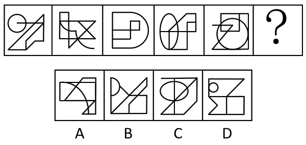

# 数量规律-笔画数（一笔画）

考点：[[20-考点/判断推理/图形推理/数量规律-笔画数（一笔画）|图形推理 / 数量规律-笔画数（一笔画）]]

**问法模型**：问号处填入最合适图形使之呈现规律 → 元素组成不同先看属性，属性无规律转数量规律；图形多端点、多交叉时优先数奇点验证笔画数

## 推理链
1. 第1步：题干五图元素组成不同，对称、开闭、曲直等属性无统一规律，且图一、图二、图五均出现线头外露的多端点图形，提示考查笔画数
2. 第2步：调用一笔画判定规则——连通图形奇点数（从该点引出奇数条线的点）为0或2时可一笔画，奇点数为2n（n≥2）时最少需n笔画
3. 第3步：逐一数题干各图奇点：图一、图二、图三、图四、图五均为连通图形且奇点数为0或2，全部可一笔画
4. 第4步：归纳规律——？处图形也应为『一笔画』图形
5. 第5步：逐项数奇点验证：A项奇点数超过2，为两笔画；B项为两笔画；C项为两笔画，均不符合
6. 第6步：D项为连通图形且奇点数为0或2，可一笔画，与题干规律一致，当选

**最快解法**：⚡ 一笔画奇点法：先确认图形连通，再快速数奇点（盯住线头端点、T字接头、交叉点），奇点数为0或2即一笔画；题干五图均一笔画，选项中仅D奇点数≤2，秒选D

## 易错点
- ⚠ 见『多端点』只想到数端点数或线数量，没想到笔画数考点
- ⚠ 数奇点时漏数交叉点、T形接头的度数，把偶点误判为奇点导致笔画数算错
- ⚠ 忽视连通性：奇点数达标但图形分离为两部分时仍不能一笔画

## 母题抽象
> 🧩 当图形元素组成不同、属性无统一规律，且出现线头外露的多端点图或圆/曲线与直线交叉的‘多交点’图时，优先数奇点验证一笔画规律，奇点数为0或2的连通图形即一笔画

**同类特征**：元素组成不同、多端点图形（线头外露）、圆/曲线与直线交叉、交点、接头较多、题干五图全为一笔画、问号处求同

## 相关题
- [[10-真题/判断推理/图形推理/10204454 数量规律-部分数（黑白球连通区域数做和）|10204454]]（甘肃 2024，相关度1）
- [[10-真题/判断推理/图形推理/10204604 数量规律-线数量（汉字横线数）|10204604]]（辽宁 2024，相关度1）
- [[10-真题/判断推理/图形推理/10297050 数量规律-特殊计数（线条穿过小白球的数量）|10297050]]（天津 2025，相关度1）
- [[10-真题/判断推理/图形推理/10297127 图形间关系-相交图形中不相交边数量（黑白图形相交）|10297127]]（天津 2025，相关度1）
- [[10-真题/判断推理/图形推理/10297148 数量规律-线的细化（端点连线穿过线条数；备选：平行线组数）|10297148]]（天津 2025，相关度1）

---

### 题干

从所给的四个选项中，选择最合适的一个填入问号处，使之呈现一定的规律性：

### 选项
- A. A
- B. B
- C. C
- D. D　✅

### 官方解析
元素组成不同，无明显属性规律，考虑数量规律。观察发现，图一、图二和图五都存在多端点图形，可以考虑笔画数。题干图形均为一笔画，所以？处图形也应该是一笔画。A项两笔画，B项两笔画，C项两笔画，D项一笔画。只有D项满足规律。
故正确答案为D。

### 给定材料
（无）
