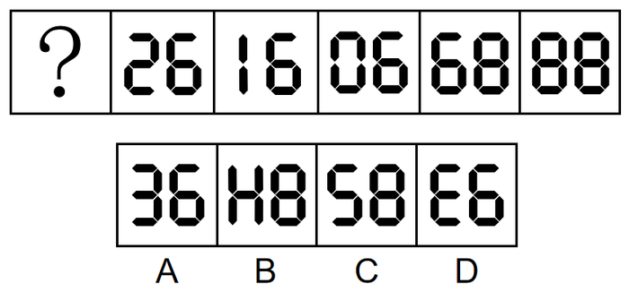

# 图形推理-数字整体旋转180°（旋转后逆序读数成等差数列）

考点：[[20-考点/判断推理/图形推理/图形推理-数字整体旋转180°（旋转后逆序读数成等差数列）|图形推理 / 图形推理-数字整体旋转180°（旋转后逆序读数成等差数列）]]

**问法模型**：'选择最合适的一个填入问号处使之呈现规律性'且题干为电子数字、？居于首位 → 将每幅图旋转180°并从右向左读数，找连续递增规律

## 推理链
1. 第1步：题干为七段管电子数字？、26、16、06、68、88，元素组成不同且无明显属性规律和数量规律
2. 第2步：题干出现旋转后的数字特征（选项D为'E6'、A为'36'，其中'3'互为旋转形），且？在第一幅图，提示应将图形旋转180°后从右向左逆序观察
3. 第3步：从右向左将每幅图旋转180°读数：88→88、68→89（6转成9且两数字换位）、06→90、16→91、26→92，恰好构成88至92的连续递增数列
4. 第4步：故？处图形旋转180°后应为93
5. 第5步：93整体旋转180°：数字顺序反转，3旋转后呈'E'、9旋转后呈'6'，得'E6'，与选项对照只有D项符合

**最快解法**：⚡ 旋转法+逆序读数：把题干五幅已知图整体倒转180°，从右往左依次读出88、89、90、91、92，故？倒转后应为93；将93倒过来看即'E6'，直接锁定D

## 易错点
- ⚠ 只按常规从左往右找属性/数量规律，忽略电子数字可整体旋转180°读数的命题特征
- ⚠ 忽略'？在第一幅图'这一暗示，未从右向左逆序观察，若顺序旋转读数（98、86、96、91、62）则规律断裂
- ⚠ 受'两笔画'规律干扰误选C（58），未比较两种规律与题干特征（旋转数字、？居首）的贴合度
- ⚠ 旋转时忘记数字顺序需同时左右反转，误以为93旋转后是'3E'而非'E6'

## 母题抽象
> 🧩 当题干为电子（七段管）数字、？位于序列首位或选项出现旋转形数字时，将每幅图整体旋转180°（数字左右换位）后逆序读数，验证是否构成连续等差数列，再反推？处图形的旋转形态。

**同类特征**：电子表/七段管风格数字、？位于第一幅图、数字序列26、16、06、68、88、选项含E6、36等互为旋转形的数字、元素组成不同且无属性数量规律、0/1/2/6/8/9倒转后仍可读数

## 相关题
（暂无）

---

### 题干

从所给的四个选项中，选择最合适的一个填入问号处，使之呈现一定的规律性：

### 选项
- A. A
- B. B
- C. C
- D. D　✅

### 官方解析

解法一：元素组成不同，且无明显属性规律和数量规律。观察发现，“？”在题干的第一幅图，选项中出现旋转后的数字，且题干的数字旋转后可得到新的数字，故将题干图形均旋转进行观察，此时从右向左看，每幅图中的数字依次为：88、89、90、91、92，故“？”处图形旋转之后为数字93，只有D项符合。

故正确答案为D。

解法二：元素组成不同，且无明显属性规律，优先考虑数量规律。观察发现，题干出现“日”字变形图，考虑笔画数。题干均为两笔画图形，故“？”处为两笔画图形，选项的笔画数分别为：3、4、2、3，只有C项符合。

故正确答案为C。

注：观察题目特征，根据A、D两项中的数字“3”互为旋转的图形，说明可能会考查旋转，另外根据“？”在题干的第一幅图，说明可能需要将题干图形从右向左看，而根据解法一将题干图形从右向左看时，数字恰好呈递增规律，故解法一相比解法二更贴近题目特征，因此粉笔更倾向于选D。

### 给定材料
（无）

> [!note] 复核版本状态
> 原题不可计分（underdetermined；来源记录的答案键/竞争项：D、C）；仅当前明确标注的编辑版按答案D计分。
> 详细原题疑点、修订题面、解析和证据见下方独立复核记录。

<!-- CODEX-ANSWER-REVIEW:BEGIN -->
### 本次独立复核

**复核结论：** `resolved`（答案与解析已核定）

**原题计分状态：** 不计分（`underdetermined`：原题证据不足以唯一判定）。来源中记录的答案键/竞争项：D、C；这些记录不代表原题已核准答案。

**原题疑点与处理：**

青海 2022 〔20-考点/判断推理/图形推理/图形推理-数字整体旋转180°（旋转后逆序读数成等差数列）〕 — 官方解析解法二（均为两笔画）指向C项，与最终答案D形成双解；官方已在注释中说明：因A、D中数字'3'互为旋转形、？居首提示逆序观察，解法一更贴合题干特征，故倾向…

**当前计分版本：** 明确标注的编辑版；未列出的题干、材料或选项沿用固定题源。答案不回填为原题答案。

**计分答案：** D（可计分）

**复核解析：**

编辑版明确旋转和读取方向后，数列下一项为93。选项D整体旋转180°后从右向左读作93；其他项不满足，故选D。此修订排除了原题中可导向C的笔画数解释。

**修订题干：**

【编者修订版，非原题复原】将每幅图整体旋转180°，再从右向左读取七段数字。已知读数依次为88、89、90、91、92，选择下一幅图。

**相关信息：**

图形推理—整体旋转与数字读取；编辑版明示变换方式和读序。

**核对依据与来源边界：**

- 固定题源：[原题文件](https://github.com/Mentat-Uran/kaogongzhentizhengliu/blob/84ab93d4b64b61d897bece8a1c0a5bab06b4feb2/10-%E7%9C%9F%E9%A2%98/%E5%88%A4%E6%96%AD%E6%8E%A8%E7%90%86/%E5%9B%BE%E5%BD%A2%E6%8E%A8%E7%90%86/4818229%20%E5%9B%BE%E5%BD%A2%E6%8E%A8%E7%90%86-%E6%95%B0%E5%AD%97%E6%95%B4%E4%BD%93%E6%97%8B%E8%BD%AC180%C2%B0%EF%BC%88%E6%97%8B%E8%BD%AC%E5%90%8E%E9%80%86%E5%BA%8F%E8%AF%BB%E6%95%B0%E6%88%90%E7%AD%89%E5%B7%AE%E6%95%B0%E5%88%97%EF%BC%89.md)；内容版本 `84ab93d4b64b61d897bece8a1c0a5bab06b4feb2`，源 Markdown blob `f4035e972d0d00f1471de11dff7c29b1c7bd4e32`.
- 固定题图/公式图：`90-图片/题目图/17fc95657c3a00c.png`, `90-图片/公式图/formula-91852d5dd32220b9.png`.

<!-- CODEX-ANSWER-REVIEW:END -->
