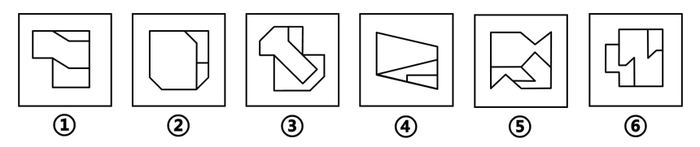

# 图形推理-对称性（最大面的轴对称与中心对称分组）

考点：[[20-考点/判断推理/图形推理/图形推理-对称性（最大面的轴对称与中心对称分组）|图形推理 / 图形推理-对称性（最大面的轴对称与中心对称分组）]]

**问法模型**：'六个图形分为两类，每类有各自共同特征'的分组分类问法 → 先找整体共性（面数量），共性无法分组时转向子对象（最大面）的对称性分类

## 推理链
1. 第1步：六个图形均为多边形被内部线条分割，优先数面数量，发现每个图形的面数量都是3，无法以此分成两类
2. 第2步：转换观察层级，所有图形均存在明显占主体的'最大面'，且最大面含等腰元素（如等腰三角形、平行对边），提示考查最大面的对称性
3. 第3步：逐一判断最大面对称性：图①②⑥的最大面为平行四边形类图形，仅中心对称、非轴对称；图③④⑤的最大面为等腰三角形类图形，仅轴对称、非中心对称
4. 第4步：按最大面对称类型分组：①②⑥一组（中心对称），③④⑤一组（轴对称），对照选项只有C符合

**最快解法**：⚡ 口诀'先数面、再看最大面找对称'：数面均为3排除面数量规律→锁定各图最大面→平行四边形只中心对称（①②⑥），等腰三角形只轴对称（③④⑤）→直接选C

## 易错点
- ⚠ 停留在'面数量都是3'的第一层规律上无法分组，忽略'最大面'这一二级观察对象
- ⚠ 混淆轴对称与中心对称：平行四边形（含斜放等腰元素）仅是中心对称，等腰三角形仅是轴对称，二者不可互换
- ⚠ 被非最大面的小面（如图④⑤中的小三角形）干扰，误判整体图形的对称类型

## 母题抽象
> 🧩 当分组分类题中各图面数量相同、且明显存在一个占主体的大面（尤其含等腰/平行元素）时，优先观察'最大面的对称性'（轴对称vs中心对称）进行二分

**同类特征**：多边形内部被线条分割、各图面数量相同、存在明显最大面、最大面含等腰元素、轴对称与中心对称对比、分组分类问法

## 相关题
- [[10-真题/判断推理/图形推理/10204457 面数量+最大面的对称性（中心对称与轴对称分组）|10204457]]（甘肃 2024，相关度1）
- [[10-真题/判断推理/图形推理/10297098 功能元素-黑点标记交点的发射线数|10297098]]（天津 2025，相关度1）
- [[10-真题/判断推理/图形推理/10297262 数量规律-面的形状种类（封闭面种类数分组）|10297262]]（浙江 2025，相关度1）
- [[10-真题/判断推理/图形推理/12019737 数量规律-相同元素的位置关系（相对-相邻）分组|12019737]]（浙江 2026，相关度1）
- [[10-真题/判断推理/图形推理/12536392 数量规律-黑色区域面积（宫格面积折算）|12536392]]（四川 2024，相关度1）

---

### 题干

把下面的六个图形分为两类，使每一类都有各自的共同特征或规律，分类正确的一项是：

### 选项
- A. ①②③，④⑤⑥
- B. ①②④，③⑤⑥
- C. ①②⑥，③④⑤　✅
- D. ①③⑥，②④⑤

### 官方解析
本题为分组分类题目。观察发现，多边形内部被线条分割，优先考虑面数量，但题干图形的面数量都是3，无法分组。继续观察发现，所有图形均明显存在最大面且最大面出现等腰元素，可优先考虑最大面的对称性，其中图①②⑥最大面均为中心对称图形，图③④⑤最大面均为轴对称图形，故图①②⑥一组，图③④⑤一组。
故正确答案为C。

### 给定材料
（无）
