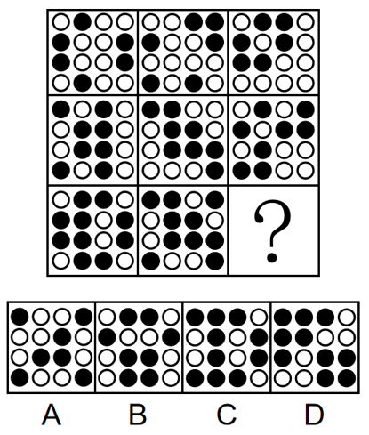
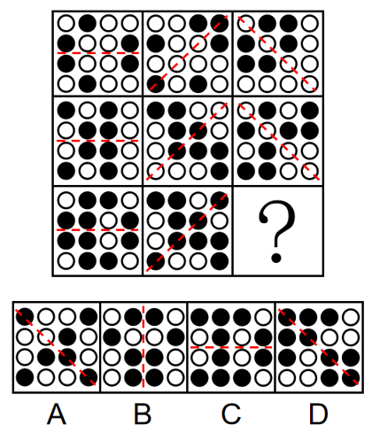

# 数量规律（黑球个数行内相同、行间递增）＋属性规律（整体轴对称且对称轴方向按列一致）

考点：[[20-考点/判断推理/图形推理/数量规律（黑球个数行内相同、行间递增）＋属性规律（整体轴对称且对称轴方向按列一致）|图形推理 / 数量规律（黑球个数行内相同、行间递增）＋属性规律（整体轴对称且对称轴方向按列一致）]]

**问法模型**：'九宫格＋元素组成不同，选择最合适的一个填入问号处'→先横行数黑球个数做排除，再叠加对称轴方向规律锁定唯一答案

## 推理链
1. 第1步：题干为九宫格，每个图形由4×4排列的小黑球和小白球构成，元素组成不同，优先考虑数量规律，且九宫格优先横着看
2. 第2步：逐行数黑球：第一行三个图形均含六个小黑球，第二行三个图形均含八个小黑球，第三行前两个图形均含十个小黑球，故问号处图形应含十个小黑球
3. 第3步：对照选项黑球数量，A、B两项黑球数不为十，排除A、B
4. 第4步：仅靠数量剩余两项，叠加属性规律：题干所有图形将小黑球和小白球作为整体观察，均构成轴对称图形且对称轴只有一条
5. 第5步：按列观察对称轴方向，发现同一列三个图形的对称轴方向相同，问号处（第三列）应延续该列图形的对称轴方向
6. 第6步：C项黑球数虽为十个但对称轴方向与第三列不一致，D项既含十个小黑球、对称轴方向又与第三列相同，故选D

**最快解法**：⚡ 数量排除法＋对称轴方向验证：横行数黑球6→8→10递增，快速排除A、B；再验'每列对称轴方向相同'，C项方向与第三列不符，直接锁定D

## 易错点
- ⚠ 只数黑球个数便匆忙作答，漏验对称轴方向这一二级规律（本题数量规律只能排除两项，不足以定答案）
- ⚠ 只盯黑球连线找对称，未把黑白小球作为整体图形看轴对称，或忽略'对称轴只有一条'的限定
- ⚠ 九宫格惯性只在横行找规律，忽略本题对称轴方向是'按列一致'的列规律

## 母题抽象
> 🧩 当九宫格黑白小球题中黑球数量呈'行内相同、行间递增'特征时，先按行数黑球排除部分选项，再叠加整体轴对称及其对称轴方向规律（按列一致）确定唯一答案

**同类特征**：九宫格、4×4黑白小球阵列、黑球数量行内相同、行间递增（6→8→10）、整体轴对称且对称轴唯一、对称轴方向按列相同、数量规律＋对称属性双规律叠加

## 相关题
- [[10-真题/判断推理/图形推理/10204610 样式规律-加减同异（去同存异），九宫格列规律|10204610]]（辽宁 2024，相关度1）
- [[10-真题/判断推理/图形推理/10297349 样式规律-黑白运算|10297349]]（浙江 2025，相关度1）
- [[10-真题/判断推理/图形推理/10297407 样式规律-黑白运算（定义叠加）|10297407]]（四川 2025，相关度1）
- [[10-真题/判断推理/图形推理/10975255 数量规律-元素个数与部分数（黑白球连通堆数）|10975255]]（江苏 2024，相关度1）
- [[10-真题/判断推理/图形推理/11367791 属性类-对称性（对称轴方向与条数、轴对称+中心对称）＋数量类-面数量（九宫格横行复合规律）|11367791]]（江苏 2025，相关度1）

---

### 题干

从所给四个选项中，选择最合适的一个填入问号处，使之呈现一定的规律性：

### 选项
- A. A
- B. B
- C. C
- D. D　✅

### 官方解析

元素组成不同，优先考虑数量规律。本题为九宫格题目，优先横着看，第一行每个图形均有六个小黑球，第二行每个图形均有八个小黑球，第三行前两个图形均有十个小黑球，那么问号处图形应有十个小黑球，排除A、B两项；继续观察发现，题干所有图形均由小黑球和小白球组成，整体均构成轴对称图形，且对称轴只有一条，观察对称轴方向可知，每列图形对称轴方向相同，只有D项符合。

故正确答案为D。

### 给定材料
（无）
