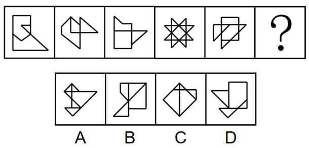

# 数量规律-笔画数（奇点数与一笔画）

考点：[[20-考点/判断推理/图形推理/数量规律-笔画数（奇点数与一笔画）|图形推理 / 数量规律-笔画数（奇点数与一笔画）]]

**问法模型**：一组图形顺推填问号处图形 → 元素组成不同且属性无规律时，线条相交/相切变形图优先考虑笔画数（一笔画）

## 推理链
1. 第1步：题干五幅图元素组成不同，对称性、封闭区域等属性规律不明显，排除属性角度
2. 第2步：观察图形结构，题干图形均为线条相切、相交的变形连通图（官方称'多圆相切变形图'），命中'变形图→笔画数'高频考点
3. 第3步：逐一数题干各图的奇点（从该点引出奇数条线的点，如端点、T字/十字交叉点）：各图奇点数均为0或2
4. 第4步：依据'奇点数为0或2的连通图可一笔画'，确认题干所有图形均可一笔画成，？处应填一笔画图形
5. 第5步：数选项奇点：A、B、C三项均含4个奇点，最少笔画数=4÷2=2笔，排除
6. 第6步：D项含2个奇点，为连通一笔画图形，与题干规律一致，故选D

**最快解法**：⚡ 一笔画口诀法：奇点数÷2=最少笔画数，奇点数为0或2即一笔画。快速扫描每幅图的端点与交叉点数奇点：题干全为0或2个奇点（一笔画），选项中A、B、C均为4个奇点（两笔画），直接锁定D

## 易错点
- ⚠ 误把相切/相交的变形图看成多个独立图形，误判为多笔画而放弃笔画数思路
- ⚠ 漏数隐蔽奇点：线条相切处、交叉处度数为奇数的点易被忽略，导致奇点数数错
- ⚠ 先入为主去数面数量或线段数，绕开'变形图优先考虑一笔画'的命题套路而浪费时间

## 母题抽象
> 🧩 当题干出现多线条相切/相交的连通变形图、且属性（对称/封闭/曲直）无统一规律时，优先数奇点验证一笔画：奇点数为0或2的一笔画入选，4个奇点为两笔画排除

**同类特征**：元素组成不同、无明显属性规律、多图形相切/相交变形、线条连通成整体、全部可一笔画、问号处求同规律

## 相关题
- [[10-真题/判断推理/图形推理/10204454 数量规律-部分数（黑白球连通区域数做和）|10204454]]（甘肃 2024，相关度2）
- [[10-真题/判断推理/图形推理/10297050 数量规律-特殊计数（线条穿过小白球的数量）|10297050]]（天津 2025，相关度2）
- [[10-真题/判断推理/图形推理/10297262 数量规律-面的形状种类（封闭面种类数分组）|10297262]]（浙江 2025，相关度2）
- [[10-真题/判断推理/图形推理/10297314 数量规律-交点数（曲直交点）|10297314]]（浙江 2025，相关度2）
- [[10-真题/判断推理/图形推理/11454020 数量规律-小元素按行排布（每行个数自上而下递增1）|11454020]]（选调 2024，相关度2）

---

### 题干

从所给的四个选项中，选择最合适的一个填入问号处，使之呈现一定的规律性（    ）。

### 选项
- A. A
- B. B
- C. C
- D. D　✅

### 官方解析
元素组成不同，且无明显属性规律，考虑数量规律。观察发现，题干已知图形均为多圆相切变形图，考虑笔画数。题干中所有图形均由一笔画成，故？处应为一笔画图形。A、B、C三项均有4个奇点，由两笔画成，D项有2个奇点，由一笔画成。
故正确答案为D。

### 给定材料
（无）
