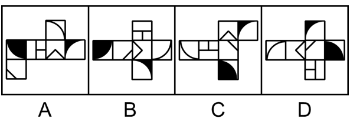

# 空间重构-六面体展开图折叠（画边法判定相邻面相对位置）

考点：[[20-考点/判断推理/图形推理/空间重构-六面体展开图折叠（画边法判定相邻面相对位置）|图形推理 / 空间重构-六面体展开图折叠（画边法判定相邻面相对位置）]]

**问法模型**：'哪一个折叠成的纸盒与其他三个不一样'→ 展开图找异型：因四图六个面完全相同，只能比较相邻面相对方位，用画边法以特征面为基准逐项比对，与众不同的即为答案

## 推理链
1. 第1步：四个展开图所含六个面完全相同（可统一标注为a—f），单看面本身无法区分，只能比较折叠后各面之间的相邻关系与相对方位
2. 第2步：选定含黑色扇形的面b作为基准面，以黑扇形圆心（面b顶点处）为起点，顺时针给面b的边依次编号1、2、3、4，四个选项采用完全相同的编号规则
3. 第3步：A项以面b黑扇形圆心为起点顺时针画边，边1邻面c、边2邻面f、边3邻面e
4. 第4步：B项同法画边，边1→c、边2→f、边3→e；C项同法画边，边1→c、边2→f、边3→e，与A项完全一致
5. 第5步：D项同法画边，边1→f、边2→e、边3→a，围绕面b的邻接面顺序（f、e、a）与前三项（c、f、e）不一致
6. 第6步：面组合相同而相对方位不同，只有D项折叠成的纸盒与其他三个不一样，本题选异（选非），故答案为D

**最快解法**：⚡ 画边法（描边法）：四个展开图统一以'含黑色扇形的面b'为基准面，从黑扇形圆心起顺时针给面b的四条边编号，逐一写出1、2、3号边所贴邻的面——A/B/C均为'c、f、e'，D为'f、e、a'，前三项一致、D项不同，秒选D

## 易错点
- ⚠ 四个展开图面图案彼此相同，基准面锁定失误（应为含黑色扇形的面b）或画边起点未统一到黑扇形圆心，导致编号方向混乱无法比较
- ⚠ 只核对'某两面是否相邻'而不核对'相邻在基准面的第几条边'，因A、B、C、D相邻面集合相近而误判为折叠结果相同
- ⚠ 本题是'找异型'（与其他三个不一样）而非常规的'折起后哪个正确/相同'，按惯性思维找相同项会做错方向

## 母题抽象
> 🧩 当六面体展开图各面图案相同或高度相似、问'哪一个折叠后与其他不一样'时，锁定带独特标记（如黑色扇形）的面作基准，从标记点出发统一顺时针画边编号，逐项列出各编号边邻接的面，与多数项不一致者即为答案

**同类特征**：四个正方体纸盒外表面展开图、各选项六个面完全相同（可用同一字母标注对应面）、存在黑色扇形等独特标记面可作基准、问法为'哪个与其他三个不一样'（找异/选非）、面组合一致、差异在相邻面的相对方位、画边法（描边法）典型适用题型

## 相关题
（暂无）

---

### 题干

下列选项为4个正方体纸盒的外表面展开图，其中哪一个折叠成的纸盒与其他三个不一样？

### 选项
- A. A
- B. B
- C. C
- D. D　✅

### 官方解析

将选项展开图标上序号，如下图所示（各选项面都相同，故相同的面用相同字母表示），逐一进行分析。

A项：以面b内黑色扇形的圆心为起点进行顺时针画边（如下图所示），边1对应面c，边2对应面f，边3对应面e；

B项：以面b内黑色扇形的圆心为起点进行顺时针画边（如下图所示），边1对应面c，边2对应面f，边3对应面e；

C项：以面b内黑色扇形的圆心为起点进行顺时针画边（如下图所示），边1对应面c，边2对应面f，边3对应面e；

D项：以面b内黑色扇形的圆心为起点进行顺时针画边（如下图所示），边1对应面f，边2对应面e，边3对应面a。

综上，只有D项与其他三项不同。

本题为选非题，故正确答案为D。

### 给定材料
（无）
