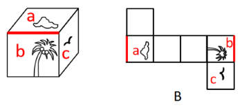

# 空间重构-六面体折叠（相邻面公共边与图案朝向比对）

考点：[[20-考点/判断推理/图形推理/空间重构-六面体折叠（相邻面公共边与图案朝向比对）|图形推理 / 空间重构-六面体折叠（相邻面公共边与图案朝向比对）]]

**问法模型**：问法为'不能折叠成左框所示纸盒的是'（选非题）→ 采用公共边法，逐一验证展开图折叠后相邻面图案位置及朝向与立体图是否一致

## 推理链
1. 第1步：立体图给出三个两两相邻的特征面——顶面云朵（面a）、正面椰子树（面b）、右侧面小鸟（面c）
2. 第2步：规则为展开图折叠后，相邻面的公共边位置及图案与公共边的相对朝向必须与立体图完全一致
3. 第3步：锁定特征最鲜明的一对相邻面'云朵面+椰子树面'：立体图中面a与面b的公共边靠近面a中云朵的底部
4. 第4步：B项展开图中云朵面与椰子树面（椰叶）折叠后相邻，但公共边靠近面a中云朵的顶部，图案朝向上下颠倒，与立体图不符
5. 第5步：逐项对照，A、C、D项折叠后三个特征面的相邻关系及图案朝向均与立体图一致
6. 第6步：本题为选非题，要求选出'不能折叠成'的一项，故锁定B

**最快解法**：⚡ 公共边法（特征点定位）：只盯'云朵+椰子树'这对相邻面，看公共边贴云朵的'底部'还是'顶部'——立体图贴底、B项贴顶，直接锁定B，无需逐一折叠

## 易错点
- ⚠ 只核对图案种类是否齐全，忽略图案在面内的旋转朝向（云朵上下颠倒）
- ⚠ 云朵外形圆润、方向感弱，需借助其与公共边或与椰叶面的相对位置判断上下，不能凭直觉认为云朵可任意旋转
- ⚠ 官方备注C项作图不严谨（云朵细节与立体图有差别），考生在B、C之间反复纠结浪费时间

## 母题抽象
> 🧩 当六面体折叠题中立体图与展开图都出现'带朝向图案的相邻面'时，用公共边法，验证图案特征点（如云朵底/顶、树冠/树根）与公共边的相对位置是否与立体图一致

**同类特征**：六面体展开图折叠、选非题（选不能折叠的）、三个特征面两两相邻（云朵/椰子树/小鸟）、图案朝向与公共边相对位置、公共边法/相邻面位置关系

## 相关题
- [[10-真题/判断推理/图形推理/12019707 空间折叠（六面体折纸盒）——相对面排除＋公共边画边法-公共点引线法|12019707]]（广东 2026，相关度1）
- [[10-真题/判断推理/图形推理/18899566 空间重构-折纸盒（相对面排除+无中生有面排除）|18899566]]（上海 2021，相关度1）
- [[10-真题/判断推理/图形推理/2043634 空间重构-六面体折叠（相对面排除＋时针法＋公共点法）|2043634]]（江苏 2017，相关度1）
- [[10-真题/判断推理/图形推理/2452620 空间重构-六面体折叠（相对面排除+相邻面公共边-公共点验证）|2452620]]（江苏 2020，相关度1）
- [[10-真题/判断推理/图形推理/2742184 空间重构-六面体折叠（相对面排除+公共点引线验证）|2742184]]（江苏 2021，相关度1）

---

### 题干

下图右框内纸盒的外表面中，不能折叠成左框内所示的纸盒的是：

### 选项
- A. A
- B. B　✅
- C. C
- D. D

### 官方解析

本题考查六面体的空间重构。将题干立体图中的面依次标注为面a、面b、面c，如下图所示。

A项：选项与题干立体图一致，排除；

B项：题干立体图中面a与面b的公共边靠近面a中云朵的底部，而选项中面a与面b的公共边靠近面a中云朵的顶部，选项与题干立体图不一致，当选；

C项：选项与题干立体图一致，排除；

D项：选项与题干立体图一致，排除。

本题为选非题，故正确答案为B。

备注：本题作图不严谨，C项中面b与面a的公共边所对应的图形与题干立体图有差别，云朵的细节与立体图形不同，但对比B、C两项，B项错误更加明显，因此小粉笔建议选择B项。

### 给定材料
（无）

> [!warning] 疑点（官方解析可能有误，待人工复核）
> 官方解析备注自认C项作图不严谨——C中面b与面a公共边对应的云朵细节与立体图存在差别，即B、C两项均有瑕疵，仅因'B项错误更加明显'而定为B，题目作图严谨性存疑；但按官方结论答案仍取B
