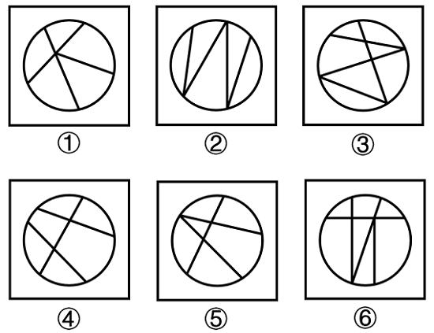

# 数量规律-面的细化（面的边界构成：是否存在全直线围成的面）

考点：[[20-考点/判断推理/图形推理/数量规律-面的细化（面的边界构成：是否存在全直线围成的面）|图形推理 / 数量规律-面的细化（面的边界构成：是否存在全直线围成的面）]]

**问法模型**：六个图形分为两类使每类有共同特征 → 分组分类题，先属性后数量，数面无规律时进一步做面的细化观察

## 推理链
1. 第1步：题干六图均为圆形外框被内部直线分割成若干封闭面，元素组成不同且无明显对称等属性规律，进入数量规律分析
2. 第2步：整体数各图面数量无一致规律，按'封闭图形被分割'的细化思路，转而观察每个面的边界由什么线构成
3. 第3步：逐图检查：图①中各封闭面均由圆弧（曲线）与直线段共同围成，图②同理，每个面都含圆弧边
4. 第4步：图④中所有面同样均含曲线边；而图③中出现了不接触圆弧、完全由直线段围成的封闭面
5. 第5步：图⑤、⑥中同样存在全由直线围成的面（内部不贴圆弧的小封闭区域）
6. 第6步：据此分组：①②④为'所有面均由曲线+直线围成'，③⑤⑥为'存在全直线围成的面'，与选项B吻合

**最快解法**：⚡ 面的细化口诀法：圆被直线分割、数面无规律时，检查'每个面是否都贴弧'——①②④每个面都含圆弧边，③⑤⑥存在不贴弧的全直线面，直接锁定B

## 易错点
- ⚠ 只停在整体数面数量，发现无规律后乱数线段数、交点数，未想到面的细化考法
- ⚠ 忽略③⑤⑥中不与圆弧接触的小封闭区域，误以为六图所有面都由曲直共同围成而无法分组
- ⚠ 把'全直线围成的面'误判为'面内含直线'，混淆面的边界构成与面内元素

## 母题抽象
> 🧩 当题干出现'圆形（或弧形外框）被内部直线分割且数面无规律'时，用'面的细化—判定是否存在全由直线围成（不贴外框弧）的面'来分组

**同类特征**：圆形外框被直线分割、封闭图形被分割成多个面、整体数面无规律、面的边界由曲线与直线构成、存在不接触外框弧的封闭面、分组分类问法

## 相关题
- [[10-真题/判断推理/图形推理/10297098 功能元素-黑点标记交点的发射线数|10297098]]（天津 2025，相关度1）
- [[10-真题/判断推理/图形推理/10297262 数量规律-面的形状种类（封闭面种类数分组）|10297262]]（浙江 2025，相关度1）
- [[10-真题/判断推理/图形推理/12019737 数量规律-相同元素的位置关系（相对-相邻）分组|12019737]]（浙江 2026，相关度1）
- [[10-真题/判断推理/图形推理/12536392 数量规律-黑色区域面积（宫格面积折算）|12536392]]（四川 2024，相关度1）
- [[10-真题/判断推理/图形推理/12882156 图形推理-对称性（仅轴对称 vs 既轴对称又中心对称）|12882156]]（黑龙江 2025，相关度1）

---

### 题干

把下面的六个图形分为两类，使每一类图形都有各自的共同特征或规律，分类正确的一项是：

### 选项
- A. ①②③，④⑤⑥
- B. ①②④，③⑤⑥　✅
- C. ①③④，②⑤⑥
- D. ①③⑥，②④⑤

### 官方解析
本题为分组分类题目。元素组成不同，且无明显属性规律，考虑数量规律。观察发现，题干均为封闭图形被分割，考虑面数量，但整体数面无规律，考虑面的细化。进一步观察发现，图①②④的封闭面均由曲线和直线围成，图③⑤⑥的封闭面除由曲线和直线围成外，还存在全由直线围成的面。即①②④一组，③⑤⑥一组。
故正确答案为B。

### 给定材料
（无）
