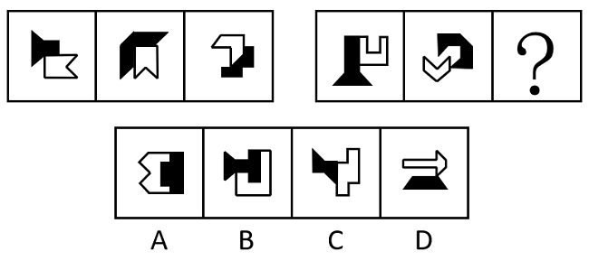
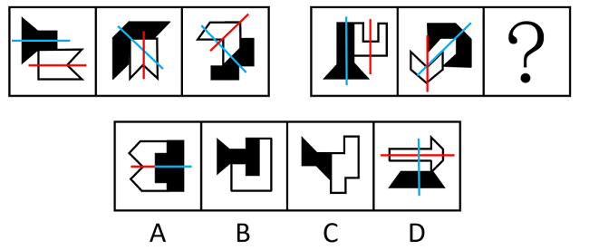

# 属性规律-对称性（双图形两条对称轴的位置关系：平行-相交-垂直）

考点：[[20-考点/判断推理/图形推理/属性规律-对称性（双图形两条对称轴的位置关系：平行-相交-垂直）|图形推理 / 属性规律-对称性（双图形两条对称轴的位置关系：平行/相交/垂直）]]

**问法模型**：两组图（3+3）填问号、元素组成不同且每幅图含箭头/等腰元素→将每图拆成两个单对称轴子图形分别画对称轴，考查两轴位置关系的序列规律

## 推理链
1. 第1步：题干两组图共6幅，元素组成不同，优先考虑属性规律；每幅图均由两个子图形拼合而成（箭头、等腰梯形、U形等等腰元素），每个子图形各自只有1条对称轴
2. 第2步：采用的方法是分别画出每幅图中两个子图形的对称轴，再比较这两条对称轴的位置关系
3. 第3步：第一组验证规律——图1两个子图形的对称轴平行，图2两轴相交，图3两轴垂直，呈'平行→相交→垂直'的递进序列
4. 第4步：第二组套用同一规律——图1（等腰梯形+U形）两轴平行，图2（黑色箭头+带缺口白色箭头）两轴相交，故？处图形两轴应为垂直
5. 第5步：逐项对照选项——A、B、C中两个子图形的对称轴方向相同或平行，均不构成垂直关系
6. 第6步：D项白色箭头对称轴为水平方向、黑色等腰梯形（等腰元素）对称轴为竖直方向，一横一竖两轴垂直，符合规律，锁定D

**最快解法**：⚡ 双图对称轴法：每幅图拆成两个单对称轴子图形并画出各自对称轴，标出两轴夹角；第一组规律为'平行→相交→垂直'，第二组问号处直接选两轴一横一竖互相垂直的选项，秒杀D

## 易错点
- ⚠ 只看整体图形是否轴对称，忽略'每幅图由两个单对称轴图形组成'这一结构，需拆开分别画轴而非看整图
- ⚠ 将'相交'与'垂直'混为一谈——垂直是相交的特例，必须细分夹角是否为90°
- ⚠ 忽略两组图各自独立呈现'平行→相交→垂直'的完整序列，误用第一组图形与第二组做形状相似性类比

## 母题抽象
> 🧩 当两组图中每幅图都由两个各自轴对称的子图形拼合而成时，分别画出两条对称轴，验证其位置关系是否呈'平行→相交→垂直'等序列规律，据此锁定问号处选项

**同类特征**：两组式图形（3+3）问号处填图、元素组成不同优先属性规律、每幅图由两个单对称轴图形拼合、出现箭头及等腰元素（等腰梯形、U形）、考查两条对称轴的位置关系、平行/相交/垂直递进序列

## 相关题
- [[10-真题/判断推理/图形推理/12561860 数量规律-面数量与属性规律-对称轴数量的复合对应规律|12561860]]（浙江 2024，相关度1）
- [[10-真题/判断推理/图形推理/19452426 属性规律-对称性（仅中心对称与轴+中心对称的区分）|19452426]]（上海 2026，相关度1）
- [[10-真题/判断推理/图形推理/2028342 属性规律（曲直性上下交替）＋数量规律（面数量）|2028342]]（国考 2017，相关度1）
- [[10-真题/判断推理/图形推理/2387635 对称性-对称轴与图形内部线条的位置关系（重合-不重合交替）|2387635]]（浙江 2019，相关度1）
- [[10-真题/判断推理/图形推理/2395209 属性规律-对称性（对称轴顺时针旋转45°）+内部小元素种类数二次验证|2395209]]（上海 2018，相关度1）

---

### 题干

从所给的四个选项中，选择最合适的一个填入问号处，使之呈现一定的规律性：

### 选项
- A. A
- B. B
- C. C
- D. D　✅

### 官方解析

元素组成不同，优先考虑属性规律。观察发现，题干图形出现箭头及多个等腰元素图形，考虑对称性。题干每幅图形都由两个单对称轴图形组成，因此分别画出每个图形的对称轴。第一组图形中，图1的两条对称轴平行，图2的两条对称轴相交，图3的两条对称轴垂直。第二组图形应遵循此规律，故？处图形应两条对称轴垂直，只有D项符合。

故正确答案为D。

### 给定材料
（无）
