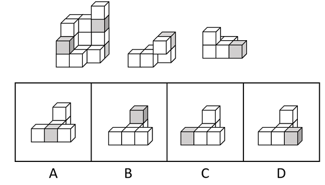
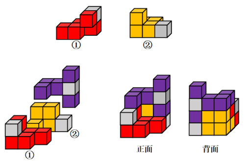

# 立体拼合（多块拼合-颜色块位置对应）

考点：[[20-考点/判断推理/图形推理/立体拼合（多块拼合-颜色块位置对应）|图形推理 / 立体拼合（多块拼合-颜色块位置对应）]]

**问法模型**：整体多面体＝2个给定小多面体＋所求项 → 先核对总块数与灰色块数量，再将选项旋转嵌入剩余空腔，用灰色块位置逐项排除

## 推理链
1. 第1步：数量核对——题干整体由15个白色＋3个灰色共18个正方体堆叠而成，四个选项图形均为5块小多面体，故①、②两小块应合计13块，与图中所示块数相符
2. 第2步：颜色数量核对——①、②中各含1个灰色正方体，整体共3个灰色，故所求多面体必含且仅含1个灰色块；A、B、C、D均含1灰，外形也完全相同，唯一区分点是灰块的位置
3. 第3步：轮廓拼合——将①、②按凹凸相嵌放入大立体后，剩余空腔呈'底层一字3块、一端向上再叠2块'的L形5块结构，与四个选项外形一致，故外形无法排除，须靠灰块位置定答案
4. 第4步：旋转嵌入验证——所求块需整体旋转后嵌入空腔，灰块作为刚体一部分随之转动，最终必须与整体中剩余那个灰色正方体的实际位置重合
5. 第5步：逐项对照——A灰块位于底层中间，旋转嵌入后恰与整体剩余灰位重合；B灰块位于顶部、C灰块位于底层左端、D灰块位于底层右端，旋转后均与整体灰位错位
6. 第6步：结论——只有A同时满足轮廓互补与灰块位置对应，故选A

**最快解法**：⚡ 三查法（数块数→数颜色→旋转定灰位）：四选项外形全同，直接锁定灰块；①②各含1灰、整体3灰，所求必含1灰；将A旋转嵌入缺口，其底层中间灰块与整体剩余灰位重合，B（顶部）、C（左端）、D（右端）旋转后灰位均对不上，秒选A

## 易错点
- ⚠ 只对轮廓不对颜色：四个选项外形完全相同，仅灰色块位置不同，忽略颜色对应必出错
- ⚠ 旋转时未跟踪灰块相对位置：各选项灰块在L形件上的附着点不同，须随刚体整体旋转逐项验证
- ⚠ 误认为灰块位置可任意摆放，忽视拼合后各灰色正方体必须与整体中灰色位置一一对应

## 母题抽象
> 🧩 当立体拼合题中各选项外形相同、仅某种颜色小方块位置不同时，先用整体与已知件核对颜色数量确定所求件颜色构成，再将选项随整体旋转嵌入，看颜色块能否与整体同色位置重合来定答案

**同类特征**：立体拼合、15白3灰共18个正方体、两个给定小多面体＋所求项、选项外形相同仅灰色块位置不同、需旋转后凹凸互补嵌入、颜色块位置一一对应验证

## 相关题
- [[10-真题/判断推理/图形推理/2776149 图形推理-立体拼合（小方块计数守恒+分层形状咬合）|2776149]]（浙江 2021，相关度1）
- [[10-真题/判断推理/图形推理/10204640 立体拼合（多面体组合：数量守恒+凹凸互补+旋转）|10204640]]（河南 2024，相关度1）
- [[10-真题/判断推理/图形推理/12019797 立体拼合-由两视图及全等小块反推小立体（数小立方体+旋转试装）|12019797]]（浙江 2026，相关度1）
- [[10-真题/判断推理/图形推理/12536475 图形推理-立体拼合（正方体堆叠多面体组合）|12536475]]（四川 2024，相关度1）
- [[10-真题/判断推理/图形推理/12881949 立体拼合-多块拼合正方体（凹凸互补+旋转）|12881949]]（广东 2025，相关度1）

---

### 题干

下图最左边的多面体由15个等大的白色正方体和3个等大的灰色正方体堆叠而成，其可以由右边2个小多面体和另一多面体组合而成，该多面体是：

### 选项
- A. A　✅
- B. B
- C. C
- D. D

### 官方解析

本题考查立体拼合。如下图所示，立体图可以由①、②以及A项拼合而成。

故正确答案为A。

### 给定材料
（无）
