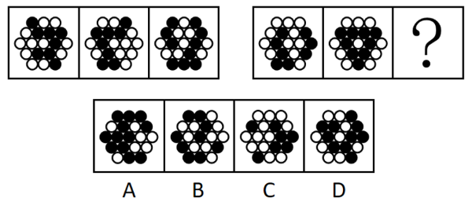

# 样式规律-黑白叠加运算（同色得白、异色得黑，即异或）

考点：[[20-考点/判断推理/图形推理/样式规律-黑白叠加运算（同色得白、异色得黑，即异或）|图形推理 / 样式规律-黑白叠加运算（同色得白、异色得黑，即异或）]]

**问法模型**：两组各三幅图、问号处填最合适图形 → 图形轮廓和分割区域相同时，优先做'逐位黑白叠加运算'模型

## 推理链
1. 第1步：题干两组图形均为同一'花瓣状'轮廓内相同排布的小圆，且黑块数量不成规律，排除数量规律
2. 第2步：轮廓和分割区域完全相同 → 采用样式规律中的黑白运算，逐位对比第一组图1与图2对应位置的颜色叠加结果
3. 第3步：归纳第一组运算规律：同色叠加得白（黑+黑=白，白+白=白），异色叠加得黑（黑+白=黑，白+黑=黑）
4. 第4步：将'同色得白、异色得黑'规则逐位套用到第二组图1与图2，推算问号处各位置的颜色分布
5. 第5步：逐项比对选项，A、B、D均存在与运算结果不符的位置，仅C项与推算图形完全一致

**最快解法**：⚡ 黑白运算口诀法：记住'同色得白、异色得黑'（异或），对第二组前两图选几个特征位置快速叠加，先排除明显不符的选项，再整体比对锁定C

## 易错点
- ⚠ 只数黑块个数找数量规律，忽略'轮廓和分割区域相同'提示的黑白运算
- ⚠ 运算规则记反（误用同色得黑、异色得白），导致误选A或D
- ⚠ 两组图形放在一起时误用第一组黑块位置套第二组，未逐位独立运算

## 母题抽象
> 🧩 当两组图形轮廓与分割区域完全相同、但黑白分布不成数量或位置规律时，用逐位黑白叠加（同色变白、异色变黑的异或规则）推出第三幅图，再与选项逐一比对

**同类特征**：两组各三图的类比型命题、轮廓和分割区域完全相同、黑白小圆混合分布、黑块数量不成规律、需逐位叠加运算、同色得白、异色得黑

## 相关题
- [[10-真题/判断推理/图形推理/13504585 图形推理-样式规律-黑白运算（定义叠加）|13504585]]（辽宁 2025，相关度2）
- [[10-真题/判断推理/图形推理/10297407 样式规律-黑白运算（定义叠加）|10297407]]（四川 2025，相关度1）
- [[10-真题/判断推理/图形推理/5430354 样式规律-黑白运算（定义叠加）|5430354]]（浙江 2023，相关度1）

---

### 题干

从所给的四个选项中，选择最合适的一个填入问号处，使之呈现一定的规律性：

### 选项
- A. A
- B. B
- C. C　✅
- D. D

### 官方解析
元素组成相似，优先考虑样式规律。观察发现，题干图形轮廓和分割区域相同，但黑块数量不成规律，考虑黑白运算。第一组图形的运算规律为：黑+黑=白，白+白＝白，黑+白＝黑，白+黑＝黑，第二组图形运用此规律，只有C项符合。
故正确答案为C。

### 给定材料
（无）
