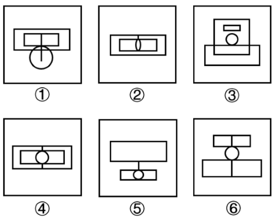

# 数量规律-笔画数（一笔画与多笔画，奇点计数）

考点：[[20-考点/判断推理/图形推理/数量规律-笔画数（一笔画与多笔画，奇点计数）|图形推理 / 数量规律-笔画数（一笔画与多笔画，奇点计数）]]

**问法模型**：六个图形分为两类使每类有共同规律→分组分类题：元素组成不同且属性规律不明显时转向数量规律，出现'日'字变形、圆相切等特征结构优先测笔画数

## 推理链
1. 第1步：六个图形均由矩形、圆和竖线组合而成，元素组成不同，对称性、开闭性、曲直性等属性规律无法统一分组，转向数量规律
2. 第2步：观察特征结构，题干多处出现'日'字变形图（矩形被竖线分割，如①⑥中带竖线的矩形）及圆与直线相切的结构，这是'笔画数'考点的典型提示
3. 第3步：用奇点法判定：数每个图形中度为奇数的点（丁字路口T形交点、悬空线段端点为奇点；十字交叉点、切点均为偶点）
4. 第4步：图①②⑤的奇点数为0或2且图形连通，均符合一笔画判定
5. 第5步：图③④⑥的奇点数为4，最少笔画数=奇点数÷2=2，均为两笔画图形
6. 第6步：①②⑤为一笔画一组，③④⑥为两笔画一组，与选项A完全对应

**最快解法**：⚡ 口诀法：看到'日'字变形+圆相切→直接数奇点定笔画；奇点数0或2为一笔画，4为两笔画（两笔画=奇点数÷2）；快速判定①②⑤一笔画、③④⑥两笔画，锁A

## 易错点
- ⚠ 把圆的切点、十字交叉点误判为奇点（切点与四线交汇点均为偶点）
- ⚠ 漏数线条悬空的端点（端点度数为1，也是奇点）
- ⚠ 未先确认图形连通性就套用一笔画结论（连通是前提）

## 母题抽象
> 🧩 当分组分类题元素组成不同、且出现'日'字变形、圆与直线相切、带端点竖线等特征时，用奇点计数法定笔画数：0或2个奇点的归一笔画组，4个奇点的归两笔画组

**同类特征**：日字变形图、圆与直线相切、竖线贯穿矩形/圆、元素组成不同、无明显属性规律、分组分类题

## 相关题
- [[10-真题/判断推理/图形推理/5893637 数量规律-笔画数（一笔画与多笔画，奇点计数）|5893637]]（国考 2024，相关度4）
- [[10-真题/判断推理/图形推理/2133620 图形推理-数量规律（一笔画-奇点数）|2133620]]（国考 2018，相关度3）
- [[10-真题/判断推理/图形推理/2434274 数量规律-一笔画（笔画数-奇点数）|2434274]]（新疆 2019，相关度3）
- [[10-真题/判断推理/图形推理/2725321 数量规律-角的计数（直角个数）|2725321]]（四川 2020，相关度3）
- [[10-真题/判断推理/图形推理/5509801 数量规律-笔画数（一笔画与多笔画，奇点计数）|5509801]]（甘肃 2023，相关度3）

---

### 题干

把下面六个图形分为两类，使每一类图形都有各自的共同特征或规律，分类正确的一项是：

### 选项
- A. ①②⑤，③④⑥　✅
- B. ①③⑤，②④⑥
- C. ①②③，④⑤⑥
- D. ①④⑤，②③⑥

### 官方解析
本题为分组分类题目。元素组成不同，且无明显属性规律，考虑数量规律。观察发现，题干图形出现了“日”字变形图和圆相切，考虑笔画数。图①②⑤为一笔画图形，图③④⑥为两笔画图形。即图①②⑤为一组，图③④⑥为一组。
故正确答案为A。

### 给定材料
（无）
