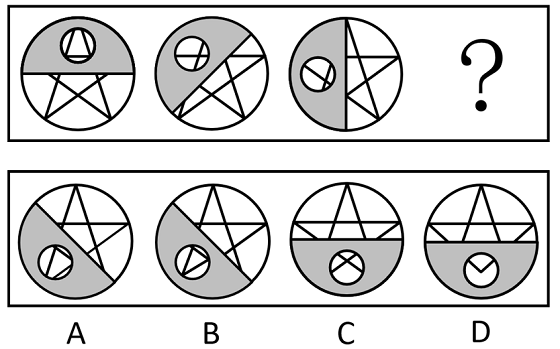

# 图形推理-位置规律（旋转）

考点：[[20-考点/判断推理/图形推理/图形推理-位置规律（旋转）|图形推理 / 图形推理-位置规律（旋转）]]

**问法模型**：'符合所给图形的变化规律'→双层叠加图形先分层：不变层固定为底图，变化层找旋转规律，再用透视图做二级辨析逐项排除

## 推理链
1. 第1步：题干三幅图元素组成相同，均由上下两层叠加构成：下层为圆内切一个五角星（三幅图完全一致），上层为灰色半圆挖掉一个空心小圆（位置变化）
2. 第2步：元素组成相同，优先考虑位置规律；跟踪上层灰色半圆：图1位于正上（直径边水平），图2逆时针转到左上（直径边斜置），图3转到正左（直径边竖直），即每次逆时针旋转45°，且挖掉的小圆随半圆同步旋转
3. 第3步：按此规律，？处灰色半圆（含挖孔）应继续逆时针旋转至左下位置、直径边斜置，C、D两项半圆位于正下方，位置不符，排除C、D
4. 第4步：二级辨析A、B：上层小圆是被挖掉的透明孔，可透过它看到下层五角星的部分线条；关键约束是'五角星内切于大圆'，即星角尖端均落在最外圈圆周上，而挖孔位于灰色区域内部、不接触圆周
5. 第5步：因此透过小圆不可能看到五角星的'整个角'；B项小圆内呈现完整的星角（角尖完整落在孔内），与内切关系矛盾，排除B
6. 第6步：A项小圆内只透见星角附近的局部线条，符合内切约束与旋转规律，故选A

**最快解法**：⚡ 位置跟踪法+几何约束排除：先只看上层灰色半圆，正上→左上→正左（每次逆时针45°），锁定？处'左下'秒排C、D；再比较A、B的挖孔透视图，B透见完整星角，违背'星角尖在内切圆周上、挖孔达不到圆周'的约束，排除B选A

## 易错点
- ⚠ 用半圆旋转排除C、D后就仓促作答，忽略A、B的二级辨析（透过挖孔看到的内容不同），易误选B
- ⚠ 忽视'五角星内切于大圆'的几何约束：星角尖端在圆周上、挖孔在内部，透视图不可能出现完整星角
- ⚠ 旋转方向看反（把逆时针看成顺时针）或把每步45°看成90°，导致？处半圆位置判断错误

## 母题抽象
> 🧩 当图形由'不变底层+变化上层'双层叠加且元素组成相同时，先盯变化层找旋转方向与角度定位置排除，再借下层图形的几何约束（内切/相切关系）对透视图内容做二级辨析

**同类特征**：上下两层叠加图形、下层圆内切五角星保持不变、上层灰色半圆挖掉空心小圆、半圆依次逆时针旋转45°、挖孔相当于透视窗可透见下层、问？处图形

## 相关题
- [[10-真题/判断推理/图形推理/2262999 图形推理-位置规律（旋转）|2262999]]（四川 2016，相关度2）
- [[10-真题/判断推理/图形推理/5509866 图形推理-位置规律（旋转）|5509866]]（内蒙古 2023，相关度2）
- [[10-真题/判断推理/图形推理/19452425 位置规律（上下翻转+分行平移复合变化）|19452425]]（上海 2026，相关度1）

---

### 题干

下列选项中，符合所给图形的变化规律的是<u>        </u>。

### 选项
- A. A　✅
- B. B
- C. C
- D. D

### 官方解析

元素组成相同，优先考虑位置规律。观察发现，题干图形均由上下叠加的两层组成，下层是一个圆内切一个五角星，上层是一个灰色半圆挖掉一个空心小圆，下层图形不发生变化，上层的图形依次逆时针旋转，？处图形上层的挖掉小圆的灰色半圆应在左下角位置，排除C、D两项，对比A、B两项，观察发现，由于下层的五角星内切于大圆，故透过上层被挖掉的小圆不可能看到五角星的整个角，排除B项，只有A项符合规律。

故正确答案为A。

### 给定材料
（无）
