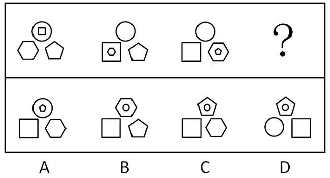

# 位置规律-外框轮换与内圈小图形接力嵌套

考点：[[20-考点/判断推理/图形推理/位置规律-外框轮换与内圈小图形接力嵌套|图形推理 / 位置规律-外框轮换与内圈小图形接力嵌套]]

**问法模型**：问'符合所给图形变化规律的一项'→ 相邻两图逐步对比，归纳'外框变化+内圈嵌套'的位置规律，再用排除法锁定选项

## 推理链
1. 第1步：题干三图与选项均为'上、左下、右下'三个固定位置的外框图形（部分外框内含小图形），元素组成基本相同→优先考虑位置规律
2. 第2步：对比图1与图2：左下角外框由六边形变为正方形，且原外框六边形变为同位置正方形的内圈；顶部圆、右下五边形外框不变
3. 第3步：对比图2与图3：右下角外框由五边形变为六边形，且原外框五边形变为同位置六边形的内圈；验证规律'每步仅一个位置外框变化，旧外框降为同位置内圈'
4. 第4步：补充观察内圈接力：图1顶部圆内的小正方形、图2左下正方形内的小六边形在下一幅中消失，对应'内圈小图形外移成为下一位置（上→左下→右下→上循环）的外框'
5. 第5步：据此推图3→？：图3右下角六边形内的小五边形应外移到顶部成为外框，顶部原圆形降为五边形内圈；左下正方形、右下六边形外框保持不变
6. 第6步：逐项对照：A项三处外框全未变且五边形由右下移到顶部内圈（违反'相同位置'规则）；B项顶部外框变六边形且右下再现五边形；D项左下、右下外框互换位置；C项仅顶部外框圆→五边形且旧圆降为内圈，完全符合

**最快解法**：⚡ 排除法+外框变化计数：与图3相比只允许一个位置外框变化——A三处外框全未变；B顶部变六边形且右下多出五边形；D除顶部外左下、右下外框也变（圆、方互换）；只有C仅顶部外框由圆变五边形且旧圆降为内圈，秒选C

## 易错点
- ⚠ 只盯外框不看内圈：忽略图1顶内小正方形、图2左下内小六边形在下一幅中的'外移接力'，规律链断裂而误选A
- ⚠ 忽略'相同位置'限制：A项中五边形确实进了内圈，但它是从右下位置移到顶部，不满足'变到下一个相同位置图形的内部'，A为最大干扰项
- ⚠ D项顶部规律与C完全相同，若不逐位置核对左下、右下外框（正方形/六边形是否在原位）易误选D

## 母题抽象
> 🧩 当题干图形呈'多个固定位置的外框+内圈小图形'且元素组成基本相同时，逐步对比相邻两图，归纳'每步仅一处外框变化、旧外框降为同位置内圈、内圈小图形按固定顺序外移接力'的循环规律，再用排除法对照选项

**同类特征**：元素组成基本相同、三个位置外框+内圈嵌套、相邻图逐步对比、每步仅一处外框变化、旧外框降为同位置内圈、内圈小图形接力外移

## 相关题
- [[10-真题/判断推理/图形推理/11226890 位置规律（端点沿外框顺时针移动+交点沿内部路径逆时针移动的双轨迹平移）|11226890]]（上海 2025，相关度1）
- [[10-真题/判断推理/图形推理/11226914 图形推理-位置规律（交点沿轨迹移动：定点+动点分轨追踪）|11226914]]（上海 2025，相关度1）
- [[10-真题/判断推理/图形推理/13432277 位置规律（旋转）+数量规律（端点加线递增）复合考点|13432277]]（深圳市考 2025，相关度1）
- [[10-真题/判断推理/图形推理/15419024 位置规律-相邻比较（黑白三角形拼接图中相邻两图相同黑块数恒定）|15419024]]（湖北 2025，相关度1）
- [[10-真题/判断推理/图形推理/16095253 功能元素-小白圆标记线条的序号规律|16095253]]（江苏 2024，相关度1）

---

### 题干

下列选项中，符合所给图形的变化规律的是<u>        </u>。

### 选项
- A. A
- B. B
- C. C　✅
- D. D

### 官方解析
元素组成基本相同，优先考虑位置规律。观察发现，图1和图2相比，图1左下角的六边形到了图2变到了相同位置图形的内部；图2和图3相比，图2右下角的五边形到了图3变成了相同位置图形的内部，故前一幅图形与后一幅图形相比，某个图形要变到下一个相同位置图形的内部，排除A项。继续观察发现，图1和图2相比，只有左下角图形的外框发生变化，图2和图3相比，只有右下角图形的外框发生了变化，？处与前一幅图形相比只有一个位置图形的外框发生了变化，只有C项符合。
故正确答案为C。

### 给定材料
（无）

> [!warning] 疑点（官方解析可能有误，待人工复核）
> 官方解析称图1与图2相比'只有左下角图形的外框发生变化'，但未解释图1顶部圆内小正方形（及图2左下正方形内小六边形）在下一幅中的去向；补充'前一幅内圈小图形外移成为下一位置（上→左下→右下→上循环）外框'的接力规律可完全解释全部变化，且不改变答案C的正确性
