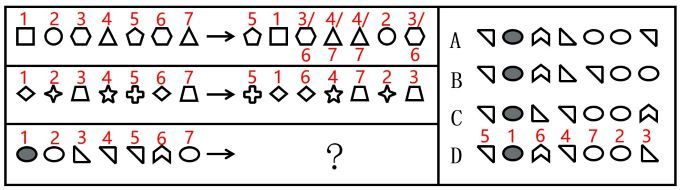

# 位置规律（小元素位置重排-交错换位）

考点：[[20-考点/判断推理/图形推理/位置规律（小元素位置重排-交错换位）|图形推理 / 位置规律（小元素位置重排/交错换位）]]

**问法模型**：问'符合所给图形的变化规律'→ 给每行左侧小元素标号，建立左→右的位置映射规律，再套用到问号行并排除选项

## 推理链
1. 第1步：三行图形的7个小元素左右两排完全相同、仅排列顺序不同（如第一行□○⬡△⬠⬡△变⬠□⬡△△○⬡），元素组成相同，优先考虑位置规律而非样式规律
2. 第2步：给第一行左侧元素依次标号1~7（□=1、○=2、⬡=3、△=4、⬠=5、⬡=6、△=7），右侧可辨认为5、1、?、?、?、2、?——因⬡、△各出现两次，标号存在歧义
3. 第3步：用第二行消歧：左侧1=◇、2=✦、3=⏢、4=☆、5=✚、6=◇、7=⏢，右侧为✚◇◇☆⏢✦⏢，逐一对应得5、1、6、4、7、2、3
4. 第4步：归纳规律：右排第k位取左排第[5,1,6,4,7,2,3]号元素，即后半段(5,6,7)与前半段(1,2,3,4)交错洗牌式换位；回代第一行（⬠□⬡△△○⬡）验证成立
5. 第5步：套用到第三行（1=●、2=○、3=△、4=▽、5=▽、6=⌒、7=○），右排应为▽、●、⌒、▽、○、○、△
6. 第6步：逐项对照关键位置：第2位必须是●、第3位必须是⌒、第5第6位为○○、第7位与左排第3位同形
7. 第7步：A、B、C在第1位、第3位⌒或○○及末位排布上不符，只有D项完全满足[5,1,6,4,7,2,3]的重排，故选D

**最快解法**：⚡ 标号+两端定位排除法：给左排元素标号，先用第二行锁定'右排=左排第5,1,6,4,7,2,3号'的换位规律；第三行只核对三个锚点——第1位=左5(▽)、第2位=●、第3位=⌒、末位=左3，即可快速排除A/B/C锁定D

## 易错点
- ⚠ 第一行含相同元素（两个⬡、两个△），仅凭第一行标号不唯一，直接定规律会出错，必须用第二行消歧
- ⚠ 误将规律当成整体循环平移或左右对称翻转，换位方向套反
- ⚠ 四个选项仅个别位置元素不同，只核对●、⌒等前几位而不查末位与○○顺序，易误选

## 母题抽象
> 🧩 当图形'元素组成相同、仅排列顺序改变'且组内含重复元素时，给元素标号建立左→右位置映射；标号歧义处用下一组图形反推唯一定位，再把映射套用到目标行选答案。

**同类特征**：元素组成相同、位置改变、每行箭头连接变换前后两组7个小元素、行内存在重复元素需二次消歧、位置重排/交错换位（洗牌式）、三行递进、问号处求第三行变换结果

## 相关题
（暂无）

---

### 题干

下列选项中，符合所给图形的变化规律的是<u>        </u>。

### 选项
- A. A
- B. B
- C. C
- D. D　✅

### 官方解析

元素组成相同，优先考虑位置规律。将每行中左侧小元素由左到右标号（如下图所示），可知小元素在每行的右侧进行位置变动。第一行中，左侧标号为1、2、3、4、5、6、7的元素，变为右侧5、1、3/6、4/7、4/7、2、3/6。其中不确定的元素由第二行观察可知，左侧位置变动到右侧后应为5、1、6、4、7、2、3，故第三行也符合该规律，只有D项符合。

故正确答案为D。

### 给定材料
（无）
