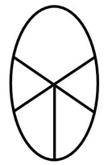
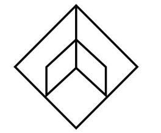

# 样式规律-加减同异（线条求并+旋转+长短修正）

考点：[[20-考点/判断推理/图形推理/样式规律-加减同异（线条求并+旋转+长短修正）|图形推理 / 样式规律-加减同异（线条求并+旋转+长短修正）]]

**问法模型**：两组图对照求'？'处图形 → 先在第一组内归纳'线线相加→旋转→长短调整'的复合规律，再逐步套用到第二组

## 推理链
1. 第1步：两组图形元素组成相似、均由零散线条构成，优先考虑样式类加减同异规律
2. 第2步：观察第一组，图1（弧线+折线）与图2（弧线+三角线）的线条相加，即把两图所有线条合并求并集
3. 第3步：合并后的线条整体顺时针旋转，方向由横置变为斜置
4. 第4步：旋转后再作长短修正——外框线条及图1、图2原本重合的线条缩短，其余线条延长，得到图3（X形外框+中间椭圆）
5. 第5步：第二组套用同一规律：图1与图2线条相加，再顺时针旋转
6. 第6步：对相加旋转后的图形同样执行'外框线及重合线缩短、其余线延长'的修正
7. 第7步：逐项对照A/B/C/D内部小图形的线段长短与交叠差异，只有B项符合修正后的结构

**最快解法**：⚡ 样式口诀'元素相似看加减同异'+三步操作法：两图线条求并→顺时针旋转→重合线与外框线缩短、其余延长，直接锁定B

## 易错点
- ⚠ 只做线条相加就选答案，漏掉'顺时针旋转'这一步骤
- ⚠ 忽略'重合线条及外框线缩短、其余线条延长'的长短修正细节，误选结构相近的A/C/D
- ⚠ 四个选项外形高度相似，仅内部小图形线段交叠方式不同，粗心比对会看错细节

## 母题抽象
> 🧩 当两组图元素组成相似且由零散线条构成时，用'线条求并→旋转→长短修正'三步法，将第一组规律逐步复现在第二组并对照选项验证

**同类特征**：两组图对照求第三图、元素组成相似、零散线条构成、线条相加（求并）、顺时针旋转、重合线缩短、其余线延长

## 相关题
- [[10-真题/判断推理/图形推理/10204610 样式规律-加减同异（去同存异），九宫格列规律|10204610]]（辽宁 2024，相关度1）
- [[10-真题/判断推理/图形推理/10297349 样式规律-黑白运算|10297349]]（浙江 2025，相关度1）
- [[10-真题/判断推理/图形推理/10297407 样式规律-黑白运算（定义叠加）|10297407]]（四川 2025，相关度1）
- [[10-真题/判断推理/图形推理/11226895 图形推理-样式规律（叠加求同-保留相同部分）|11226895]]（上海 2025，相关度1）
- [[10-真题/判断推理/图形推理/11226896 样式规律-加减同异（分区域：上圆内部求异+下椭圆内部求同）|11226896]]（上海 2025，相关度1）

---

### 题干

下列选项中，符合所给图形的变化规律的是<u>        </u>。

### 选项
- A. A
- B. B　✅
- C. C
- D. D

### 官方解析

元素组成相似，优先考虑加减同异。观察发现，第一组图形中，图1与图2线条相加，再顺时针旋转，如下图所示：

然后外框线条及第一幅图、第二幅图的重合线条缩短，其余线条延长，即得第三幅图。第二组图形遵循此规律，即图1与图2线条相加，再顺时针旋转，如下图所示：

然后外框线条及第一幅图、第二幅图的重合线条缩短，其余线条延长，即得第三幅图。只有B项符合。

故正确答案为B。

### 给定材料
（无）
