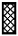
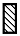

# 样式规律-黑白运算（金字塔型多层叠加，逐区域运算）

考点：[[20-考点/判断推理/图形推理/样式规律-黑白运算（金字塔型多层叠加，逐区域运算）|图形推理 / 样式规律-黑白运算（金字塔型多层叠加，逐区域运算）]]

**问法模型**：问号置于金字塔顶层、问'符合图形变化规律'→ 自下而上找规律：下层相邻两幅图按同位置区域逐一运算得到上层图形，再用已知行验证运算规则后排除选项

## 推理链
1. 第1步：观察题干为金字塔结构（顶层'?'、第二行2幅、第三行3幅、底层4幅），每幅图轮廓相同，均由横向5个区域构成，区域内图案共5种可能（实黑/阴影/斜线/竖线/空白），元素组成相似→优先考虑样式规律中的黑白运算
2. 第2步：金字塔类题目从下到上找规律：下层相邻两幅图之间逐区域运算得到上层一幅图，故'?'处图形=第二行两幅图对应区域（左图第n格+右图第n格）的运算结果
3. 第3步：下方三行是已知运算，可用来反推运算规则：先定位第三行后两幅图中'右侧第二个区域'的运算，其结果即问号处'左侧第二个区域'应呈现的图案，据此排除A、B两项
4. 第4步：再定位第四行前两幅图中'左侧第二个区域'的运算，其结果即问号处'中间区域'应呈现的图案，据此排除C项
5. 第5步：问号处左侧第一个区域的运算在下方三行中找不到可验证的样本，但四个选项该区域图案均相同，不影响排除
6. 第6步：剩余D项即为答案，属于'多区域交叉验证+排除法'的择优结论

**最快解法**：⚡ 黑白运算法（金字塔自下而上）+排除法：抓住'同位置区域对应运算'，先看第三行右两幅图右侧第二个区域确定问号左侧第二区域→排除A、B；再看第四行前两幅图左侧第二个区域确定问号中间区域→排除C，锁定D

## 易错点
- ⚠ 金字塔方向看反：误从上往下找规律，实际须自下而上运算
- ⚠ 区域定位错位：须找准'右侧第二个区域''左侧第二个区域'等同位置样本，错位比较会排除错误选项
- ⚠ 只验证一个区域就急于选择，或被'第一区域无法验证'的死角干扰而犹豫——因四选项该区域相同，不影响答案
- ⚠ 把区域内图案种类当作位置平移/旋转规律，忽略本题是逐区域的样式叠加运算

## 母题抽象
> 🧩 当多幅图形呈金字塔（或分层）堆叠、各图轮廓与分割区域完全一致且内部填充图案多样时，用'自下而上逐区域样式运算'：先在已知行找同位置区域反推运算规则，再套用到问号处对应区域，用排除法锁定答案

**同类特征**：金字塔形多层排列、问号位于塔顶、每幅图5个横向分割区域、区域内图案共5种（实黑/阴影/斜线/竖线/空白）、元素组成相似、轮廓与分割区域相同、下层相邻两图运算得上层图

## 相关题
- [[10-真题/判断推理/图形推理/1758970 样式规律-图形叠加（自定义运算：相同保留且方向反转、不同消去为空白）|1758970]]（上海 2016，相关度1）
- [[10-真题/判断推理/图形推理/1805294 样式规律-品字运算（杨辉三角式相邻叠加，箭头方向运算）|1805294]]（上海 2016，相关度1）

---

### 题干

下列选项中，符合所给图形的变化规律的是<u>        </u>。

### 选项
- A. A
- B. B
- C. C
- D. D　✅

### 官方解析

元素组成相似，且图形的轮廓和分割区域相同，优先考虑样式规律中的黑白运算。本题为金字塔类题目，要从下到上找规律，即下层相邻的两幅图之间进行运算得到上面的一幅图，则问号处图形应由第二行的两幅图运算得到（详见下图）。

每幅图都由横向的5个区域构成，每个区域内的图案存在5种可能性：、、、和。将第二行两幅图的对应区域进行运算可知，问号处图形从左至右每个区域分别对应+、+、+、+、+的运算结果，在下面三行的运算中找到以上运算对应的结果即可。观察下面三行的图形，根据第三行后两幅图中右侧第二个区域的运算可知：+=，则问号处左侧第二个区域应为，排除A、B两项；根据第四行前两幅图中左侧第二个区域的运算可知：+=，则问号处中间区域应为，排除C项。

故正确答案为D。

注：本题不严谨，因为问号处左侧第一个区域+的运算结果在下面三行中无法验证，但四个选项中左侧第一个区域内的图案均相同，且根据其他区域的运算结果可以排除明显错误的A、B、C三项，因此，根据对比择优的原则，小粉笔建议选择D项。

### 给定材料
（无）

> [!warning] 疑点（官方解析可能有误，待人工复核）
> 官方解析已自认本题不严谨：问号处左侧第一个区域的运算结果在下方三行中无法验证，D项实为'其余区域均排除他项后的择优'而非严格演绎；但该区域四选项图案相同，不影响答案，与官方答案D无矛盾
