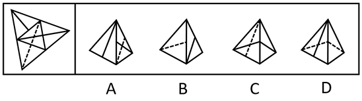
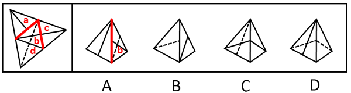
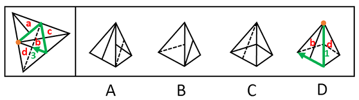

# 空间重构-四面体折叠（公共边法+画边法）

考点：[[20-考点/判断推理/图形推理/空间重构-四面体折叠（公共边法+画边法）|图形推理 / 空间重构-四面体折叠（公共边法+画边法）]]

**问法模型**：给出四面体（三角锥）外表面展开图问哪项能折成 → 用公共边法核对每面内线条与公共边（中点）的位置关系，无法区分时用画边法核对相邻面与边的对应序号

## 推理链
1. 第1步：展开图为大三角形分割成的四个小三角形面（标为a、b、c、d），各面内含实线或虚线，折成四面体后任意两面恰有一条公共边
2. 第2步：采用公共边法——折叠后每面内的线条与该面和相邻面公共边（尤其公共边中点）的相对位置不变；两两相邻难辨时改用画边法——从某面特征线条引出的顶点起顺时针依次编号四条边
3. 第3步：A项右侧为面b、左侧为面a或c，选项中左侧面实线与两面公共边中点不相交，而展开图中面a、面c的实线均与各自和面b的公共边中点相交，排除
4. 第4步：B项左侧为面d、右侧为面a或c，选项中面d虚线与右侧面的公共边中点相交，而展开图中面d虚线是与面b的公共边中点相交，排除
5. 第5步：C项由面b和面c构成，线条与公共边位置关系和展开图一致，当选
6. 第6步：D项由面b和面d构成，以面b中引出实线的顶点为起点沿面b顺时针画边，展开图中边3对应面d，而选项中边1对应面d，排除

**最快解法**：⚡ 公共边法优先：A、B两项直接比较'线条是否与公共边中点相交'即可秒杀排除；D项用画边法（从实线顶点起顺时针编号1-2-3-4边），核对相邻面落在第几条边上；剩余C即为答案

## 易错点
- ⚠ 忽略'线条与公共边中点是否相交'这一细节，只看线条大致方向而误判A、B
- ⚠ 混淆面d的公共邻面：展开图中d的虚线相邻公共边是d与b，而非d与a/c，B项正是利用这一点设错
- ⚠ D项画边法方向搞反（顺时针误作逆时针）或未从实线引出顶点起画，导致边1与边3的对应关系算错

## 母题抽象
> 🧩 当题干出现'大三角形分割成四个小三角形'的四面体展开图且各面带线条时，用公共边法核对线条与公共边中点的相交关系，排除两项后再用画边法验证剩余相邻面的边序号对应，即可锁定答案

**同类特征**：四面体展开图（大三角形分四小面）、各面内含实线或虚线、问'右边哪项能由它折叠而成'、选项为立体三视图式锥体、需核对线条与公共边中点位置关系、相邻面判定可用画边法

## 相关题
- [[10-真题/判断推理/图形推理/2042728 空间重构-四面体折叠（描边法-边面对应）|2042728]]（江苏 2017，相关度1）

---

### 题干

左图给定的是纸盒的外表面，右边哪项能由它折叠而成？

### 选项
- A. A
- B. B
- C. C　✅
- D. D

### 官方解析

将原展开图标上序号如下图，逐一进行分析。

A项：选项右侧为面b，左侧为面a或面c，选项中左侧面上的实线与其和面b的公共边中点不相交，而展开图中面a与面c上的实线均和该面与面b的公共边中点相交，选项与展开图不一致，排除；

B项：选项左侧为面d，右侧为面a或面c，选项中面d上的虚线与其和右侧面（面a或面c）的公共边中点相交，而展开图中面d上虚线与其和面b的公共边中点相交，选项与展开图不一致，排除； 

C项：选项由面b和面c构成，与展开图一致，当选；

D项：选项由面b和面d构成，以面b中引出实线的顶点为起点，沿面b顺时针画边（如下图所示），展开图中边3对应面d，而选项中边1对应面d，选项与展开图不一致，排除。

故正确答案为C。

### 给定材料
（无）
