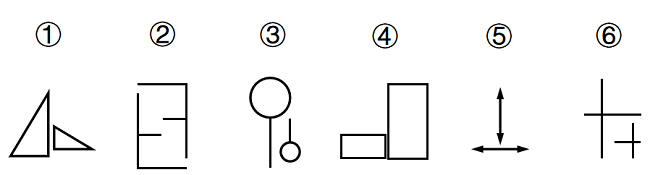

# 位置规律-旋转与翻转（两个同形元素的旋转-翻转关系分组）

考点：[[20-考点/判断推理/图形推理/位置规律-旋转与翻转（两个同形元素的旋转-翻转关系分组）|图形推理 / 位置规律-旋转与翻转（两个同形元素的旋转/翻转关系分组）]]

**问法模型**：六个由两个同形异位元素组成的图形二分归类 → 逐图判断两元素是'仅靠旋转可重合'还是'须镜像翻转才可重合'，据此分成两类

## 推理链
1. 第1步：六幅图均由'形状相同、大小与摆放不同的两个元素'构成——①大小两直角三角形、②两个缺口钩形框、③大小两个'圆+短线'（气球形）、④横放小长方形与竖放大长方形、⑤竖直与水平两个双向箭头、⑥大小两个十字，提示考查两元素间的位置变换规律
2. 第2步：同形元素的位置变换只有平移、旋转、翻转三种，逐一验证每个图形中'一个元素经何种变换可得到另一个元素'：先试旋转，旋转不重合再看是否互为镜像
3. 第3步：图①小三角形旋转后与大三角形朝向一致；图④横放长方形旋转90°即为竖放长方形的方向；图⑤竖直双向箭头旋转90°可与水平双向箭头重合——①④⑤中两元素均可通过'旋转'互得
4. 第4步：图②两个钩形框开口方向相反、图③两气球形的短线朝向互为镜像、图⑥大小十字的长短臂方向互为镜像，均无法仅靠旋转重合——②③⑥中两元素为'翻转（镜像）'关系
5. 第5步：据此①④⑤为'旋转'一组、②③⑥为'翻转'一组，与选项D（①④⑤，②③⑥）完全对应

**最快解法**：⚡ 口诀法'旋转不变手性、翻转改变镜像'：对每图取小元素，想象其绕中心旋转能否与大元素重合——能重合归①④⑤组，不能（须翻面镜像）归②③⑥组，直接锁定D

## 易错点
- ⚠ 将②③⑥也误判为旋转可重合，忽略镜像图形无法仅靠旋转重合（缺手性/镜像二级辨析）
- ⚠ 只看到'两元素形状相同'就套用平移、组合或相对位置规律，未进一步区分旋转与翻转
- ⚠ ⑥中十字、③中气球线条短小且不对称，易看错长短臂与短线朝向而归错组

## 母题抽象
> 🧩 当题干出现'六个图形、每图由两个同形异位元素组成、要求分两类'的特征时，用'旋转/翻转辨析法'：逐图验证两元素是旋转重合还是镜像翻转重合，据此二分定答案

**同类特征**：六个图形两两分组分类问法、每图由两个形状相同、大小不同的元素构成、考查两元素间的位置变换关系、旋转可重合与翻转（镜像）可重合的对比、元素为三角形、长方形、箭头、十字、气球形等常见轮廓

## 相关题
（暂无）

---

### 题干

把下面的六个图形分为两类，使每一类图形都有各自的共同特征或规律，分类正确的一项是：

### 选项
- A. ①③⑤，②④⑥
- B. ①③⑥，②④⑤
- C. ①②③，④⑤⑥
- D. ①④⑤，②③⑥　✅

### 官方解析

本题为分组分类题目。观察发现，题干每幅图形均由两幅形状相同但位置不同的元素组成，考虑位置规律。图①④⑤中的一个元素图形旋转后可得到另一个元素图形的形状，图②③⑥中的一个元素图形旋转后可得到另一个元素图形的形状，即图①④⑤为一组，图②③⑥为一组。

故正确答案为D。

### 给定材料
（无）

> [!warning] 疑点（官方解析可能有误，待人工复核）
> 所给官方解析中，①④⑤与②③⑥两组均被表述为'一个元素图形旋转后可得到另一个元素'，两组文字完全相同则无法构成分组依据，显系笔误；按图形实际特征及该题通行解析，②③⑥应为'翻转（镜像）后可得到另一元素'。此为解析文字瑕疵，不影响正确答案D的判定

<!-- CODEX-ANSWER-REVIEW:BEGIN -->
### 本次独立复核

**复核状态：** `resolved`（答案与解析已核定）

**计分答案：** D（可计分）

**复核解析：**

按图形本身对照两个相同元素：①④⑤中一元素旋转90°后可得到另一元素；②③⑥中一元素旋转180°后可得到另一元素。两组依据是旋转角不同，不是翻转。原官方解析把两组都写成“旋转后得到”漏掉了角度差异。

**相关信息：**

图形推理—位置规律；区分旋转与翻转，并记录旋转角度。

**题源依据：** [固定版本原题](https://github.com/Mentat-Uran/kaogongzhentizhengliu/blob/84ab93d4b64b61d897bece8a1c0a5bab06b4feb2/10-%E7%9C%9F%E9%A2%98/%E5%88%A4%E6%96%AD%E6%8E%A8%E7%90%86/%E5%9B%BE%E5%BD%A2%E6%8E%A8%E7%90%86/5430439%20%E4%BD%8D%E7%BD%AE%E8%A7%84%E5%BE%8B-%E6%97%8B%E8%BD%AC%E4%B8%8E%E7%BF%BB%E8%BD%AC%EF%BC%88%E4%B8%A4%E4%B8%AA%E5%90%8C%E5%BD%A2%E5%85%83%E7%B4%A0%E7%9A%84%E6%97%8B%E8%BD%AC-%E7%BF%BB%E8%BD%AC%E5%85%B3%E7%B3%BB%E5%88%86%E7%BB%84%EF%BC%89.md)；固定内容 commit `84ab93d4b64b61d897bece8a1c0a5bab06b4feb2`，Markdown blob `5612c20c59c7edd82d37ac92469330522610834b`。
<!-- CODEX-ANSWER-REVIEW:END -->
