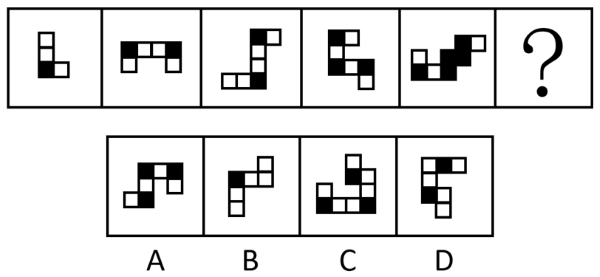

# 黑白块分布规律（拐角处均为黑块的结构特征）

考点：[[20-考点/判断推理/图形推理/黑白块分布规律（拐角处均为黑块的结构特征）|图形推理 / 黑白块分布规律（拐角处均为黑块的结构特征）]]

**问法模型**：“选择最合适的一个填入问号处使之呈现规律性”→ 先试数量、位置等常规规律，均不成立时转向归纳黑白块在结构中的分布特征（局部特征法），再逐项排除选项

## 推理链
1. 第1步：题干5幅图均由黑块与白块拼接而成，先数数量、看排布，发现黑块与白块的数量及整体位置均无明显规律；
2. 第2步：转换思路，将黑块颜色与图形结构结合观察，发现每幅图中“拐角”（方块行进方向改变处）位置的方块无一例外均为黑块；
3. 第3步：逐图验证规律：图1的L形拐角、图2桥形两端的拐角、图3/4/5折线形的全部拐角处均为黑块，规律在5幅图中均成立；
4. 第4步：将规律外推至“？”处：所选图形的每个拐角处也必须均为黑块；
5. 第5步：逐项对照：B、C、D三项图形中均存在拐角处为白块的情形，与规律冲突，予以排除；
6. 第6步：只有A项每个拐角处均为黑块，满足规律，故选A。

**最快解法**：⚡ 拐角标黑法：不纠结黑白数量与移动，先扫一眼题干每幅图方向转变处的方块颜色，确认“拐角必黑”后，只检查四个选项的拐角——B、C、D均出现白块拐角直接排除，锁定A

## 易错点
- ⚠ 在黑块数量、白块数量或位置移动上找规律，因题干“数量、位置均无规律”而卡壳，未及时转向黑白块的结构分布特征
- ⚠ 对“拐角”概念理解不清：把尽头端点（只有一个相邻方块的端头）误当拐角，或漏看部分拐角导致误判
- ⚠ 观察不细致，把紧邻黑块的白块拐角误判为满足规律，误选B/C/D

## 母题抽象
> 🧩 当一组图形均由黑白块拼成且数量规律、位置规律均不成立时，改查黑白块的结构性分布（拐角/端点/相邻关系），用“拐角处全为黑块”这类特征规律逐项排除选项

**同类特征**：黑白块拼接的多连方块图形、黑块白块数量无规律、位置移动无规律、拐角处均为黑块、问号处延续同一规律

## 相关题
（暂无）

---

### 题干

从所给的四个选项中选择最合适的一个填入问号处，使之呈现一定的规律性：

### 选项
- A. A　✅
- B. B
- C. C
- D. D

### 官方解析

观察发现，题干图形均出现黑块与白块，但数量、位置等均无规律，将两幅图相邻比较发现，黑块的位置存在规律，即题干图形的每个拐角处均为黑块，故“？”处图形的每个拐角处应均为黑块，B、C、D三项均有拐角处不是黑块（如下图所示），只有A项满足规律。

故正确答案为A。

### 给定材料
（无）
