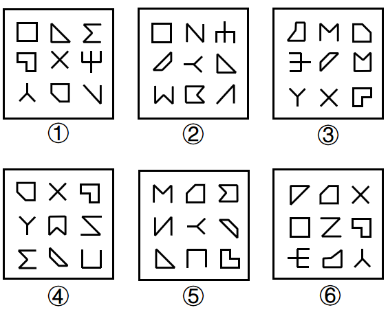

# 数量规律-数面（封闭区域个数）分组，辅以属性规律-开闭性验证

考点：[[20-考点/判断推理/图形推理/数量规律-数面（封闭区域个数）分组，辅以属性规律-开闭性验证|图形推理 / 数量规律-数面（封闭区域个数）分组，辅以属性规律-开闭性验证]]

**问法模型**：『把六个图形分为两类，使每一类都有各自共同特征』→ 分组分类题，元素组成不同时按'先属性后数量'模型找组间差异

## 推理链
1. 第1步：六幅图均为3×3宫格拼盘，每图含9个小元素，元素组成不同（□、◁、×、Y、N、W、Σ等混排），优先考虑属性规律，封闭面明显则转数量规律
2. 第2步：观察每图同时出现全封闭小图形（如□、◁、▱）和全开放小图形（如×、Y、V、Σ），封闭区域个数可数，采用'数面'规则
3. 第3步：逐图点数封闭面：图①中□、◁、L形封闭图、五边形共4个面；图②中□、▱、▷、四边形共4个面；图④同样数得4个面
4. 第4步：图③、图⑤、图⑥中封闭小图形各数得5个面
5. 第5步：按面数分两组：①②④（4个面）一组，③⑤⑥（5个面）一组
6. 第6步：换用开闭性交叉验证：①②④各含5个全开放图形、4个全封闭图形；③⑤⑥各含4个全开放图形、5个全封闭图形，两种口径分组一致，锁定B

**最快解法**：⚡ 数面法+排除法：快速点数每图中带封闭区域的小图形个数，得4、4、5、4、5、5，4个面的①②④一组、5个面的③⑤⑥一组，直接选B；亦可数全开放图形个数5/4分两组

## 易错点
- ⚠ 被×、Y、N等显眼的开线条元素带偏，去数笔画数或找对称性，忽略'数面'这一明显特征
- ⚠ 点数面时漏数带缺口的开口图形或将组合处的封闭区域多数/少数，导致分组摇摆
- ⚠ 忽略'全开放图形个数'与'面个数'的互补关系（9个元素=开放数+封闭数），两规律口径不一时不敢确定答案

## 母题抽象
> 🧩 当题干为多小元素拼盘（如3×3宫格共9个小图形）且封闭与开放图形混排时，先数封闭面（或全封闭/全开放图形个数）看能否分成两组数量，按数量完成分类

**同类特征**：分组分类题、每图含9个小元素呈宫格排布、封闭面数量明显可数、全开放与全封闭小图形混排、元素组成不同无位置规律、需找两类各自的数量/属性共同点

## 相关题
- [[10-真题/判断推理/图形推理/12561867 数量规律-相同元素的位置关系（对角相对-边邻相邻）分组分类|12561867]]（浙江 2024，相关度1）
- [[10-真题/判断推理/图形推理/12561900 数量规律-面与外框的位置关系（面是否有公共边-悬空面）|12561900]]（浙江 2024，相关度1）
- [[10-真题/判断推理/图形推理/2133606 图形间关系（面与面的连接方式：公共边连接 vs 点连接）|2133606]]（国考 2018，相关度1）
- [[10-真题/判断推理/图形推理/2133620 图形推理-数量规律（一笔画-奇点数）|2133620]]（国考 2018，相关度1）
- [[10-真题/判断推理/图形推理/2136754 数量规律-面数量相同时看面的形状特征（是否存在完全相同的面）|2136754]]（河南 2017，相关度1）

---

### 题干

把下面的六个图形分为两类，使每一类图形都有各自的共同特征或规律，分类正确的一项是：

### 选项
- A. ①③④，②⑤⑥
- B. ①②④，③⑤⑥　✅
- C. ①②⑥，③④⑤
- D. ①⑤⑥，②③④

### 官方解析
解析一：本题为分组分类题目。元素组成不同，且封闭面明显，考虑数面。观察发现，图①②④中有4个面；图③⑤⑥中有5个面，即图①②④为一组，图③⑤⑥为一组。
故正确答案为B。
解析二：本题为分组分类题目。元素组成不同，优先考虑属性规律。观察发现，题干每幅图中均出现多个全开放图形，优先考虑开闭性。图①②④中有5个全开放图形、4个全封闭图形；图③⑤⑥中有4个全开放图形、5个全封闭图形，即图①②④为一组，图③⑤⑥为一组。
故正确答案为B。

### 给定材料
（无）
