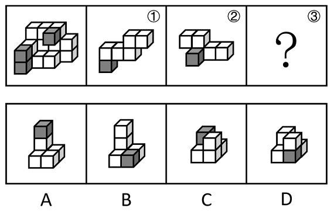

# 立体拼合（多面体切割重组、旋转归位）

考点：[[20-考点/判断推理/图形推理/立体拼合（多面体切割重组、旋转归位）|图形推理 / 立体拼合（多面体切割重组、旋转归位）]]

**问法模型**：已知整体多面体及其两个分割部分①②，求第三部分③ → 采用'凹凸互补+特征色块定位'的立体拼合模型：①+②+③=整体，旋转归位后剩余空缺即③

## 推理链
1. 第1步：整体多面体由3个灰色正方体和15个白色正方体（共18个等大正方体）组成；①中含1个灰色正方体，②中也含1个灰色正方体
2. 第2步：由'切割为①②③三个小多面体'可知①+②+③=整体，故③必含第3个灰色正方体，其白色正方体数量等于整体扣除①②后的剩余量
3. 第3步：立体拼合允许旋转——按官方解析，将图①、图②分别旋转至与整体方位一致的姿态，确定它们在整体中的占位区域
4. 第4步：①②归位后，整体中剩余的空缺形状即为③，且空缺区域中灰色正方体应处于对应高度（非底层）
5. 第5步：逐项对照：A与B外轮廓相近但灰色位置不同（A的灰色在顶端、B的灰色在底部）；C、D为矮胖双层结构且灰色位置靠下，均与空缺不符
6. 第6步：验证：①、②旋转后与A凹凸互补，恰好拼合为左图的多面体，与官方解析一致，故选A

**最快解法**：⚡ 灰块定位排除法：先锁定③必含1个灰色正方体；再将①②脑中旋转归位，观察剩余空缺中灰色正方体位于上层而非底层——A、B轮廓相似，但只有A的灰色方块在顶端，直接排除B、C、D锁定A

## 易错点
- ⚠ 只核对灰色正方体数量（①②各含1个、③也含1个），忽略灰色方块的空间位置，误选与A轮廓相近但灰色在底部的B
- ⚠ 忘记①②可以旋转后再拼合，按图中原始朝向硬找空缺导致无匹配项
- ⚠ 忽视被遮挡的正方体，数错整体或选项的方块数量与层数

## 母题抽象
> 🧩 当题干给出正方体组合的整体多面体及其分割出的若干部分、求剩余部分时，用'凹凸互补+特征色块（灰色方块）定位'法：先数特征色块数量，再将已知部分旋转归位，剩余空缺的形状与色块位置即答案

**同类特征**：立体拼合、等大正方体组合成多面体、切割为三个小多面体、灰色正方体作定位标记、部分可旋转后拼合、问第三个部分

## 相关题
- [[10-真题/判断推理/图形推理/2776149 图形推理-立体拼合（小方块计数守恒+分层形状咬合）|2776149]]（浙江 2021，相关度1）
- [[10-真题/判断推理/图形推理/10204640 立体拼合（多面体组合：数量守恒+凹凸互补+旋转）|10204640]]（河南 2024，相关度1）
- [[10-真题/判断推理/图形推理/12019797 立体拼合-由两视图及全等小块反推小立体（数小立方体+旋转试装）|12019797]]（浙江 2026，相关度1）
- [[10-真题/判断推理/图形推理/12536475 图形推理-立体拼合（正方体堆叠多面体组合）|12536475]]（四川 2024，相关度1）
- [[10-真题/判断推理/图形推理/12881949 立体拼合-多块拼合正方体（凹凸互补+旋转）|12881949]]（广东 2025，相关度1）

---

### 题干

左图为等大的3个灰色正方体和15个白色正方体组合成的多面体，其可以切割为①、②和③三个小多面体，问③代表的多面体可能是：

### 选项
- A. A　✅
- B. B
- C. C
- D. D

### 官方解析

本题考查立体拼合。如下图所示，将图①、图②进行旋转，结合A项，即可拼合成为左图的多面体。

故正确答案为A。

### 给定材料
（无）
