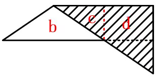
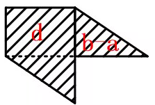

# 空间折叠-折纸投影面积计算（翻折覆盖与重叠容斥）

考点：[[20-考点/判断推理/图形推理/空间折叠-折纸投影面积计算（翻折覆盖与重叠容斥）|图形推理 / 空间折叠-折纸投影面积计算（翻折覆盖与重叠容斥）]]

**问法模型**：问'两次折叠后的纸片投影面积'→采用分步折叠+投影并集模型：每步投影=各层区域并集，重叠部分只计一次

## 推理链
1. 第1步：从图形提取前提——水平、竖直两条虚线折痕将直角三角形分成四块：右下a、左下b、左上c、右上d，折叠后的投影面积按各层所覆盖区域的并集计算，重叠只计一次
2. 第2步：第一次沿水平折痕向下折叠，将面c和面d向下翻折、覆盖面b和面a，规则是翻折区域与落点区域取并集
3. 第3步：逐块核对——c翻折后完全落在b的范围之内、不新增投影，d翻折后盖住a、a不再单独计面积，故第一次折叠后投影面积=b+d
4. 第4步：第二次沿竖直折痕向右折叠，将左侧的面b（连同其上已折的c层）向右翻折，覆盖右侧面d、面a所在投影区
5. 第5步：翻折过来的部分与右侧原有投影发生重叠，重叠面积对应a，重叠部分只计一次
6. 第6步：最终投影面积=b+d−a，与选项对照仅D符合，故选D

**最快解法**：⚡ 排除法+分步投影并集：第一次折叠后c已被完全盖进b的范围，c不可能再出现在最终投影表达式中，据此排除含c的A、B、C三项，直接锁定D；验证：第一步折后投影=b+d，第二步翻折与右侧重叠a，投影=b+d−a

## 易错点
- ⚠ 缺乏'投影=并集、重叠只计一次'的意识，把a、b、c、d随意加减，误选把c也计入的A
- ⚠ 第一次折叠后的状态记错：误以为折后面积为b+a或仍需单独计c，忽视'd盖住a、c完全落入b'两个覆盖关系
- ⚠ 第二次折叠的重叠对象搞错：把重叠面积当成c而误选B（b+d−c），实际翻折重叠对应的是a

## 母题抽象
> 🧩 当题干出现'纸片沿折痕折叠若干次后求投影/覆盖面积'特征时，用分步投影并集法：每步投影=各块并集、被覆盖的重叠面积只计一次，并用'被完全遮盖的块不会出现在结果式中'排除定向

**同类特征**：直角三角形纸片两次折叠、展开后折痕分成a、b、c、d四块、求折叠后投影面积、选项为面积代数组合式、翻折覆盖产生重叠、水平与竖直两条折痕

## 相关题
（暂无）

---

### 题干

将一张直角三角形形状的纸片进行两次折叠，展开后的折痕将该三角形分成如图所示的a、b、c、d四个部分，则两次折叠后的纸片投影面积为：

### 选项
- A. b+d+c-a
- B. b+d-c
- C. b+c-a
- D. b+d-a　✅

### 官方解析

第一步，将直角三角形先沿水平折痕进行折叠，即将面c和面d向下折叠，覆盖面b和面a，得到如下图形，此时折叠后面积为：b+d；

第二步，将直角三角形沿着竖直折痕进行折叠，即将面b和面c向右折叠，覆盖面d和面a，得到如下图形，此时折叠后面积为：d+b-a。

故正确答案为D。

### 给定材料
（无）
