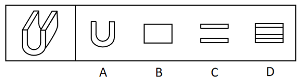
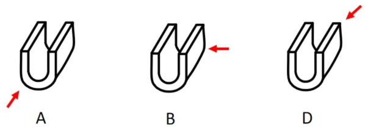

# 三视图-立体图形视图判断（选非题）

考点：[[20-考点/判断推理/图形推理/三视图-立体图形视图判断（选非题）|图形推理 / 三视图-立体图形视图判断（选非题）]]

**问法模型**：问'哪项不可能是该立体图形的视图'（选非）→ 按正面/侧面/顶面逐一还原三视图，用'外轮廓必须封闭+内部可见棱线不缺不多'验证排除

## 推理链
1. 第1步：题干立体为U形槽状体——正面轮廓为U形、沿深度方向拉伸，选项分别为：A是U形、B是矩形、C是两条分离的横条'='、D是带两条内部横线的矩形
2. 第2步：三视图规则：正面看→完整U形外轮廓；侧面看→外侧壁投影为矩形；俯视（从上往下）看→外侧壁顶棱在左右两端仍投影为两条竖线，外轮廓是封闭矩形，两横条之间看到的是槽内弧面而非空白
3. 第3步：逐项对照：A与正面视图一致，B与侧面视图一致，D对应俯视方向（含槽口棱线），按官方给出的观察方向均能看到，排除
4. 第4步：C项若是从上往下的视图，左右两侧应有两条竖线封闭外轮廓，且两横条间不应留空；C缺这两条竖线、呈两段分离横条，任何角度均无法看到，故C不可能，当选

**最快解法**：⚡ 封闭轮廓排除法（选非题）：先快速匹配正面=U形（A）、侧面=矩形（B）、俯视=带内部棱线的封闭矩形（D），剩下的C是唯一'轮廓断开、两横条分离'的图形，而立体从任何方向投影外轮廓必封闭，直接锁定C

## 易错点
- ⚠ 忽略外轮廓封闭性：俯视时外侧壁顶棱仍形成左右两条竖线，误以为只看到两条横条而认为C正确
- ⚠ 忽略槽底可见性：俯视时两横条之间是可见的槽内弧面（投影连续），不是透明空缺
- ⚠ 选非题看反：把'不可能是视图'误当成'选可能的视图'而错选A/B/D

## 母题抽象
> 🧩 当题干给出立体图形并问'哪项不可能是其视图'时，按正面-侧面-顶面逐一还原，验证每个视图外轮廓必须封闭、内部可见棱线不缺不多，凡轮廓断开或缺线的选项即为答案

**同类特征**：三视图选非问法、U形（凹形）槽状拉伸体、任意角度观看、外轮廓封闭性、分离横条'='缺竖线、俯视内外棱线区分

## 相关题
（暂无）

---

### 题干

左图为给定的立体图形，从任一角度观看，下面哪项不可能是该立体图形的视图？

### 选项
- A. A
- B. B
- C. C　✅
- D. D

### 官方解析

本题考查三视图。如下图所示，A、B、D三项按图中箭头方向观察，均可看到，排除；C项为从上往下观察图形，则左右两侧应有两条竖线，当选。

本题为选非题，故正确答案为C。

### 给定材料
（无）
