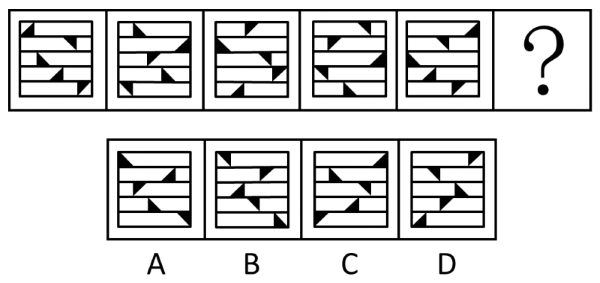

# 图形推理-位置规律（循环平移+旋转）

考点：[[20-考点/判断推理/图形推理/图形推理-位置规律（循环平移+旋转）|图形推理 / 图形推理-位置规律（循环平移+旋转）]]

**问法模型**：『选择最合适的一个填入问号处，使之呈现一定的规律性』且元素组成相同 → 采用位置规律模型（逐行追踪平移+旋转双重规律）

## 推理链
1. 第1步：题干5幅图均由相同数量的黑色三角形和被分成5行的矩形框架组成，元素组成相同，优先考虑位置规律而非数量/样式规律
2. 第2步：每幅图分行明显，优先按行看，对每行内的黑色三角形单独追踪其移动轨迹
3. 第3步：发现规律一——黑色三角形在其所在行内每次向右移动一格，移动到最右侧时循环走回到最左侧，方向不变继续向右（循环平移）
4. 第4步：用循环平移规律推算问号处各行三角形应在的位置，C、D两项位置不符，排除C、D
5. 第5步：发现规律二——黑色三角形在移动过程中依次顺时针旋转90°（位置+方向双规律）
6. 第6步：对照剩余选项，B项三角形方向不符顺时针旋转90°规律，排除B；A项同时满足位置与方向规律，故选A

**最快解法**：⚡ 排除法+按行追踪口诀：先按『每行黑三角逐图右移一格、到头循环回行首』核对位置排除C、D，再用『每次顺时针转90°』核对三角形朝向排除B，锁定A

## 易错点
- ⚠ 只追踪平移位置而忽略三角形自身旋转方向，易误选B
- ⚠ 循环平移到最右侧后应回到最左侧继续向右，误判为『折返反弹』导致位置推错
- ⚠ 未按行分离观察，将5行三角形混在一起看，难以发现稳定的移动规律

## 母题抽象
> 🧩 当题干图形元素组成相同（形状数量一致）且框架分行/分格明显时，用『按行/按格逐个追踪平移（含循环走）+叠加旋转方向』的双重位置规律法，逐项排除验证

**同类特征**：元素组成相同（黑色三角形数量一致）、矩形框架分成5行、分行明显优先按行看、逐图向右移动一格、移到行末循环回行首、顺时针旋转90°

## 相关题
- [[10-真题/判断推理/图形推理/12536397 样式规律-求异（去同存异）与位置规律（顺时针旋转90°）复合|12536397]]（四川 2024，相关度1）
- [[10-真题/判断推理/图形推理/13432345 图形推理-位置规律（旋转-分组类比）|13432345]]（深圳市考 2025，相关度1）
- [[10-真题/判断推理/图形推理/13504515 图形推理-位置规律（旋转-顺时针90°）|13504515]]（河北 2025，相关度1）
- [[10-真题/判断推理/图形推理/17056528 位置规律-旋转（九宫格V形开口顺时针旋转90°）|17056528]]（上海 2026，相关度1）
- [[10-真题/判断推理/图形推理/17058543 图形推理-位置规律（缺口方位旋转-移动）|17058543]]（选调 2023，相关度1）

---

### 题干

从所给的四个选项中，选择最合适的一个填入问号处，使之呈现一定的规律性：

### 选项
- A. A　✅
- B. B
- C. C
- D. D

### 官方解析
题干图形均由相同数量的黑色三角形和被分成5行的矩形框架组成，元素组成相同，优先考虑位置规律。观察发现，每幅图形分行明显，优先按行看。黑色三角形于其所在行内每次向右移动一格，且移动到最右侧时循环走，回到最左侧从头 再来，方向不变继续向右移动，排 C、D两项。继续观察发现，黑色三角形在移动的过程中依次顺时针旋转 90°，排除B项，只有A项符合。
故正确答案为A。

### 给定材料
（无）
