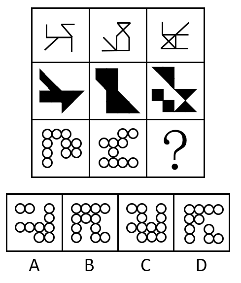

# 样式规律-求异（去同存异）

考点：[[20-考点/判断推理/图形推理/样式规律-求异（去同存异）|图形推理 / 样式规律-求异（去同存异）]]

**问法模型**：九宫格'填入问号使之呈现规律性'→ 优先横向逐行找样式运算规律（本题为一图⊕二图=三图的求异）

## 推理链
1. 第1步：九宫格共三行，第一行为线条图、第二行为黑色块、第三行为圆圈组合，每行图形元素组成相似，指向样式规律而非属性或数量规律
2. 第2步：优先横向观察第一行，将图一与图二叠加，相同线条消去、不同线条保留（去同存异/求异），恰好得到图三
3. 第3步：用第二行黑色块验证：图一与图二重合的黑块部分抵消、仅保留不重合部分得到图三，规律成立
4. 第4步：第三行应用求异规律：图一与图二按位置比对圆圈，两图相同位置都有的圆圈消去，只在一图中出现的圆圈保留
5. 第5步：将求异所得圆圈组合与选项逐项对照：A、B、D 均存在多余或缺失的圆圈
6. 第6步：只有C项与第三行图一、图二求异的结果完全一致，故选C

**最快解法**：⚡ 求异口诀法（去同存异）：横看第一行确认'图1⊕图2=图3'，第二行黑块快速验证，第三行对圆圈按位置做 XOR 直接锁定C，无需数总数

## 易错点
- ⚠ 只看第一行不回验第二行，误把规律当列规律或整体规律
- ⚠ 把'求异'误当'求同'：留下两图相同的圆圈、消去不同的圆圈，方向恰好做反
- ⚠ 只数圆圈个数不比对位置，在个数接近的C、D之间误选

## 母题抽象
> 🧩 当九宫格各图元素组成相似且同色同类元素出现重叠迹象时，优先横行用'去同存异'运算（图1⊕图2=图3），验证一行后再套用到含问号的行

**同类特征**：九宫格、每行元素组成相似、线条图+黑块+圆圈同规律贯穿、元素重合可消去、横行规律优先、第三行含问号

## 相关题
- [[10-真题/判断推理/图形推理/5832444 样式规律-求异（去同存异）|5832444]]（浙江 2021，相关度3）
- [[10-真题/判断推理/图形推理/17056527 数量规律-小黑块分层计数（行内遍历）|17056527]]（上海 2026，相关度2）
- [[10-真题/判断推理/图形推理/18643914 样式规律-去同存异（求异）与位置旋转的复合规律|18643914]]（四川 2026，相关度2）
- [[10-真题/判断推理/图形推理/10204610 样式规律-加减同异（去同存异），九宫格列规律|10204610]]（辽宁 2024，相关度1）
- [[10-真题/判断推理/图形推理/10297349 样式规律-黑白运算|10297349]]（浙江 2025，相关度1）

---

### 题干

从所给的四个选项中，选择最合适的一个填入问号处，使之呈现一定的规律性：

### 选项
- A. A
- B. B
- C. C　✅
- D. D

### 官方解析
题干每行图形元素组成相似，优先考虑样式规律。九宫格中优先横向看，第一行中，图一和图二求异得到图三；经验证，第二行也满足此规律；第三行应用此规律，图一和图二求异，只有C项符合。
故正确答案为C。

### 给定材料
（无）
