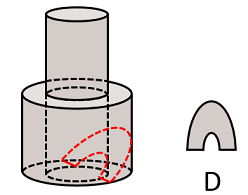

# 截面图-圆柱组合体挖空截面的可截性判断（选非题）

考点：[[20-考点/判断推理/图形推理/截面图-圆柱组合体挖空截面的可截性判断（选非题）|图形推理 / 截面图-圆柱组合体挖空截面的可截性判断（选非题）]]

**问法模型**：“从任一面剖开，哪一项不可能是该立体图形的截面”（选非）→ 用“平切圆、斜切椭圆、竖切矩形”口诀逐项模拟切割面，排除可截项，锁定不可截项

## 推理链
1. 第1步：题干立体为“小圆柱叠于大圆柱上方”的分层回转体，大圆柱内沿轴有圆柱形挖空（虚线部分），即任一水平高度最多同时存在“一个圆柱外轮廓＋空心圆”两类圆形要素
2. 第2步：应用截面基本规律——平行于底面平切圆柱得圆、斜切得椭圆、过轴线竖切得矩形；圆（同心圆）只能由平切产生
3. 第3步：验证A项三个同心圆：平切上方小圆柱只能得“小圆柱外圆＋空心圆”两个同心圆；平切下方大圆柱只能得“大圆柱外圆＋空心圆”两个同心圆；任何平面都不可能同时截出三层同心圆，A无法截出
4. 第4步：验证B项：按官方解析“从上方圆柱向下经过空心圆柱竖切”，过轴纵切得上下矩形组合并带空心轮廓，可截出
5. 第5步：验证C项：按官方解析“从上方圆柱向下经过空心圆柱斜切”，圆柱壁截成椭圆、空心壁截成内部椭圆弧（梭形线），可截出
6. 第6步：验证D项：按官方解析“斜切下方圆柱同时经过空心部分”，外轮廓为椭圆弧、挖空处呈拱形缺口，可截出
7. 第7步：本题为选非题，仅A项无法截出，与官方答案A一致

**最快解法**：⚡ 排除法＋口诀“平切得圆、斜切得椭圆、竖切得矩形”：A项三个同心圆要求同一平面切出三层圆，而该立体任一水平截面最多只有“外圆＋空心圆”两层圆，层数对不上，直接锁定A为不可能截面

## 易错点
- ⚠ 忽略选非题设问，误把可截出的B/C/D当作答案
- ⚠ 只记得平切得圆，忽略斜切得椭圆、竖切得矩形的组合截面，误判B/C/D不可截
- ⚠ 误以为在两圆柱交界处平切可凑出三个同心圆，忽略任一高度平切只能呈现“所在圆柱外圆＋空心圆”两层，A正是多出一层而无对应高度

## 母题抽象
> 🧩 当题干为“两段圆柱（回转体）叠加且内部有圆柱形挖空”求不可能截面时，用“平切圆、斜切椭圆、竖切矩形”口诀逐项模拟切面，并核对同心圆层数是否等于该高度实际存在的圆轮廓数，层数不符者即为答案

**同类特征**：大小两圆柱叠加的分层回转体、内部有圆柱形挖空（虚线标注）、选非设问：“不可能是截面”、选项含同心圆、凸形组合、椭圆嵌套、拱形缺口、截面形状由切割角度（平/斜/竖）决定

## 相关题
（暂无）

---

### 题干

下图是给定的立体图形（大圆柱内的虚线部分为挖空部分），将其从任一面剖开，下面哪一项不可能是该立体图形的截面？

### 选项
- A. A　✅
- B. B
- C. C
- D. D

### 官方解析

本题考查截面图。逐一分析选项。

A项：无法截出，当选；

B项：如下图所示，从上方圆柱向下经过空心圆柱竖切，可以截出，排除；

C项：如下图所示，从上方圆柱向下经过空心圆柱斜切，可以截出，排除；

D项：如下图所示，斜切下方圆柱同时经过空心部分，可以截出，排除。

本题为选非题，故正确答案为A。

### 给定材料
（无）
