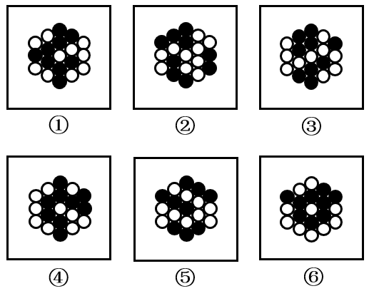

# 数量规律-部分数（按颜色分计连通块数）

考点：[[20-考点/判断推理/图形推理/数量规律-部分数（按颜色分计连通块数）|图形推理 / 数量规律-部分数（按颜色分计连通块数）]]

**问法模型**：六个图形分为两类且各类有共同特征 → 分组分类题，元素组成相同时先试位置/属性，均无规律则分颜色数部分数（连通块数）

## 推理链
1. 第1步：六图均由黑球与白球堆叠成花状整体，元素组成相同，整体无平移/旋转等位置规律，也无对称、开闭等统一属性规律
2. 第2步：题干解析指出'每个图形均存在黑球或白球被分隔开的情况'，故转向数量规律中的部分数，即同色相邻（相连）小球算同一部分
3. 第3步：数图①④⑥的黑球：均连通成1部分；数其白球：均被黑球分隔为3部分
4. 第4步：数图②③⑤的白球：均连通成1部分；数其黑球：均被白球分隔为3部分
5. 第5步：按'黑1白3'与'黑3白1'两组特征对照，①④⑥一组、②③⑤一组，与选项B完全一致

**最快解法**：⚡ 分色数部分数法：先看黑球是否连成一片——①④⑥黑球1部分、白球3部分；②③⑤黑球3部分、白球1部分，直接锁定B

## 易错点
- ⚠ 只数黑白球各自的总个数（各图常相同），漏掉'部分数（连通块）'这一真正计数维度
- ⚠ 判断连通时误把仅点接触/视觉靠近的同色球算作连通，或把被异色球隔开的同色球误算为同一部分
- ⚠ 未按颜色分别计数，把黑白球混合数整体连通区域，得出无法分组的混乱结果

## 母题抽象
> 🧩 当黑白双色小球堆叠成团、元素个数与位置属性均无规律时，按颜色分别数部分数（连通块数），'一色1部分+另一色3部分'的互补特征即分组依据

**同类特征**：黑白两色小球堆叠成花状整体、元素组成相同、无位置规律、无属性规律、同色球被异色球分隔、需分色数部分数

## 相关题
- [[10-真题/判断推理/图形推理/2742277 数量规律-部分数（同色连通域个数）|2742277]]（北京 2021，相关度2）
- [[10-真题/判断推理/图形推理/2172768 位置规律（旋转-翻转）|2172768]]（海南 2021，相关度1）
- [[10-真题/判断推理/图形推理/10204458 位置规律-平移（特征交点沿内圈循环平移）|10204458]]（甘肃 2024，相关度1）
- [[10-真题/判断推理/图形推理/10204614 图形推理-位置规律（旋转+翻转交替循环）|10204614]]（黑龙江 2024，相关度1）
- [[10-真题/判断推理/图形推理/10297399 位置规律—平移（多黑块分组循环平移）|10297399]]（四川 2025，相关度1）

---

### 题干

把下面的六个图形分为两类，使每一类图形都有各自的共同特征或规律，分类正确的一项是：

### 选项
- A. ①⑤⑥，②③④
- B. ①④⑥，②③⑤　✅
- C. ①②⑥，③④⑤
- D. ①③④，②⑤⑥

### 官方解析
本题为分组分类题目。元素组成相同，但无明显位置规律和属性规律，考虑数量规律。观察发现，题干每个图形均存在黑球或白球被分隔开的情况，考虑部分数。图①④⑥中，黑球的部分数均为1，白球的部分数均为3；图②③⑤中，黑球的部分数均为3，白球的部分数均为1。即图①④⑥为一组，图②③⑤为一组。
故正确答案为B。

### 给定材料
（无）
