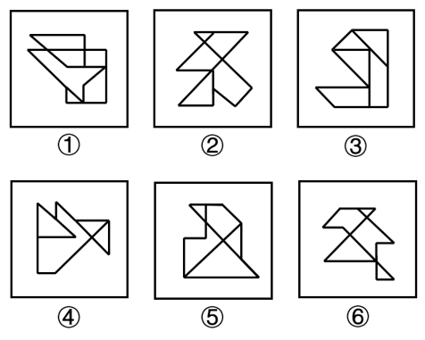

# 图形推理-数量规律（一笔画-笔画数·奇点计数）

考点：[[20-考点/判断推理/图形推理/图形推理-数量规律（一笔画-笔画数·奇点计数）|图形推理 / 图形推理-数量规律（一笔画/笔画数·奇点计数）]]

**问法模型**：'把六个图形分为两类、每类有共同特征或规律'→分组分类题，逐图提取可量化特征（属性→面→笔画数）寻找二分规律

## 推理链
1. 第1步：六个图形元素组成不同，对称、曲直、开闭等属性均无一致的二分特征，考虑数量规律
2. 第2步：题干图形封闭面较多，先数各图面数量，但面数量无法分成两组，面数量无规律
3. 第3步：六个图均为多个封闭面相交的'多圆相切'变形图（七巧板式组合图形），提示笔画数考点
4. 第4步：逐图数奇点（引出奇数条线的交点及端点）：图①②⑥的奇点数为0或2，满足一笔画条件
5. 第5步：图③④⑤的奇点数为4，笔画数=奇点数÷2，均为两笔画图形
6. 第6步：①②⑥为一组（一笔画），③④⑤为一组（两笔画），对照选项得C

**最快解法**：⚡ 奇点计数法（一笔画规律）：先试属性和面数量排除无规律，再逐图找奇点（引出1、3、5条线的点，端点也算奇点），奇点0或2个→一笔画、4个→两笔画；快速得出①②⑥一笔画、③④⑤两笔画，选C

## 易错点
- ⚠ 数面数量或线段数量无规律后卡住，未及时切换到一笔画这一高频二分考点
- ⚠ 数奇点时漏掉端点（度数为1也是奇点）或漏数T字、十字交点处的奇数引线，误判笔画数
- ⚠ 被'多个封闭面相交'的外观误导，去分析相切、连接等位置关系而偏离笔画数规律

## 母题抽象
> 🧩 当分组分类题出现'多个封闭面相交的组合图形'且属性规律、面数量均无规律时，用一笔画规律验证：数奇点，0或2个奇点的图为一组，4个奇点（两笔画）的图为一组

**同类特征**：六个图形分组分类问法、元素组成不同、无明显属性规律、封闭面较多但面数量无规律、多个封闭面相交（七巧板式/'多圆相切'变形图）、一笔画与两笔画的二分、奇点计数定组

## 相关题
- [[10-真题/判断推理/图形推理/2448480 图形推理-数量规律（一笔画-笔画数·奇点计数）|2448480]]（国考 2020，相关度2）
- [[10-真题/判断推理/图形推理/11454021 数量规律-小元素个数与边数的等量关系（叠加白色同形区域验证）|11454021]]（选调 2024，相关度1）
- [[10-真题/判断推理/图形推理/12019732 数量规律-笔画数（奇点数与最少笔画数）|12019732]]（浙江 2026，相关度1）
- [[10-真题/判断推理/图形推理/15833882 属性规律-曲直性（有曲有直 vs 全直线）|15833882]]（黑龙江 2026，相关度1）
- [[10-真题/判断推理/图形推理/2144665 数量规律-线数量（两组图运算：图一线数+图三线数=图二线数）|2144665]]（新疆 2017，相关度1）

---

### 题干

把下面的六个图形分为两类，使每一类图形都有各自的共同特征或规律，分类正确的一项是：

### 选项
- A. ①③⑥，②④⑤
- B. ①④⑤，②③⑥
- C. ①②⑥，③④⑤　✅
- D. ①③④，②⑤⑥

### 官方解析
本题为分组分类题目。元素组成不同，无明显属性规律，考虑数量规律。观察发现，题干图形封闭面较多，可优先考虑数面数量，但面数量无规律。继续观察发现，题干图形存在多个封闭面相交，均为“多圆相切”的变形图，考虑笔画数，图①②⑥均为一笔画图形，图③④⑤均为两笔画图形。即图①②⑥为一组，图③④⑤为一组。
故正确答案为C。

### 给定材料
（无）
