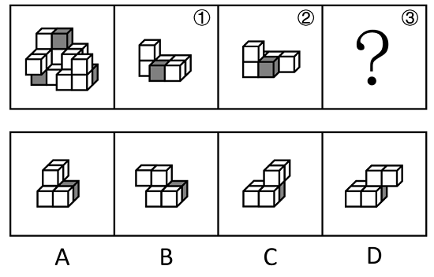
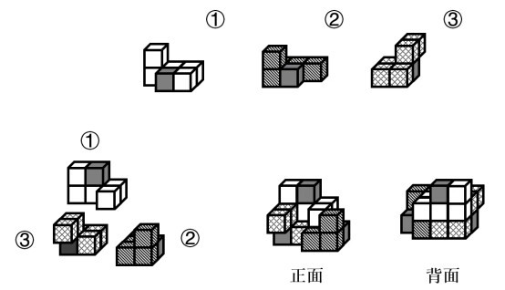

# 立体拼合（整体切割复原-剩余空间凹凸互补）

考点：[[20-考点/判断推理/图形推理/立体拼合（整体切割复原-剩余空间凹凸互补）|图形推理 / 立体拼合（整体切割复原/剩余空间凹凸互补）]]

**问法模型**：整体多面体可切割为①②③三块，已知①②求③ → 立体拼合剩余空间法：把已知块放回原图，剩余空腔即为目标块

## 推理链
1. 第1步：题干给出由3个灰色+15个白色共18个小正方体组成的多面体，及其可切割出的两块①（竖两层+横排形）、②（竖两层+短横排形），求第三块③
2. 第2步：立体拼合用'剩余空间法'——将①、②在脑中平移、旋转后放回原图，剩余空腔的凹凸轮廓即为③
3. 第3步：灰色块定位——整体共3个灰色小正方体，①、②各含1个灰色块，故③必须含1个灰色小正方体，且其位置须对应原图中剩余的那个灰色块
4. 第4步：将①、②按凹凸方向嵌入原图，剩余空腔呈'底层横排3块+上层错位堆叠'的组合轮廓
5. 第5步：逐项对照，A、B、D在块数、凹凸走向或灰色块位置上与剩余空腔不吻合；C项经旋转后与空腔完全咬合，灰色面与原图第三个灰色块位置对应
6. 第6步：验证①+②+C恰好复原原多面体（18块、3灰15白不重不漏），故③为C

**最快解法**：⚡ 剩余空间法+灰色块定位：先把①、②（连同各自灰色块）放回原图占位，剩下的空腔形状与C项旋转对照即可秒选C

## 易错点
- ⚠ 只数小正方体总数、不核对凹凸咬合，误选块数相近的干扰项（如B）
- ⚠ 忽略灰色块的数量分配与位置对应（①②各含1灰，③必含1灰且位置特定）
- ⚠ 未考虑拼块可旋转/翻转，把形状相同但朝向不同的选项误判排除或误选

## 母题抽象
> 🧩 当题干出现'整体可切割为几块、已知其中几块求剩余一块'时，用剩余空间法：先按灰色块等特征分配定位，再把已知块嵌入原图，剩余空腔与选项旋转对照验证

**同类特征**：3个灰色+15个白色共18个小正方体、整体可切割为①②③三块、已知两块①②求第三块、①②均含1个灰色小正方体、选项为小正方体组合体、问'③代表的多面体可能是'

## 相关题
（暂无）

---

### 题干

左图为等大的3个灰色正方体和15个白色正方体所组成的多面体，其可以切割为①、②和③三个小多面体，则③代表的多面体可能是：

### 选项
- A. A
- B. B
- C. C　✅
- D. D

### 官方解析

本题考查立体拼合。如下图所示，立体图可以由①、②以及C项拼合而成。

故正确答案为C。

### 给定材料
（无）
