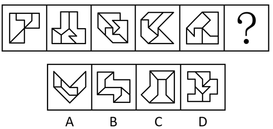

# 属性规律-对称性（外框对称轴方向顺时针旋转）

考点：[[20-考点/判断推理/图形推理/属性规律-对称性（外框对称轴方向顺时针旋转）|图形推理 / 属性规律-对称性（外框对称轴方向顺时针旋转）]]

**问法模型**：'选出最恰当的一项填在问号处，使图形呈现规律性'且元素组成不同 → 优先考虑属性规律，锁定'外框对称轴方向'的旋转规律

## 推理链
1. 第1步：题干五图元素组成不同、内部线条分割各异，但每个图形外框规整且含明显等腰元素 → 优先考虑属性规律中的对称性，而非数量规律
2. 第2步：提取规律载体——只看外框不看内部：题干图形的外框都是轴对称图形，对称轴方向依次顺时针旋转45°
3. 第3步：以最典型的图2（外框对称轴竖直）和图4（外框对称轴水平）为锚点，相邻两图对称轴顺时针转45°，推出图1、图3、图5外框均为斜向对称轴，位置吻合
4. 第4步：按'每次顺时针旋转45°'继续外推，？处外框对称轴应回到竖直方向（自洽验证：图2到？共4步×45°=180°，轴方向回到竖直，规律自洽）
5. 第5步：逐项验证外框对称轴：仅A项外框（对称雁形/V形轮廓）具有竖直对称轴；B项外框为中心对称的S/Z形，C、D项外框均不具备竖直对称轴
6. 第6步：与选项对照，只有A项满足'外框对称轴为竖直方向'，故选A

**最快解法**：⚡ 外框对称轴法+排除法：忽略内部杂乱线条，只看外框；先确认图2竖直轴、图4水平轴（相隔两图转90°，即每图转45°顺时针），推出？处为竖直轴，直接在选项中找外框竖直轴对称的图形，仅A符合

## 易错点
- ⚠ 被内部繁杂的分割线条干扰，去数面/线/角的数量而未及时转向属性规律
- ⚠ 忽略'外框'这一限定，用内部图形（不对称）的对称性替代外框对称性，导致规律看不出来
- ⚠ 对称轴旋转方向判断错（误当作逆时针或认为方向无规律），错选斜轴或水平轴的选项

## 母题抽象
> 🧩 当题干图形元素组成不同、外框规整且含等腰（对称）元素时，只看外框的对称轴方向；若对称轴依次顺/逆时针旋转45°，按步数外推问号处的轴方向，直接选外框对称轴方向吻合的选项

**同类特征**：元素组成不同、外框规整且含明显等腰元素、外框均为轴对称图形、对称轴方向依次顺时针旋转45°、问号处应为竖直对称轴外框

## 相关题
- [[10-真题/判断推理/图形推理/2264340 属性规律-对称性（对称轴方向旋转+对称轴与线条重合交替）|2264340]]（国考 2019，相关度2）
- [[10-真题/判断推理/图形推理/10204454 数量规律-部分数（黑白球连通区域数做和）|10204454]]（甘肃 2024，相关度1）
- [[10-真题/判断推理/图形推理/10204604 数量规律-线数量（汉字横线数）|10204604]]（辽宁 2024，相关度1）
- [[10-真题/判断推理/图形推理/10297050 数量规律-特殊计数（线条穿过小白球的数量）|10297050]]（天津 2025，相关度1）
- [[10-真题/判断推理/图形推理/10297127 图形间关系-相交图形中不相交边数量（黑白图形相交）|10297127]]（天津 2025，相关度1）

---

### 题干

每道题包含一套图形和四个选项，请从四个选项中选出最恰当的一项填在问号处，使图形呈现出一定的规律性。

### 选项
- A. A　✅
- B. B
- C. C
- D. D

### 官方解析

元素组成不同，优先考虑属性规律。题干图形的外框都比较规整，且出现了明显的等腰元素，考虑对称性。观察发现，题干图形的外框都是轴对称图形，且对称轴的方向依次顺时针旋转，因此？处应选择图形外框的对称轴为竖直方向的，只有A项符合。

故正确答案为A。

### 给定材料
（无）
