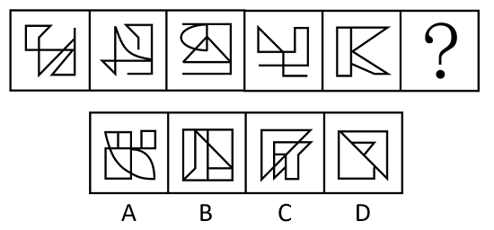

# 图形推理-数量规律（一笔画-笔画数）

考点：[[20-考点/判断推理/图形推理/图形推理-数量规律（一笔画-笔画数）|图形推理 / 图形推理-数量规律（一笔画/笔画数）]]

**问法模型**：问号处填入使整组图形呈现规律性的选项 → 元素组成不同且无属性规律时，由'出头端点'特征锁定笔画数规律，用奇点计数法判定一笔画

## 推理链
1. 第1步：题干五幅图形元素组成不同（线条交叉、形状各异），排除样式类规律
2. 第2步：检查属性（对称、封闭、曲直）无明显统一规律，且图形中出现明显出头端点，优先考虑笔画数
3. 第3步：对题干各图数奇点（度数为奇数的交点及端点）：每幅图奇点数均为0或2，满足一笔画判定条件
4. 第4步：归纳规律——题干图形全部为一笔画图形，问号处也应为一笔画图形
5. 第5步：逐项数选项奇点：A、B、D奇点数为4（最少笔画数=4÷2=2笔），C奇点数为0或2（一笔画），只有C与题干规律一致

**最快解法**：⚡ 一笔画判定口诀法：'端点即奇点、数奇点定笔画，奇点0或2一笔画'。题干图形均为一笔画→扫选项：A有多个分离部分且奇点≥4、B含独立线条为两笔、D外框内线交出4个奇点为两笔，仅C奇点数≤2为一笔画，秒选C

## 易错点
- ⚠ 忽略'出头端点'这一笔画数题的典型特征信号，误入数面、数线的数量误区
- ⚠ 数奇点时漏数端点——线段的出头端点度数为1，也是奇点
- ⚠ 把'日'字形（2个奇点，一笔画）与'田'字形（4个奇点，两笔画）混为一谈，误判选项笔画数
- ⚠ A项含分离小元素，误以为'部分数'规律而偏离笔画数主线

## 母题抽象
> 🧩 当图形元素组成不同、属性规律（对称/封闭/曲直）均不成立，且图形出现出头端点或多个交叉点时，优先数奇点判笔画数：奇点数为0或2即一笔画，选择与题干笔画数相同的选项

**同类特征**：元素组成不同、无明显属性规律、出头端点明显、线条交叉、交点较多、全部图形一笔画、问号处延续规律

## 相关题
- [[10-真题/判断推理/图形推理/2742274 数量规律-黑白面积关系（黑色部分与白色部分面积相等）|2742274]]（北京 2021，相关度3）
- [[10-真题/判断推理/图形推理/3523636 数量规律-一笔画（奇点数判定）|3523636]]（四川 2021，相关度3）
- [[10-真题/判断推理/图形推理/4714952 数量规律-笔画数（一笔画与奇点数）|4714952]]（福建 2018，相关度3）
- [[10-真题/判断推理/图形推理/5702225 数量规律-面数量（封闭区域数）|5702225]]（上海 2016，相关度3）
- [[10-真题/判断推理/图形推理/10204454 数量规律-部分数（黑白球连通区域数做和）|10204454]]（甘肃 2024，相关度2）

---

### 题干

每道题包含一套图形和四个选项，请从四个选项中选出最恰当的一项填在问号处，使图形呈现出一定的规律性。

### 选项
- A. A
- B. B
- C. C　✅
- D. D

### 官方解析
图形元素组成不同，且无明显属性规律，考虑数量规律。观察发现，题干图形出现明显的出头端点，优先考虑笔画数。题干图形均为一笔画图形，所以？处图形也应该是一笔画图形。A、B、D三项均为两笔画图形，只有C项符合。
故正确答案为C。

### 给定材料
（无）
