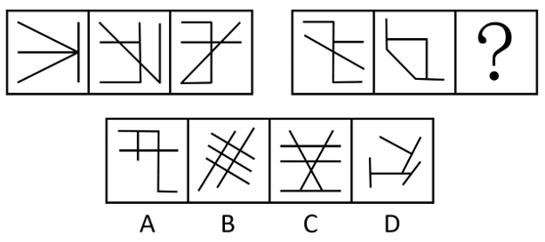

# 数量规律-面数量（封闭区域数）

考点：[[20-考点/判断推理/图形推理/数量规律-面数量（封闭区域数）|图形推理 / 数量规律-面数量（封闭区域数）]]

**问法模型**：两套图形'求同存异'选最适合取代问号的图形 → 元素组成不同且无属性规律时，转向数量规律，本题优先数面数量找等差规律

## 推理链
1. 第1步：两组图形元素组成不同（线条样式各异），且对称、曲直、开闭等属性无明显统一规律，转入数量规律分析
2. 第2步：观察题干图形均存在明显封闭区域，优先考虑面数量（封闭区域数）这一数量规律
3. 第3步：清点第一组三图的面数量，依次为0、1、2，构成递增等差规律
4. 第4步：清点第二组前两图的面数量，依次为0、1，按同一规律问号处图形面数量应为2
5. 第5步：逐项数面：A项1个面、B项2个面、C项面数多于2、D项0个面（无封闭区域）
6. 第6步：只有B项面数量为2，既满足两套图形的面数量等差规律，又体现第二组自身'0、1、2'的特征，故选B

**最快解法**：⚡ 数面法：两组图形都有明显封闭空间→直接数面数量，第一组0、1、2，第二组0、1→问号处选2个面的图形，快速锁定B

## 易错点
- ⚠ 本题存在双规律：横线数（第一组1、2、3，第二组3、2、？→1）指向D项，考场先想到横线数规律易误选D，官方最终以面数量规律定B
- ⚠ 数面时误将交叉但未封闭的开放线条区域计入面数，面必须是完全封闭的区域
- ⚠ B、C项均由多条斜线交叉构成，需逐个封闭区域清点，勿将C项多个三角形误判为2个面

## 母题抽象
> 🧩 当两套图形元素组成不同且无属性规律、图形中存在明显封闭区域时，用数面法找等差规律（如0、1、2递增），选择面数量与规律吻合的选项；若面数量无规律再回退数线（横线数、交点数）。

**同类特征**：两套图形对照求同、元素组成不同、无明显属性规律、存在明显封闭区域、面数量等差递增、问号处补全规律

## 相关题
- [[10-真题/判断推理/图形推理/2097182 数量规律-面数量（封闭区域数）|2097182]]（四川 2017，相关度5）
- [[10-真题/判断推理/图形推理/12100999 数量规律-面数量（封闭区域数）|12100999]]（江苏 2025，相关度4）
- [[10-真题/判断推理/图形推理/2255600 数量规律-面数量（封闭区域数）|2255600]]（江西 2016，相关度4）
- [[10-真题/判断推理/图形推理/2280966 数量规律-面数量（封闭区域数）|2280966]]（四川 2018，相关度4）
- [[10-真题/判断推理/图形推理/2387641 数量规律-面数量（封闭区域数）|2387641]]（浙江 2019，相关度4）

---

### 题干

每道题包含两套图形和可供选择的4个图形。这两套图形具有某种相似性，也存在某种差异。要求你从四个选项中选择最适合取代问号的一个。正确的答案不仅使两套图形表现出最大的相似性，而且使第二套图形也表现出自己的特征。

### 选项
- A. A
- B. B　✅
- C. C
- D. D

### 官方解析
解法一：图形元素组成不同，且无明显属性规律，考虑数量规律。观察发现，题干图形存在明显的封闭区域，故考虑面数量。第一组图形面数量依次为0、1、2，第二组前两个图形面数量依次为0、1，因此？处图形的面数量应为2，只有B项符合。
故正确答案为B。

解法二：图形元素组成不同，且无明显属性规律，考虑数量规律。观察发现，题干图形均由多条直线构成，且存在较多横线，故考虑横线数，第一组横线数分别为1、2、3，第二组前两个图形横线数为3、2，故问号处图形横线数应为1，只有D项符合。
故正确答案为D。
注：本题不严谨，存在两种规律，考场上根据图形特征优先想到哪个选哪个。

### 给定材料
（无）

> [!warning] 疑点（官方解析可能有误，待人工复核）
> 官方解析自注'本题不严谨，存在两种规律'：解法二横线数规律（1、2、3/3、2、→1）支持D项，与解法一面数量规律（支持B项）并存，两规律均出自同一组题干图形；官方最终以面数量规律确定答案为B，此为题源双规律问题，不影响官方答案B的认定。

<!-- CODEX-ANSWER-REVIEW:BEGIN -->
### 本次独立复核

**复核状态：** `resolved`（答案与解析已核定）

**计分答案：** B（可计分）

**复核解析：**

【编辑修订版】本题只按题干图形的封闭区域（面）数量判断。按每组给定的面数对应关系，B项补入后满足封闭区域数量规律；D项虽满足横线数量递减，但横线不是本修订版指定的判定维度。

**修订题干：**

【编辑修订版】请只依据各图形中封闭区域（面）的数量规律作答，忽略横线数等其他图形特征。选择能够补全该封闭区域数量规律的选项。

**相关信息：**

图形推理—封闭区域（面）数量；编辑明确单一判定维度，以排除横线数这一并行规律。

**题源依据：** [固定版本原题](https://github.com/Mentat-Uran/kaogongzhentizhengliu/blob/84ab93d4b64b61d897bece8a1c0a5bab06b4feb2/10-%E7%9C%9F%E9%A2%98/%E5%88%A4%E6%96%AD%E6%8E%A8%E7%90%86/%E5%9B%BE%E5%BD%A2%E6%8E%A8%E7%90%86/5484014%20%E6%95%B0%E9%87%8F%E8%A7%84%E5%BE%8B-%E9%9D%A2%E6%95%B0%E9%87%8F%EF%BC%88%E5%B0%81%E9%97%AD%E5%8C%BA%E5%9F%9F%E6%95%B0%EF%BC%89.md)；固定内容 commit `84ab93d4b64b61d897bece8a1c0a5bab06b4feb2`，Markdown blob `39ef70142d96d21c02f5f881906371bb3f375ec0`。
<!-- CODEX-ANSWER-REVIEW:END -->
