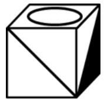
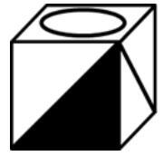

# 空间重构-六面体折叠（相对面排除法+公共点法）

考点：[[20-考点/判断推理/图形推理/空间重构-六面体折叠（相对面排除法+公共点法）|图形推理 / 空间重构-六面体折叠（相对面排除法+公共点法）]]

**问法模型**：“根据展开图各面图案判断折叠后的正方体”→ 空间重构模型：先用相对面排除，再用相邻面公共点（顶点引线）验证剩余选项。

## 推理链
1. 第1步：展开图为“1-4-1”型：中间一行四个面（空白面、含斜线三角形的面、含黑色三角形的面、空白面），下面为实心黑圆面（面a）、上面为空心圆面（面f）；由“1-4-1中上、下两面为相对面”可知面a与面f是相对面
2. 第2步：规则一（相对面排除）：相对面折叠后不能相邻、不能同时可见，凡选项同时出现面a与面f即排除
3. 第3步：A项由面a、面d和面f构成，同时含相对面a与f，排除；B项同样由面a、面d和面f构成，排除
4. 第4步：规则二（公共点法）：三个两两相邻面的公共顶点，在展开图与立体图中引出的线条情况必须一致
5. 第5步：C项由面a、面c和面d构成，三面图案及公共边、公共点位置关系均与展开图一致，当选
6. 第6步：D项虽同样由面a、面c和面d构成，但选项中三个面的公共点引出一条直线，而题干展开图中该公共点没有引出直线，位置关系不符，排除

**最快解法**：⚡ 相对面排除法＋公共点法：一眼锁定1-4-1展开图中上、下两面（两圆面a与f）为相对面，A、B同时出现两圆面直接排除；再对C、D观察三个面的公共顶点——展开图中公共点不引出任何直线，D中公共点引出一条直线，排除D，选C。

## 易错点
- ⚠ 忽略“1-4-1展开图中上、下两面必为相对面”，误以为黑圆面与白圆面相邻而误选A或B
- ⚠ C、D选项出现的三个面完全相同，只比对图案不看位置，未用公共点（顶点）引线关系区分而误选D
- ⚠ 折叠时搞反三角形/斜线图案的指向或面的内外朝向，错判公共边、公共点处的线条衔接

## 母题抽象
> 🧩 当题干给出正方体展开图求折叠图时，先用相对面排除（同行隔一面、Z字两端、上下两面相对），再对图案相同的剩余选项用公共边或公共点法验证线条与图案的位置关系。

**同类特征**：六面体展开图（1-4-1型）、两圆面分别位于展开图上、下两端、面上有斜线与黑白三角形图案、问“折叠后可能是哪个正方体”、需区分三面公共点的引线情况

## 相关题
（暂无）

---

### 题干

一正方体沿某棱角展开的平面图形如下所示：

请根据其平面图形各面上的图案，判断这个正方体可能是：

### 选项
- A. 

- B. 

- C. 

　✅
- D. 

### 官方解析

本题为空间重构题。对展开图进行编号，如下图所示：

A项：选项由面a、面d和面f构成，题干展开图中面a与面f为相对面，不能同时出现，选项与题干展开图不一致，排除；

B项：选项由面a、面d和面f构成，题干展开图中面a与面f为相对面，不能同时出现，选项与题干展开图不一致，排除；

C项：选项由面a、面c和面d构成，选项与题干展开图一致，当选；

D项：选项由面a、面c和面d构成，选项中三个面的公共点（如下图红点所示）引出一条直线，题干展开图中三个面的公共点没有引出直线，选项与题干展开图不一致，排除。

故正确答案为C。

### 给定材料
（无）
