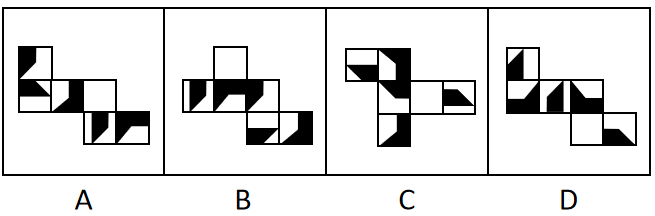

# 空间重构-六面体折纸盒（公共边法-相邻面特征边比对）

考点：[[20-考点/判断推理/图形推理/空间重构-六面体折纸盒（公共边法-相邻面特征边比对）|图形推理 / 空间重构-六面体折纸盒（公共边法/相邻面特征边比对）]]

**问法模型**：四个展开图中'与其他三个折叠成的纸盒不相同的是'（选非问法）→ 采用公共边法：给各选项中相同的面标注字母，比对相邻两面公共边两侧紧邻的图案特征边是否一致

## 推理链
1. 第1步：观察四个展开图，各选项包含的六个面完全相同（含白色多边形面a、黑色直角梯形面、白色矩形面等），但存在相同图案的面，需先给相同面统一标注字母（面a、面b…）
2. 第2步：四个展开图中面a与面b均为相邻面，折叠后必存在公共边，故用'公共边两侧紧邻的图案特征边'作为判定标准
3. 第3步：A项，面a、面b公共边紧邻'面a白色多边形长边'与'面b黑色直角梯形上底边'
4. 第4步：C项，面a、面b公共边同样紧邻'面a白色多边形长边'与'面b黑色直角梯形上底边'，与A一致
5. 第5步：D项，面a、面b公共边同样紧邻'面a白色多边形长边'与'面b黑色直角梯形上底边'，与A、C一致
6. 第6步：B项，面a、面b公共边紧邻'面a白色多边形长边'与'面b白色矩形长边'，三同一异，故B折叠成的纸盒与其他三个不同，选非题答案为B

**最快解法**：⚡ 公共边法+三同一异排除：先给各选项中图案相同的面标同一字母，锁定每个展开图中面a与面b的公共边，直接观察公共边两侧紧邻的图案边（黑色直角梯形上底边还是白色矩形长边），三项一致、一项不同者即为答案

## 易错点
- ⚠ 展开图中存在相同图案的面，若不先统一标号而逐图孤立观察，极易把不同选项中'同图案不同位置'的面误认为同一面
- ⚠ 只看面的相邻/相对位置，忽略公共边两侧图案特征边（梯形上底边vs矩形长边）的方向细节，导致误判
- ⚠ 选非题意识缺失：题目问'不相同'而非'相同'，易按惯性选三项一致的A/C/D

## 母题抽象
> 🧩 当折纸盒题干展开图中出现多个相同/相似图案面且问'哪项折叠结果不同'时，用公共边法：给相同面统一标号，找到相邻面公共边，比对公共边两侧紧邻的图案特征边，三同一异者即为答案

**同类特征**：四个正方体外表面展开图、选非问法（找不相同的一项）、各选项含相同图案面、相邻面存在公共边、黑白图案方向细节、公共边紧邻图案边比对

## 相关题
（暂无）

---

### 题干

下面四个正方体纸盒的外表面展开图中，与其他三个折叠成的纸盒不相同的是：

### 选项
- A. A
- B. B　✅
- C. C
- D. D

### 官方解析

将选项展开图中的面标上序号，如下图所示（各选项包含的面都相同，故相同的面用相同字母表示），选项存在相同面，可以通过相同面公共边解题，逐一分析选项。

A项：面a、面b是相邻面，存在公共边（如上图所示），公共边紧邻面a白色多边形长边、面b黑色直角梯形上底边；

B项：面a、面b是相邻面，存在公共边（如上图所示），公共边紧邻面a白色多边形长边、面b白色矩形长边；

C项：面a、面b存在公共边（如上图所示），公共边紧邻面a白色多边形长边、面b黑色直角梯形上底边；

D项：面a、面b存在公共边（如上图所示），公共边紧邻面a白色多边形长边、面b黑色直角梯形上底边。

综上，只有B项与其他三项不同。

本题为选非题，故正确答案为B。

### 给定材料
（无）
