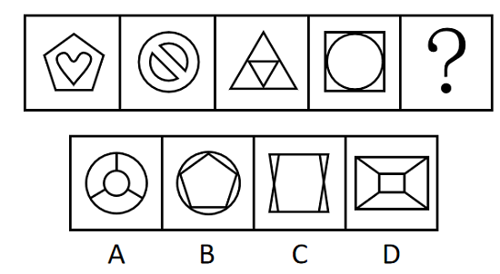

# 属性规律-对称性（对称轴数量等差递增）；数量规律-面数量（备选验证）

考点：[[20-考点/判断推理/图形推理/属性规律-对称性（对称轴数量等差递增）；数量规律-面数量（备选验证）|图形推理 / 属性规律-对称性（对称轴数量等差递增）；数量规律-面数量（备选验证）]]

**问法模型**：'选择最合适的一个填入问号处，使之呈现一定的规律性'且元素组成不同→优先属性规律数对称轴数量，再用数量规律（面数量）双重验证锁定唯一选项

## 推理链
1. 第1步：题干四图元素组成不同，且均呈现明显等腰/轴对称特征（五边形嵌心形、禁止符、等边三角形嵌倒三角、正方形内切圆），优先考虑对称性规律
2. 第2步：对每个图形整体画对称轴（注意取内外图形的公共对称轴），数量依次为1、2、3、4，构成等差递增数列
3. 第3步：由此推断？处图形应具有5条对称轴；对照选项：A项圆内辐条形约3条，C项约2条，D项约2条，B项圆内嵌正五边形恰为5条
4. 第4步：再用数量规律验证：题干封闭区域（面）数量依次为2、3、4、5，？处应为6个面，B项五边形内部1个面加五边形与外圆之间5个区域共6个面，与对称轴规律指向一致
5. 第5步：两条独立规律同时锁定B，确认答案为B

**最快解法**：⚡ 对称轴数量数轴法：快速给四个题干图形各画一条再补画对称轴，得1、2、3、4的等差数列，直接找5条对称轴的选项即B；若考场画轴犹豫，立即切换数面：2、3、4、5→选6个面的B（两规律同解，选先想到的即可，无需纠结）

## 易错点
- ⚠ 只数外框图形的对称轴而忽略内外组合后的公共对称轴：如图1正五边形本身有5条轴，但内嵌心形后整体只剩竖直1条对称轴
- ⚠ 规律单一化：只盯着面数量或只盯着对称轴，遇到面数接近的干扰项（如D项5个面）时缺乏第二规律排查而误选
- ⚠ 嵌套图形面数量漏数：数面时漏掉内外图形之间的区域（如B项五边形与外圆之间的5个弧形区域也是面）

## 母题抽象
> 🧩 当题干图形元素组成不同且整体呈等腰/内外嵌套特征时，先画整体公共对称轴数数量看是否构成等差数列；若对称轴有歧义，立即切换数封闭区域（面）数量做双重验证，两条规律同指的选项即为答案

**同类特征**：元素组成不同、等腰/轴对称图形明显、内外嵌套结构（圆、三角形、五边形套内部图形）、封闭区域（窟窿）清晰可数、对称轴数量1、2、3、4等差递增、面数量2、3、4、5等差递增

## 相关题
- [[10-真题/判断推理/图形推理/4767961 属性规律（竖轴对称）+数量规律（面数量等差递增）复合考点|4767961]]（四川 2017，相关度2）
- [[10-真题/判断推理/图形推理/10204454 数量规律-部分数（黑白球连通区域数做和）|10204454]]（甘肃 2024，相关度1）
- [[10-真题/判断推理/图形推理/10204604 数量规律-线数量（汉字横线数）|10204604]]（辽宁 2024，相关度1）
- [[10-真题/判断推理/图形推理/10297050 数量规律-特殊计数（线条穿过小白球的数量）|10297050]]（天津 2025，相关度1）
- [[10-真题/判断推理/图形推理/10297127 图形间关系-相交图形中不相交边数量（黑白图形相交）|10297127]]（天津 2025，相关度1）

---

### 题干

从所给的四个选项中，选择最合适的一个填入问号处，使之呈现一定的规律性：

### 选项
- A. A
- B. B　✅
- C. C
- D. D

### 官方解析
思路一：元素组成不同，优先考虑属性规律。题干图形出现明显的等腰图形，优先考虑对称性。观察发现，题干图形均为轴对称图形，画出每个图形的对称轴，对称轴数量分别是1、2、3、4。因此？处图形应有5条对称轴，只有B项符合。
思路二：元素组成不同，且出现多个封闭区域，可以考虑数量规律。题干图形出现明显的窟窿，考虑面数量。观察发现，题干图形的面数量分别是2、3、4、5。因此？处图形应有6个面，只有B项符合。
故正确答案为B。
注：本题不管是看对称性还是面数量都可以选到B，大家主要学习解题思维即可，考场上根据图形特征优先想到哪个规律选哪个，无需纠结。

### 给定材料
（无）
