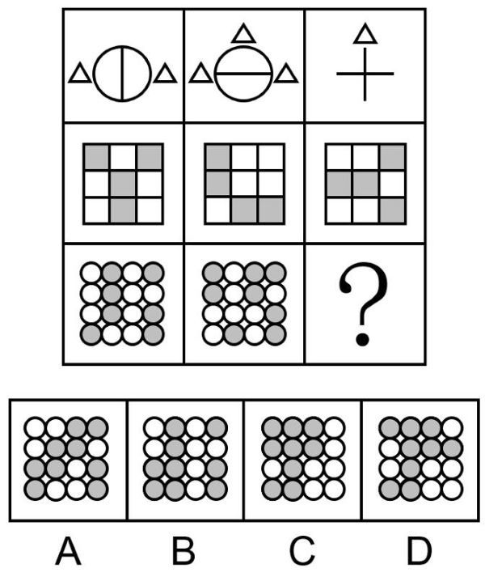

# 图形推理-样式规律-去同存异（求异）

考点：[[20-考点/判断推理/图形推理/图形推理-样式规律-去同存异（求异）|图形推理 / 图形推理-样式规律-去同存异（求异）]]

**问法模型**：'选择最合适的一个填入问号处，使之呈现一定的规律性'且九宫格各图元素组成相似 → 九宫格优先横向看，每行前两图'求异（去同存异）'得到第三图，验证后套用到问号行。

## 推理链
1. 第1步：九宫格中每行元素组成相似、外框保持不变，符合样式规律的特征，优先横向观察。
2. 第2步：第一行验证规律：图一为'圆形内一条竖线＋左右各一个小三角'，图二为'圆形内一条横线＋顶部及左右各一个小三角'；两图求异，相同的圆形轮廓和左右小三角消去，仅一图出现的竖线、横线叠加成十字，顶部小三角保留，得到图三'十字＋顶部三角'，求异规律成立。
3. 第3步：第二行验证规律：三幅图均为九宫格框架，框架不变，内部灰色方块位置逐格比对——图一与图二同为灰色的格子消去（变白），仅一图为灰的格子保留，图三与该结果吻合，规律再次验证。
4. 第4步：第三行应用规律：每幅图为4×4的小圆阵列，框架不变，仅灰色圆形位置参与运算。
5. 第5步：将图一与图二的灰色圆形逐格求异：两图均为灰色的位置变白，仅一图为灰色的位置保留灰色，其余为白，得到问号处图形。
6. 第6步：逐项对照选项，只有C项灰色圆形的分布与求异结果完全一致，A、B、D的灰色位置均不符，故选C。

**最快解法**：⚡ 图形规律口诀'元素相似看样式，九宫格先横看'：横向前两图去同存异（求异）得第三图，一、二行快速验证后，第三行只需逐格比对灰白小圆——相同灰色位置变白、不同位置留灰，直接锁定C，排除A、B、D。

## 易错点
- ⚠ 把'求异'误当成'求同'：求异即去同存异，保留两图不同的部分；若用求同去算会得出完全不同的灰块分布而误选。
- ⚠ 忽略'框架保持不变'的辅助规律：外框/小圆阵列本身不参与运算，误把框架变化纳入考虑会干扰判断。
- ⚠ 九宫格误竖向看列规律：本题列与列之间无一致规律，应优先横向看行；且第三行小圆多达16个，逐格比对时易看串行或漏格。

## 母题抽象
> 🧩 当九宫格图形元素组成相似且外框不变、仅内部灰/黑色块位置变化时，优先横向用'去同存异（求异）'：前两图相同元素消去、不同元素保留，第三行照此逐格比对灰块位置即可锁定答案。

**同类特征**：九宫格、元素组成相似、外框保持不变、内部灰色方块/灰色小圆位置变化、样式规律、填入问号处呈现规律性

## 相关题
- [[10-真题/判断推理/图形推理/2776062 样式规律-图形叠加（直接覆盖叠加）|2776062]]（浙江 2021，相关度3）
- [[10-真题/判断推理/图形推理/3523645 样式规律-求同存异（线条去同存异-叠加运算）|3523645]]（四川 2021，相关度3）
- [[10-真题/判断推理/图形推理/5660586 图形推理-样式规律（黑白运算-定义叠加，含'点'三种元素）|5660586]]（上海 2020，相关度3）
- [[10-真题/判断推理/图形推理/10204610 样式规律-加减同异（去同存异），九宫格列规律|10204610]]（辽宁 2024，相关度2）
- [[10-真题/判断推理/图形推理/10297349 样式规律-黑白运算|10297349]]（浙江 2025，相关度2）

---

### 题干

从所给的四个选项中，选择最合适的一个填入问号处，使之呈现一定的规律性：

### 选项
- A. A
- B. B
- C. C　✅
- D. D

### 官方解析
元素组成相似，优先考虑样式规律。九宫格中优先横向看，第一行中，图一和图二求异得到图三；经验证，第二行三幅图形框架保持不变，内部灰色方块也满足此规律；第三行应用此规律，图形框架保持不变，图一和图二中灰色圆形求异得到问号处图形，只有C项符合。
故正确答案为C。

### 给定材料
（无）
