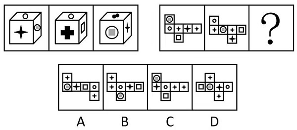

# 六面体折叠-相对面关系（立体图与展开图对应）

考点：[[20-考点/判断推理/图形推理/六面体折叠-相对面关系（立体图与展开图对应）|图形推理 / 六面体折叠-相对面关系（立体图与展开图对应）]]

**问法模型**：两组图问法：第一组三个立体图为同一六面体的不同视角 → 第二组三个展开图也应为同一六面体的展开图，用相对面判定规则筛选问号处展开图

## 推理链
1. 第1步：题干第一组为三个六面体立体图，官方判定三者是同一个六面体的不同视角，即'同一六面体'为第一组规律
2. 第2步：按两组图规律一致的要求，第二组三个展开图也必须是同一个六面体的展开面，问号处图形折叠后须与前两图完全一致
3. 第3步：用展开图相对面判定规则（同行/同列隔一个面相对、'Z'字形两端相对）读第二组第一、二幅图，得出'正方形'与'含有正方形的圆'为相对面
4. 第4步：同法读出另两组相对面：两个'小四角星'为相对面，'大四角星'与'空心圆'为相对面
5. 第5步：相对面折叠后不能相邻，故问号处展开图必须同时满足这三组相对面关系
6. 第6步：逐项对照，A项三组相对面关系与题干完全吻合；B、C、D项至少有一组面的相对关系不符（相对面变相邻或面组合错误），排除
7. 第7步：故问号处填入A项

**最快解法**：⚡ 相对面排除法：先由第二组前两幅展开图按'隔一面/Z字两端为相对面'锁定三组相对面（正方形↔含正方形的圆、小四角星↔小四角星、大四角星↔空心圆），再逐项排除相对面关系不符的B、C、D，直接锁定A

## 易错点
- ⚠ 只看第一组单个图形的面图案数量或位置，忽略'三个图为同一六面体'才是组内规律，导致第二组找错方向
- ⚠ 相对面判定失误：只认'隔一个面'型，漏掉'Z字两端'型，或把展开图中相邻的面（如'正方形'与'含有正方形的圆'）误判为相对面
- ⚠ 忽略问号处展开图须能折叠回同一六面体，只检查图案是否凑齐而误选

## 母题抽象
> 🧩 当两组图中一组为同一六面体的多个视角、另一组给出展开图求第三个展开图时，先由已知展开图确定三组相对面，再用'隔一面/Z字两端为相对面'规则检验选项展开图是否为同一六面体

**同类特征**：两组图：第一组立体六面体、第二组展开图、同一六面体不同视角、展开图相对面判定、面图案：正方形、含有正方形的圆、大/小四角星、空心圆、问号处求第三个展开图

## 相关题
（暂无）

---

### 题干

从所给的四个选项中，选择最合适的一个填入问号处，使之呈现一定的规律性：

### 选项
- A. A　✅
- B. B
- C. C
- D. D

### 官方解析
观察发现，题干两组图形均与六面体及其展开面有关，优先考虑六面体。第一组图中3个六面体图形为同一六面体，第二组图也应遵循此规律，三个六面体的展开面为同一六面体的展开面，根据第二组前两幅图可知，“正方形”与“含有正方形的圆”为相对面，两个“小四角星”为相对面，“大四角星”与“空心圆”为相对面，问号处的图形应该符合此规律，对应A项。
故正确答案为A。

### 给定材料
（无）
